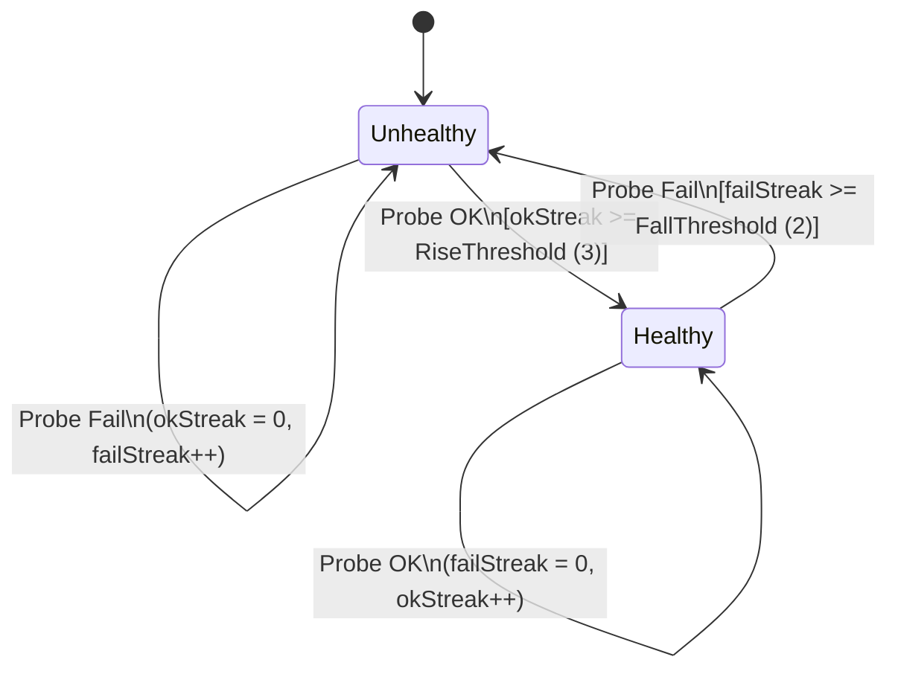
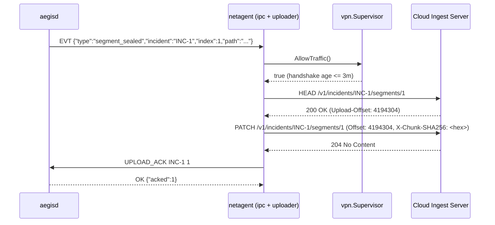

# Networking, Multi-Uplink Failover & Resumable Upload Architecture

## 1. Design Goals

Patrol vehicles and body-worn cameras operate in hostile RF environments: devices transition rapidly between station Ethernet docks (`eth0`), precinct/vehicle Wi-Fi (`wlan0`), and metered cellular (`wwan0`). `netagent` ensures:

1. **Hysteretic Uplink Selection:** Prefer `eth > wifi > lte` without route flapping when a higher-priority link is marginal.
2. **Metered-Link Cost & Bandwidth Control:** Restrict cellular (`lte`) uploads to high-priority incidents (`PriorityHigh`) and enforce a token-bucket bandwidth cap.
3. **Zero Unencrypted Offload:** Supervise the WireGuard tunnel (`wg0`) and enforce a strict kill-switch before any segment chunk leaves the device.
4. **Resumable Chunked Transfers:** Never re-transmit an entire 100 MiB video file when a vehicle drives through a tunnel; resume at the exact 4 MiB chunk offset confirmed by the server.

---

## 2. Multi-Uplink Selection & Failback Hysteresis (`internal/link`)

- **Priority order:** `Ethernet (0) < WiFi (1) < LTE (2)`.
- **Failover (`FallThreshold = 2`):** If `eth0` fails 2 consecutive probes, `Manager` immediately selects the highest-priority healthy backup (`wlan0` or `wwan0`).
- **Failback Hysteresis (`RiseThreshold = 3`):** When `eth0` is plugged back in with a loose connector that succeeds twice and drops on the third probe, `wlan0` remains active undisturbed. Only after `eth0` passes 3 consecutive probes does `Manager` switch back.
- **Health Score (`0..100`):** Exposed via `Snapshot()` for telemetry, penalizing consecutive failures (`-25` each) and high RTT (`RTT > SlowRTT` deducts `20` points).

---

## 3. DNS Canary & DHCP Lease State Machine

### 3.1 DNS Failover & Captive-Portal Detection (`internal/dnscheck`)
- Queries primary resolver first, falling back to secondary on error or empty response, and caches positive answers for `CacheTTL`.
- `CheckCanary()` resolves a known `CanaryHost` (bypassing cache) and verifies that every returned IP falls within `ExpectedCanary` CIDR prefixes. Hotel/station captive portals that hijack DNS to `192.168.x.x` return `ErrHijackDetected`.

### 3.2 DHCPv4 Lease Timers (`internal/dhcp`)
- Models RFC 2131 timers:
  - $T_1 = t_{\text{obtained}} + 0.5 \times T_{\text{lease}}$ (`BOUND` $\to$ `RENEWING`)
  - $T_2 = t_{\text{obtained}} + 0.875 \times T_{\text{lease}}$ (`RENEWING` $\to$ `REBINDING`)
  - $T_{\text{exp}} = t_{\text{obtained}} + T_{\text{lease}}$ (`REBINDING` $\to$ `INIT`)

---

## 4. WireGuard Supervision & Resumable Upload Pipeline

### Exponential Backoff with Full Jitter
When a chunk `PATCH` encounters a transient `5xx` or network error on attempt $k$, `uploader` sleeps for:

$$t_{\text{sleep}} = \text{Uniform}\left(0,\, \min\left(T_{\max},\, T_{\text{base}} \cdot 2^{k-1}\right)\right)$$

Full jitter prevents synchronized retry storms ("thundering herd") when an entire shift of patrol cameras docks simultaneously at shift change.
