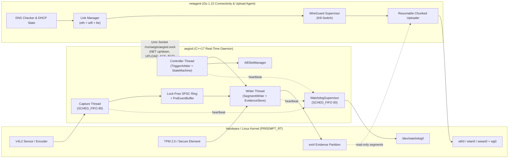
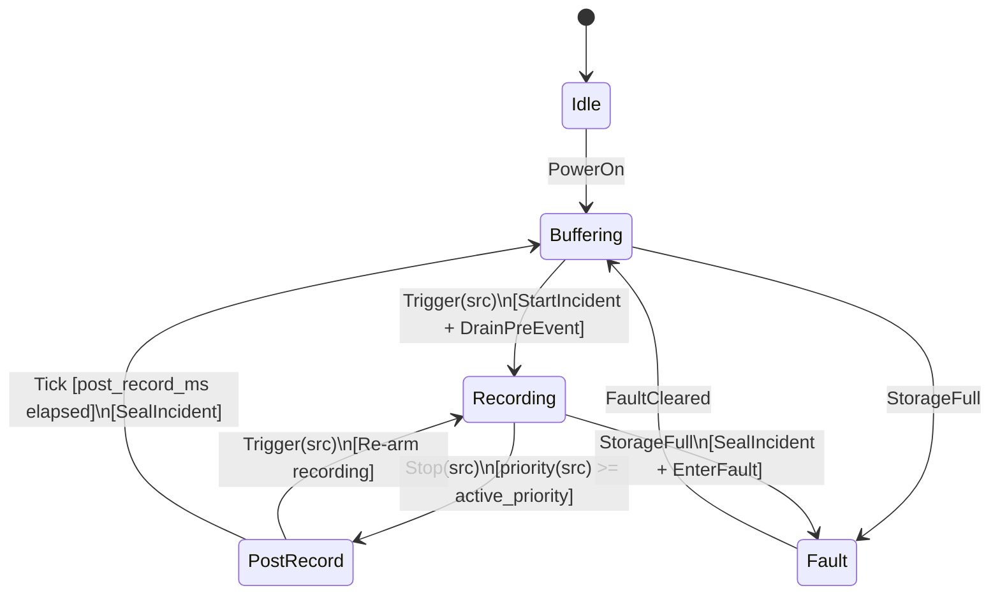

# AegisCam System Architecture Overview

> Companion to [PROJECT_SPEC.md](./PROJECT_SPEC.md).

## 1. Mission & Design Philosophy

AegisCam is a mission-critical body-worn and in-vehicle evidence camera platform designed around four non-negotiable engineering invariants:

1. **Zero Lost Frames on Trigger (R1, R2):** The 30-second pre-event buffer is continuously maintained in locked RAM and drained starting on a keyframe within `< 100 ms` of any physical or wireless trigger.
2. **Cryptographic Chain of Custody (R3, R4):** Every recorded segment is fsynced, atomically renamed, linked into a binary SHA-256 hash chain, and signed with a device-bound HMAC key so that any post-capture modification, deletion, or reordering is mathematically detectable offline.
3. **Fault & Process Isolation (R5, R7):** Real-time capture (`aegisd` in C++17) is isolated at the OS process boundary from network management and cloud upload (`netagent` in Go 1.22). A hung TLS socket or flapping cellular modem cannot stall video capture or hardware watchdog supervision.
4. **100% Host Testability (R8):** Every hardware boundary (`ICameraHal`, `IStorageHal`, `IWatchdogHal`, `IKeyStoreHal`, `IBootControlHal`, `IClock`) is injected into `DeviceController`, allowing full deterministic simulation (`aegisd --sim`) on any laptop or CI runner.

---

## 2. Two-Process Architecture

---

## 3. Recording Lifecycle & State Machine

`RecordingStateMachine` is a pure, table-driven finite state machine with zero I/O side effects; it takes `(State, Event)` and returns `(NextState, Actions)`:

### Trigger Priority Arbitration (`TriggerArbiter`)

Triggers are ranked strictly by operational criticality:
`holster` (3) > `button` (2) > `signal` (1) > `remote` (0).

- **Per-source debounce (50 ms):** Eliminates mechanical contact bounce on physical buttons and reed switches.
- **Asymmetric stop protection:** A recording initiated by a higher-priority source (e.g., `holster` draw) **cannot** be stopped by a lower-priority source (e.g., `remote` CAD command), preventing accidental or malicious remote suppression during an active confrontation.

---

## 4. Storage Layout & Power-Loss Safety

All evidence writes follow a strict crash-safe sequence:
1. Write segment frames to `seg_000001.bin.tmp`.
2. Call `fsync()` on the temporary file descriptor.
3. Atomically `rename()` `seg_000001.bin.tmp` → `seg_000001.bin`.
4. Update the hash chain `H_n = SHA256(raw(H_{n-1}) || raw(sha256_n))`, sign `chain_head` with `HMAC-SHA256`, write `manifest.json.tmp`, `fsync()`, and atomically rename to `manifest.json`.
5. Append a hash-chained record to `audit.log` and `fsync()`.

If battery power is lost at any instruction boundary, the device recovers cleanly on next boot with all previously sealed segments verifiable by `tools/verify_evidence.py`.
