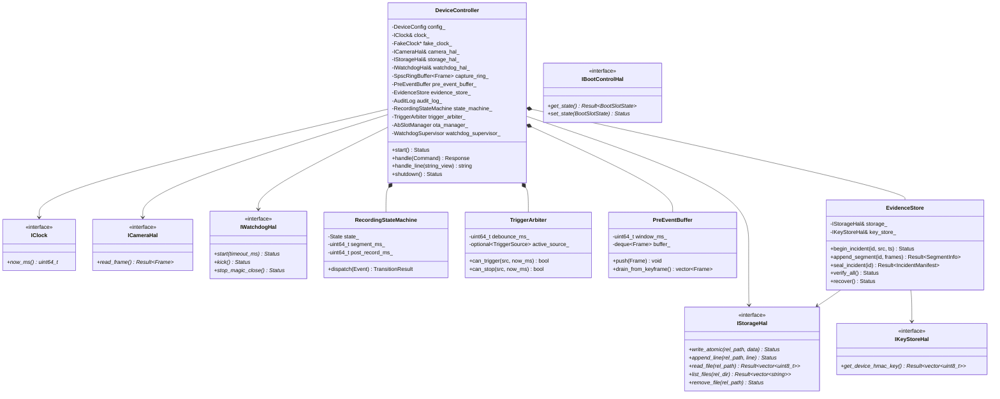
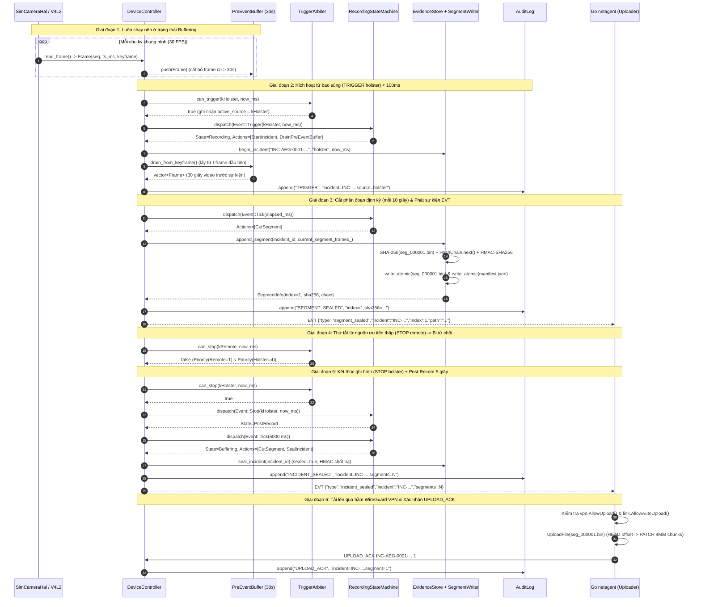
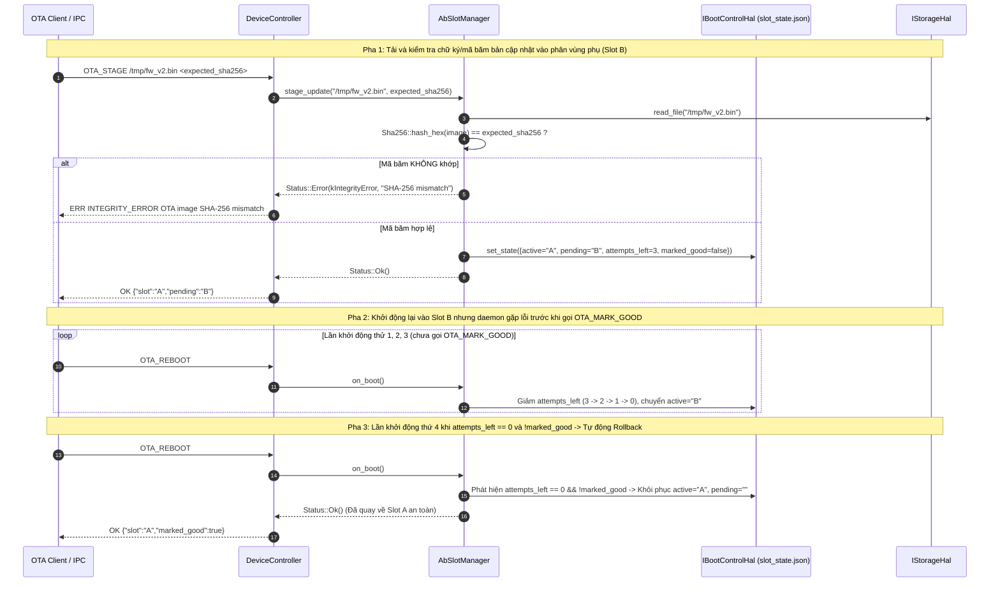

# High-Level Design Document (HLD) — AegisCam Platform
## Mission-Critical Body-Worn & In-Vehicle Evidence Camera System (`aegisd` C++17 + `netagent` Go 1.22)

Tài liệu **High-Level Design (HLD)** này mô tả kiến trúc tổng thể cấp hệ thống của dự án **AegisCam**, bao gồm sự phân tách đa tiến trình (Multi-Process Isolation), phân tầng kiến trúc 3 lớp (3-Tier Architecture), bảng trách nhiệm từng module, sơ đồ tương tác giữa các phân hệ, sơ đồ lớp Dependency Injection (DI), và các biểu đồ tuần tự (Sequence Diagrams) cho các luồng nghiệp vụ cốt lõi.

---

## 1. Triết Lý Kiến Trúc Tổng Thể (Architectural Principles)

Thiết bị camera bằng chứng chuyên dụng (Body-Worn / Patrol Vehicle Camera) hoạt động trong môi trường khắc nghiệt: rung chấn, mất mạng liên tục, có thể bị rút pin bất kỳ lúc nào, và mọi tệp video xuất ra phải có **giá trị pháp lý trước tòa án (Chain of Custody)**. Do đó, kiến trúc của AegisCam được xây dựng dựa trên 5 nguyên tắc cốt lõi:

1. **Tách biệt Tiến trình Thời gian thực và Tiến trình Mạng (Multi-Process Fault & Latency Isolation)**:
   * **`aegisd` (C++17 Real-Time Evidence Daemon)**: Chịu trách nhiệm thu nhận khung hình (Capture), quản lý vòng đệm trước sự kiện (Pre-Event Ring Buffer 30 giây), máy trạng thái ghi hình, băm mật mã SHA-256/HMAC-SHA256, ghi phân đoạn nguyên tử xuống flash, quản lý A/B OTA và giám sát Hardware Watchdog. Tuyệt đối không chứa ngăn xếp mạng phức tạp hay bộ thu gom rác (Garbage Collector).
   * **`netagent` (Go 1.22 Connectivity & Upload Agent)**: Chịu trách nhiệm quản lý chuyển mạch đường truyền (`eth > wifi > lte`), máy trạng thái DHCP lease (T1/T2), kiểm tra sức khỏe DNS & phát hiện Captive Portal, giám sát hầm VPN WireGuard (kèm Kill-Switch), và tải lên đám mây theo từng mảnh 4 MiB có thể nối lại (Resumable Chunked Upload).
   * **Lợi ích**: Nếu `netagent` bị treo do lỗi mạng hoặc tăng bộ nhớ khi tải lên, `systemd` sẽ khởi động lại `netagent` trong khi `aegisd` vẫn tiếp tục thu nhận và ghi bằng chứng xuống bộ nhớ flash mà không mất một khung hình nào.
2. **Kiến trúc 3 Tầng (Application — Domain/Service — HAL) & Dependency Injection (DI)**:
   * Toàn bộ phần cứng (Camera V4L2, POSIX Disk Storage, Linux Hardware Watchdog `/dev/watchdog`, TPM/Secure Element KeyStore, Bootloader Environment) đều được trừu tượng hóa qua các giao diện thuần ảo (`ICameraHal`, `IStorageHal`, `IWatchdogHal`, `IKeyStoreHal`, `IBootControlHal`) và tiêm vào `DeviceController` qua hàm tạo (Constructor Injection).
3. **Không cấp phát động và Không khóa trên Đường dẫn Nóng (Zero-Allocation & Lock-Free Hot Path)**:
   * Luồng thu nhận ảnh chuyển giao khung hình sang luồng điều phối/ghi đĩa qua vòng đệm `SpscRingBuffer` không khóa (`std::atomic` với `memory_order_acquire` / `memory_order_release`), đảm bảo độ trễ từ lúc bấm nút đến lúc bắt đầu ghi hình **$< 100\text{ ms}$**.
4. **An toàn Mất điện Đột ngột (Power-Loss Safe Storage)**:
   * Video được cắt thành các phân đoạn độc lập (`seg_000001.bin`, `seg_000002.bin`...). Mỗi phân đoạn và tệp `manifest.json` đều được ghi theo giao thức 4 bước: ghi vào tệp tạm `.tmp` $\rightarrow$ `fsync(fd)` $\rightarrow$ `rename()` nguyên tử $\rightarrow$ `fsync(dir_fd)`.
5. **100% Kiểm thử Tất định trên Máy tính Cá nhân (Deterministic Host Simulation)**:
   * Nhờ `FakeClock` và bộ `aegis_hal_sim`, toàn bộ hệ thống chạy tất định tuyệt đối thông qua lệnh `TICK <ms>` mà không cần phần cứng nhúng hay chờ thời gian thực.

---

## 2. Bảng Phân Rã Module & Trách Nhiệm (Module Inventory)

### 2.1 Phân hệ C++17 Core Daemon (`aegisd` — thư mục [`core/`](file:///c:/Users/Admin/Documents/EmbeddedAxon/aegiscam/core))

| Module / Class | Tầng (Tier) | File Header / Source | Trách nhiệm kỹ thuật chính | Tương tác chính |
|---|---|---|---|---|
| **`aegisd_main.cpp`** | App Entry | [`aegisd_main.cpp`](file:///c:/Users/Admin/Documents/EmbeddedAxon/aegiscam/core/apps/aegisd_main.cpp) | Phân tích tham số CLI (`--sim`, `--store`, `--pre-event-ms`...), cài đặt bẫy tín hiệu POSIX (`SIGINT`, `SIGTERM`), khởi tạo các HAL và chạy vòng lặp IPC | Khởi tạo `DeviceController` và các lớp `Sim*Hal` / `Linux*Hal` |
| **`DeviceController`** | App Layer | [`device_controller.h`](file:///c:/Users/Admin/Documents/EmbeddedAxon/aegiscam/core/include/aegis/app/device_controller.h) [`device_controller.cpp`](file:///c:/Users/Admin/Documents/EmbeddedAxon/aegiscam/core/src/app/device_controller.cpp) | Bộ điều phối trung tâm (Orchestrator): kết nối tất cả module qua DI, điều phối vòng đời thu nhận khung hình, xử lý lệnh IPC, phát sự kiện `EVT`, và thực thi quy trình tắt máy an toàn 4 pha | Sở hữu `PreEventBuffer`, `EvidenceStore`, `AuditLog`, `RecordingStateMachine`, `TriggerArbiter`, `AbSlotManager`, `WatchdogSupervisor` |
| **`CommandProtocol`** | IPC Layer | [`command_protocol.h`](file:///c:/Users/Admin/Documents/EmbeddedAxon/aegiscam/core/include/aegis/ipc/command_protocol.h) [`command_protocol.cpp`](file:///c:/Users/Admin/Documents/EmbeddedAxon/aegiscam/core/src/ipc/command_protocol.cpp) | Phân tích cú pháp (Parser) và định dạng phản hồi cho giao thức dòng lệnh ASCII (`TRIGGER`, `STOP`, `TICK`, `STATUS`, `VERIFY`, `OTA_*`, `QUIT`); chống tràn bộ đệm và được kiểm thử bằng `libFuzzer` | Được gọi bởi `DeviceController::handle_line()` |
| **`RecordingStateMachine`** | Domain / Recording | [`recording_state_machine.h`](file:///c:/Users/Admin/Documents/EmbeddedAxon/aegiscam/core/include/aegis/recording/recording_state_machine.h) [`recording_state_machine.cpp`](file:///c:/Users/Admin/Documents/EmbeddedAxon/aegiscam/core/src/recording/recording_state_machine.cpp) | Máy trạng thái hữu hạn hướng bảng (Table-Driven FSM) thuần logic, không I/O: quản lý 5 trạng thái (`Idle`, `Buffering`, `Recording`, `PostRecord`, `Fault`) và trả về danh sách `Action` | Nhận `Event` từ `DeviceController` và trả về `TransitionResult` |
| **`TriggerArbiter`** | Domain / Trigger | [`trigger_arbiter.h`](file:///c:/Users/Admin/Documents/EmbeddedAxon/aegiscam/core/include/aegis/trigger/trigger_arbiter.h) [`trigger_arbiter.cpp`](file:///c:/Users/Admin/Documents/EmbeddedAxon/aegiscam/core/src/trigger/trigger_arbiter.cpp) | Chống dội tín hiệu kích hoạt (Debounce 50 ms) theo từng nguồn và thực thi luật ưu tiên (`Holster > Button > Signal > Remote`): ngăn nguồn ưu tiên thấp tắt phiên ghi của nguồn ưu tiên cao | Được `DeviceController` tham vấn trước khi đẩy sự kiện vào FSM |
| **`PreEventBuffer`** | Domain / Evidence | [`pre_event_buffer.h`](file:///c:/Users/Admin/Documents/EmbeddedAxon/aegiscam/core/include/aegis/evidence/pre_event_buffer.h) [`pre_event_buffer.cpp`](file:///c:/Users/Admin/Documents/EmbeddedAxon/aegiscam/core/src/evidence/pre_event_buffer.cpp) | Vòng đệm khung hình lưu giữ 30 giây video trước sự kiện; tự động cắt bỏ các khung hình quá hạn và khi xả (`drain_from_keyframe()`) luôn bắt đầu từ một khung hình khóa (**I-frame/Keyframe**) để bộ giải mã đọc được ngay | Nhận `Frame` khi ở trạng thái `Buffering`, xả sang `DeviceController` khi `TRIGGER` |
| **`SegmentWriter`** | Domain / Evidence | [`segment_writer.h`](file:///c:/Users/Admin/Documents/EmbeddedAxon/aegiscam/core/include/aegis/evidence/segment_writer.h) [`segment_writer.cpp`](file:///c:/Users/Admin/Documents/EmbeddedAxon/aegiscam/core/src/evidence/segment_writer.cpp) | Đóng gói danh sách `Frame` thành tệp nhị phân `seg_%06u.bin`, tính mã băm SHA-256 và ghi nguyên tử xuống đĩa thông qua `IStorageHal` | Được gọi bởi `EvidenceStore::append_segment()` |
| **`EvidenceStore`** | Domain / Evidence | [`evidence_store.h`](file:///c:/Users/Admin/Documents/EmbeddedAxon/aegiscam/core/include/aegis/evidence/evidence_store.h) [`evidence_store.cpp`](file:///c:/Users/Admin/Documents/EmbeddedAxon/aegiscam/core/src/evidence/evidence_store.cpp) | Quản lý vòng đời bằng chứng theo từng sự cố (`INC-<dev>-<ts>`): nối chuỗi băm `HashChain`, ký `HMAC-SHA256` bằng khóa phần cứng từ `IKeyStoreHal`, cập nhật `manifest.json`, thu dọn tệp `.tmp` mồ côi khi khởi động (`recover()`) và xác minh toàn vẹn (`verify_all()`) | Sử dụng `SegmentWriter`, `HashChain`, `Hmac`, `IStorageHal`, `IKeyStoreHal` |
| **`AuditLog`** | Domain / Evidence | [`audit_log.h`](file:///c:/Users/Admin/Documents/EmbeddedAxon/aegiscam/core/include/aegis/evidence/audit_log.h) [`audit_log.cpp`](file:///c:/Users/Admin/Documents/EmbeddedAxon/aegiscam/core/src/evidence/audit_log.cpp) | Nhật ký kiểm toán chỉ ghi nối thêm (`audit.log`), mỗi dòng liên kết mật mã với dòng trước đó qua SHA-256 (`prev_hash`), phát hiện mọi hành vi xóa dòng hoặc sửa nội dung | Ghi lại mọi sự kiện `POWER_ON`, `TRIGGER`, `SEGMENT_SEALED`, `INCIDENT_SEALED`, `OTA_*`, `SHUTDOWN` |
| **`AbSlotManager`** | Domain / OTA | [`ab_slot_manager.h`](file:///c:/Users/Admin/Documents/EmbeddedAxon/aegiscam/core/include/aegis/ota/ab_slot_manager.h) [`ab_slot_manager.cpp`](file:///c:/Users/Admin/Documents/EmbeddedAxon/aegiscam/core/src/ota/ab_slot_manager.cpp) | Quản lý cập nhật firmware 2 phân vùng A/B: kiểm tra SHA-256 bản cập nhật khi `stage_update()`, thiết lập `boot_attempts_left = 3`, giảm bộ đếm mỗi lần khởi động và **tự động rollback** về phân vùng cũ nếu quá 3 lần chưa gọi `mark_good()` | Tương tác với `IBootControlHal` và `IStorageHal` |
| **`WatchdogSupervisor`** | Domain / Health | [`watchdog_supervisor.h`](file:///c:/Users/Admin/Documents/EmbeddedAxon/aegiscam/core/include/aegis/health/watchdog_supervisor.h) [`watchdog_supervisor.cpp`](file:///c:/Users/Admin/Documents/EmbeddedAxon/aegiscam/core/src/health/watchdog_supervisor.cpp) | Giám sát nhịp tim (Heartbeat) có thời hạn (Deadline) của từng luồng (`capture`, `controller`, `writer`). Chỉ gọi `IWatchdogHal::kick()` khi **tất cả** các luồng đã đăng ký đều còn sống | Bảo vệ chống treo cục bộ (livelock/deadlock một luồng) |
| **`Sha256` / `Hmac` / `HashChain`** | Crypto Layer | [`sha256.h`](file:///c:/Users/Admin/Documents/EmbeddedAxon/aegiscam/core/include/aegis/crypto/sha256.h), [`hmac.h`](file:///c:/Users/Admin/Documents/EmbeddedAxon/aegiscam/core/include/aegis/crypto/hmac.h), [`hash_chain.h`](file:///c:/Users/Admin/Documents/EmbeddedAxon/aegiscam/core/include/aegis/crypto/hash_chain.h) | Bộ thư viện mật mã tự thân (Zero external dependency): SHA-256 chuẩn FIPS 180-4, HMAC-SHA256 chuẩn RFC 2104 (kèm hàm so sánh thời gian hằng số chống tấn công định thời), và chuỗi băm nhị phân | Được dùng bởi `SegmentWriter`, `EvidenceStore`, `AuditLog`, `AbSlotManager` |
| **`SpscRingBuffer` & `BoundedQueue`** | Util Layer | [`spsc_ring_buffer.h`](file:///c:/Users/Admin/Documents/EmbeddedAxon/aegiscam/core/include/aegis/util/spsc_ring_buffer.h), [`bounded_queue.h`](file:///c:/Users/Admin/Documents/EmbeddedAxon/aegiscam/core/include/aegis/util/bounded_queue.h) | Cấu trúc dữ liệu đồng thời có giới hạn bộ nhớ: vòng đệm Lock-Free SPSC (dung lượng lũy thừa của 2) và hàng đợi đa luồng MPMC hỗ trợ `kReject` / `kDropOldest` | Truyền khung hình và thông điệp nội bộ |
| **`Result<T>` / `IClock` / `Logger`** | Common Layer | [`result.h`](file:///c:/Users/Admin/Documents/EmbeddedAxon/aegiscam/core/include/aegis/common/result.h), [`clock.h`](file:///c:/Users/Admin/Documents/EmbeddedAxon/aegiscam/core/include/aegis/common/clock.h), [`logger.h`](file:///c:/Users/Admin/Documents/EmbeddedAxon/aegiscam/core/include/aegis/common/logger.h) | Kiểu trả về lỗi tường minh `Result<T>` / `Status` (thay thế C++ Exceptions), đồng hồ trừu tượng (`SystemClock` & `FakeClock`), và bộ ghi log an toàn luồng | Nền tảng dùng chung cho toàn bộ `aegis_core` |
| **HAL Interfaces & Implementations** | HAL Layer | [`core/include/aegis/hal/*.h`](file:///c:/Users/Admin/Documents/EmbeddedAxon/aegiscam/core/include/aegis/hal/i_storage_hal.h) [`core/hal/sim/*`](file:///c:/Users/Admin/Documents/EmbeddedAxon/aegiscam/core/hal/sim/sim_storage_hal.h) [`core/hal/linux/*`](file:///c:/Users/Admin/Documents/EmbeddedAxon/aegiscam/core/hal/linux/posix_storage_hal.h) | Cô lập hoàn toàn phần cứng Linux thực tế (`V4l2CameraHal`, `PosixStorageHal`, `LinuxWatchdogHal`) và môi trường mô phỏng có tiêm lỗi (`SimCameraHal`, `SimStorageHal`, `SimWatchdogHal`, `SimKeyStoreHal`, `SimBootControlHal`) | Được tiêm vào `DeviceController` |

### 2.2 Phân hệ Go Connectivity & Upload Agent (`netagent` — thư mục [`netagent/`](file:///c:/Users/Admin/Documents/EmbeddedAxon/aegiscam/netagent))

| Package | File chính | Trách nhiệm kỹ thuật chính |
|---|---|---|
| **`cmd/netagent`** | [`main.go`](file:///c:/Users/Admin/Documents/EmbeddedAxon/aegiscam/netagent/cmd/netagent/main.go) | Điểm nhập tiến trình Go, kết nối các bộ quản lý mạng, lắng nghe tín hiệu `SIGINT`/`SIGTERM` qua `signal.NotifyContext` và điều phối vòng lặp đồng bộ với `aegisd` |
| **`internal/link`** | [`link.go`](file:///c:/Users/Admin/Documents/EmbeddedAxon/aegiscam/netagent/internal/link/link.go) | Quản lý chuyển mạch đường truyền theo thứ tự ưu tiên `eth > wifi > lte` với **bộ lọc trễ chống dao động (Hysteresis: `RiseThreshold`, `FallThreshold`)** và chính sách hạn chế tải tự động trên mạng di động tính cước (**Metered LTE Policy**) |
| **`internal/dnscheck`** | [`dnscheck.go`](file:///c:/Users/Admin/Documents/EmbeddedAxon/aegiscam/netagent/internal/dnscheck/dnscheck.go) | Kiểm tra sức khỏe máy chủ phân giải DNS (Primary $\rightarrow$ Secondary failover), bộ nhớ đệm TTL, và phát hiện **Captive Portal / DNS Hijacking** bằng tiền tố địa chỉ IP kỳ vọng (Expected Canary Prefix) |
| **`internal/dhcp`** | [`dhcp.go`](file:///c:/Users/Admin/Documents/EmbeddedAxon/aegiscam/netagent/internal/dhcp/dhcp.go) | Phân tích tệp thuê bao DHCP (`udhcpc` / `dhclient`) và vận hành máy trạng thái chuẩn RFC 2131: `BOUND` $\rightarrow$ `RENEWING` (tại mốc $T_1 = 50\%$) $\rightarrow$ `REBINDING` (tại mốc $T_2 = 87.5\%$) $\rightarrow$ `INIT` (khi hết hạn) |
| **`internal/vpn`** | [`vpn.go`](file:///c:/Users/Admin/Documents/EmbeddedAxon/aegiscam/netagent/internal/vpn/vpn.go) | Sinh cấu hình `wg-quick` và giám sát đường hầm **WireGuard VPN**: theo dõi tuổi của lần bắt tay gần nhất (`MaxHandshakeAge = 3m`), tự động khởi động lại với Exponential Backoff, và thực thi **Kill-Switch** (chặn tuyệt đối việc tải bằng chứng nếu hầm VPN chưa thông) |
| **`internal/uploader`** | [`uploader.go`](file:///c:/Users/Admin/Documents/EmbeddedAxon/aegiscam/netagent/internal/uploader/uploader.go) | Tải tệp phân đoạn lên đám mây theo từng mảnh 4 MiB có thể nối lại (**Resumable Chunked Upload**): truy vấn vị trí dở dang qua `HEAD`, đẩy từng mảnh qua `PATCH` kèm mã băm `X-Chunk-SHA256`, thử lại với **Full-Jitter Exponential Backoff**, giới hạn số luồng tải song song và kiểm soát băng thông bằng thuật toán **Token Bucket** |
| **`internal/ipc`** | [`ipc.go`](file:///c:/Users/Admin/Documents/EmbeddedAxon/aegiscam/netagent/internal/ipc/ipc.go) | Giao tiếp hai chiều với `aegisd` qua giao thức dòng lệnh: gửi trạng thái mạng (`NET up|down`), báo cáo đã tải xong phân đoạn (`UPLOAD_ACK <inc_id> <idx>`) và tách luồng sự kiện bất đồng bộ `EVT {...}` |

### 2.3 Công cụ Kiểm định Độc lập (`tools/verify_evidence.py`)
* [`verify_evidence.py`](file:///c:/Users/Admin/Documents/EmbeddedAxon/aegiscam/tools/verify_evidence.py): Công cụ Python độc lập (chỉ dùng thư viện chuẩn `hashlib`, `hmac`, `json`) dùng để kiểm tra ngoại tuyến toàn bộ thư mục lưu trữ bằng chứng (`audit.log`, `manifest.json`, từng tệp `seg_*.bin`, phát hiện tệp mồ côi, tính lại chuỗi băm nhị phân và chữ ký HMAC).

---

## 3. Sơ Đồ Kiến Trúc Tương Tác Liên Phân Hệ (System & Subsystem Interaction Diagram)

```mermaid
flowchart TD
    subgraph EXT["Tác Nhân Bên Ngoài & Phần Cứng (External Triggers & Hardware)"]
        TRIG_HW["Nút bấm / Cảm biến bao súng (Holster) / Tín hiệu BLE"]
        CAM_HW["Cảm biến Camera (MIPI CSI / V4L2 / SimCameraHal)"]
        TPM_HW["TPM 2.0 / Secure Element (Device HMAC Key)"]
        WDG_HW["Hardware Watchdog (/dev/watchdog)"]
        FLASH_HW["Bộ nhớ Flash eMMC / Filesystem (<store_root>)"]
    end

    subgraph AEGISD["Tiến Trình 1: aegisd (C++17 Real-Time Evidence Daemon)"]
        direction TB
        subgraph APP_TIER["Tier 1: Application & IPC Orchestration"]
            MAIN["aegisd_main.cpp<br/>(CLI, Signal Handler)"]
            CTRL["DeviceController<br/>(DI Orchestrator & Lifecycle)"]
            PROTO["CommandProtocol<br/>(Line Parser / Formatter)"]
        end

        subgraph DOMAIN_TIER["Tier 2: Domain Services & Lock-Free Primitives"]
            RING["SpscRingBuffer<Frame><br/>(Lock-Free Acquire/Release)"]
            PRE["PreEventBuffer<br/>(30s Circular Window, Keyframe Drain)"]
            ARB["TriggerArbiter<br/>(50ms Debounce & Priority Rules)"]
            FSM["RecordingStateMachine<br/>(Idle/Buffering/Recording/PostRecord/Fault)"]
            STORE["EvidenceStore & SegmentWriter<br/>(SHA-256, HashChain, HMAC, Atomic Write)"]
            AUDIT["AuditLog<br/>(Append-Only SHA-256 Chained Log)"]
            OTA["AbSlotManager<br/>(A/B Slots, 3-Boot Rollback)"]
            WDS["WatchdogSupervisor<br/>(Per-Thread Heartbeat Deadlines)"]
        end

        subgraph HAL_TIER["Tier 3: Hardware Abstraction Layer (HAL)"]
            ICAM["ICameraHal"]
            ISTOR["IStorageHal"]
            IKEY["IKeyStoreHal"]
            IBOOT["IBootControlHal"]
            IWDG["IWatchdogHal"]
        end
    end

    subgraph NETAGENT["Tiến Trình 2: netagent (Go 1.22 Connectivity & Upload Daemon)"]
        direction TB
        IPC_GO["internal/ipc.Client<br/>(Line Protocol & EVT Stream)"]
        LINK_GO["internal/link.Manager<br/>(eth > wifi > lte + Hysteresis)"]
        DHCP_GO["internal/dhcp.Lease<br/>(BOUND -> T1 Renew -> T2 Rebind)"]
        DNS_GO["internal/dnscheck.Checker<br/>(Failover, TTL Cache, Captive Portal)"]
        VPN_GO["internal/vpn.Supervisor<br/>(WireGuard Tunnel & Kill-Switch)"]
        UPL_GO["internal/uploader.Uploader<br/>(4 MiB Resumable Chunks + Token Bucket)"]
    end

    subgraph CLOUD["Hạ Tầng Đám Mây & Công Cụ Pháp Y (Cloud & Forensics)"]
        WG_GW["WireGuard VPN Gateway"]
        EVID_API["Evidence Cloud Ingestion API<br/>(HEAD / PATCH Resumable)"]
        VERIFIER["tools/verify_evidence.py<br/>(Offline Chain-of-Custody Verifier)"]
    end

    %% Connections from Hardware to HAL
    CAM_HW --> ICAM
    TPM_HW --> IKEY
    WDG_HW <--> IWDG
    FLASH_HW <--> ISTOR
    FLASH_HW <--> IBOOT

    %% Internal aegisd flows
    MAIN --> CTRL
    TRIG_HW -->|"IPC / GPIO Event"| PROTO
    PROTO <--> CTRL
    ICAM -->|"read_frame()"| RING
    RING -->|"try_pop()"| CTRL
    CTRL -->|"Buffering state"| PRE
    CTRL -->|"can_trigger / can_stop"| ARB
    CTRL -->|"dispatch(Event)"| FSM
    PRE -->|"drain_from_keyframe()"| CTRL
    CTRL -->|"append_segment / seal"| STORE
    CTRL -->|"append()"| AUDIT
    CTRL -->|"stage / mark_good"| OTA
    CTRL -->|"beat(thread)"| WDS

    STORE --> ISTOR
    STORE --> IKEY
    AUDIT --> ISTOR
    OTA --> IBOOT
    OTA --> ISTOR
    WDS --> IWDG

    %% Inter-process & Cloud flows
    PROTO <-->|"Unix Socket / Stdin-Stdout<br/>EVT segment_sealed / UPLOAD_ACK / NET"| IPC_GO
    LINK_GO --> VPN_GO
    DHCP_GO --> LINK_GO
    DNS_GO --> LINK_GO
    IPC_GO --> UPL_GO
    VPN_GO -->|"AllowUpload() Kill-Switch"| UPL_GO
    UPL_GO -->|" پڑھ seg_*.bin (Read-Only)"| FLASH_HW
    UPL_GO -->|"Encrypted WireGuard Tunnel"| WG_GW --> EVID_API
    FLASH_HW -.->|"Forensic Audit"| VERIFIER
```

---

## 4. Sơ Đồ Lớp & Dependency Injection (`DeviceController` Class Diagram)

Sơ đồ dưới đây thể hiện cách [`DeviceController`](file:///c:/Users/Admin/Documents/EmbeddedAxon/aegiscam/core/include/aegis/app/device_controller.h) sở hữu các dịch vụ miền giá trị và phụ thuộc hoàn toàn vào các giao diện trừu tượng (Dependency Inversion Principle — `ADR-0001`):

---

## 5. Biểu Đồ Tuần Tự Cho Các Luồng Nghiệp Vụ Cốt Lõi (Core Sequence Diagrams)

### 5.1 Luồng Ghi Hình Khẩn Cấp, Đóng Gói Bằng Chứng & Tải Lên Đám Mây

### 5.2 Luồng Cập Nhật A/B OTA và Tự Động Rollback Khi Boot Lỗi (`ADR-0004`)

---

## 6. Ma Trận Truy Vết Yêu Cầu Hệ Thống (Requirements Traceability Matrix)

| Mã Yêu Cầu | Nội Dung Yêu Cầu | Phân Hệ Thực Thi (HLD) | Cơ Chế Kiểm Chứng |
|---|---|---|---|
| **R1** | Lưu giữ 30 giây video trước khi bấm nút (Pre-event buffer), bắt đầu từ Keyframe | `SpscRingBuffer<Frame>` + `PreEventBuffer::drain_from_keyframe()` | [`test_pre_event_buffer.cpp`](file:///c:/Users/Admin/Documents/EmbeddedAxon/aegiscam/core/tests/unit/test_pre_event_buffer.cpp), [`test_system_e2e.py`](file:///c:/Users/Admin/Documents/EmbeddedAxon/aegiscam/tests/system/test_system_e2e.py) |
| **R2** | Độ trễ từ lúc kích hoạt đến khi bắt đầu ghi $< 100\text{ ms}$; phân quyền ưu tiên nguồn kích hoạt | `TriggerArbiter` + `RecordingStateMachine` (không I/O trên luồng capture) | [`test_trigger_arbiter.cpp`](file:///c:/Users/Admin/Documents/EmbeddedAxon/aegiscam/core/tests/unit/test_trigger_arbiter.cpp), [`test_recording_state_machine.cpp`](file:///c:/Users/Admin/Documents/EmbeddedAxon/aegiscam/core/tests/unit/test_recording_state_machine.cpp) |
| **R3** | Chuỗi bảo toàn bằng chứng (Chain of Custody): phát hiện mọi sửa đổi/xóa phân đoạn hoặc nhật ký | `Sha256` + `HashChain` + `Hmac` (`manifest.json`) + `AuditLog` + `verify_evidence.py` | [`test_sha256.cpp`](file:///c:/Users/Admin/Documents/EmbeddedAxon/aegiscam/core/tests/unit/test_sha256.cpp), [`test_hmac.cpp`](file:///c:/Users/Admin/Documents/EmbeddedAxon/aegiscam/core/tests/unit/test_hmac.cpp), [`test_audit_log.cpp`](file:///c:/Users/Admin/Documents/EmbeddedAxon/aegiscam/core/tests/unit/test_audit_log.cpp), [`test_system_e2e.py`](file:///c:/Users/Admin/Documents/EmbeddedAxon/aegiscam/tests/system/test_system_e2e.py) |
| **R4** | An toàn khi rút pin / mất nguồn đột ngột giữa lúc đang ghi | `SegmentWriter` + `PosixStorageHal::write_atomic` (`.tmp` + `fsync` + `rename`) + `EvidenceStore::recover()` | [`test_device_controller.cpp`](file:///c:/Users/Admin/Documents/EmbeddedAxon/aegiscam/core/tests/integration/test_device_controller.cpp) |
| **R5** | Hoạt động Offline-first, tự động chuyển mạch mạng, kiểm tra DNS/DHCP, bọc qua VPN WireGuard và tải lên nối lại | Go `netagent`: `internal/link`, `internal/dnscheck`, `internal/dhcp`, `internal/vpn`, `internal/uploader` | `aegiscam/netagent/internal/*/*_test.go` |
| **R6** | Cập nhật OTA phân vùng kép A/B và tự động rollback khi firmware mới lỗi | `AbSlotManager` + `IBootControlHal` (`boot_attempts_left = 3`) | [`test_ab_slot_manager.cpp`](file:///c:/Users/Admin/Documents/EmbeddedAxon/aegiscam/core/tests/unit/test_ab_slot_manager.cpp), [`test_system_e2e.py`](file:///c:/Users/Admin/Documents/EmbeddedAxon/aegiscam/tests/system/test_system_e2e.py) |
| **R7** | Vận hành ổn định 24/7, chống treo một luồng và giới hạn bộ nhớ | `WatchdogSupervisor` + `LinuxWatchdogHal` + `BoundedQueue` / `SpscRingBuffer` | [`test_spsc_ring_buffer.cpp`](file:///c:/Users/Admin/Documents/EmbeddedAxon/aegiscam/core/tests/unit/test_spsc_ring_buffer.cpp), [`test_bounded_queue.cpp`](file:///c:/Users/Admin/Documents/EmbeddedAxon/aegiscam/core/tests/unit/test_bounded_queue.cpp) |
| **R8** | Kiểm thử tự động toàn diện trên máy tính cá nhân không cần phần cứng | `aegis_hal_sim` + `FakeClock` + `TICK` command | Toàn bộ `ctest`, `go test -race`, `pytest` trong [`.github/workflows/ci.yml`](file:///c:/Users/Admin/Documents/EmbeddedAxon/aegiscam/.github/workflows/ci.yml) |

