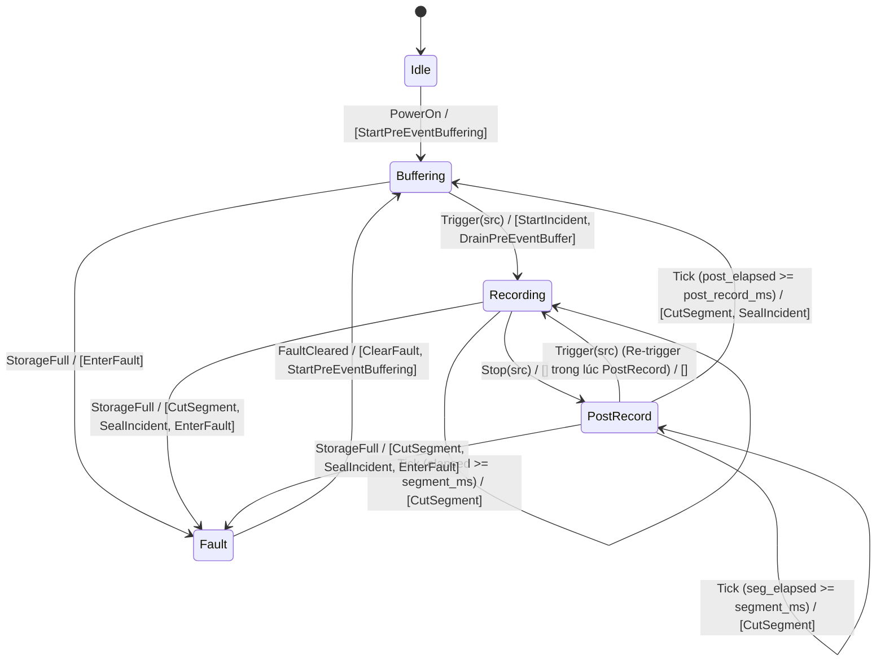

# Low-Level Design Document (LLD) — AegisCam Platform
## Detailed Data Structures, Lock-Free Memory Layouts, State Machines, Cryptographic Formulas & Networking Algorithms

Tài liệu **Low-Level Design (LLD)** này đi sâu vào mức cài đặt chi tiết của từng cấu trúc dữ liệu, bố cục bộ nhớ (Memory Layout), thứ tự bộ nhớ nguyên tử (`std::memory_order`), ma trận chuyển trạng thái, công thức mật mã học (SHA-256, HMAC, Hash Chain), định dạng nhị phân trên đĩa của **`aegisd` (C++17)** và các thuật toán mạng cốt lõi của **`netagent` (Go 1.22)**.

---

## 1. Cấu Trúc Dữ Liệu Nền Tảng & Xử Lý Lỗi Không Exception (`core/include/aegis/common/`)

### 1.1 `ErrorCode`, `Status` và `Result<T>` ([`result.h`](file:///c:/Users/Admin/Documents/EmbeddedAxon/aegiscam/core/include/aegis/common/result.h))
Trên luồng thu nhận thời gian thực (`SCHED_FIFO`), C++ Exceptions bị cấm vì cơ chế stack unwinding tiêu tốn thời gian không xác định (non-deterministic latency) và làm phình kích thước bảng `.eh_frame`. Toàn bộ hàm có thể thất bại trả về `Status` hoặc `Result<T>`:

```cpp
namespace aegis::common {

enum class ErrorCode : uint8_t {
  kOk = 0,
  kParseError,
  kInvalidArgument,
  kInvalidState,
  kIoError,
  kIntegrityError,
  kNotSupported,
  kResourceExhausted,
  kNotFound
};

class Status {
 public:
  static Status Ok() noexcept { return Status(ErrorCode::kOk, ""); }
  static Status Error(ErrorCode code, std::string msg) {
    return Status(code, std::move(msg));
  }
  bool ok() const noexcept { return code_ == ErrorCode::kOk; }
  ErrorCode code() const noexcept { return code_; }
  const std::string& message() const noexcept { return message_; }
 private:
  ErrorCode code_{ErrorCode::kOk};
  std::string message_;
};

template <typename T>
class Result {
 public:
  static Result<T> Ok(T val);
  static Result<T> Err(ErrorCode code, std::string msg);
  bool ok() const noexcept { return status_.ok(); }
  const Status& status() const noexcept { return status_; }
  T& value() & noexcept { return *value_; }
  const T& value() const& noexcept { return *value_; }
 private:
  Status status_;
  std::optional<T> value_;
};

}  // namespace aegis::common
```

### 1.2 Đồng Hồ Trừu Tượng Tất Định (`IClock`, `SystemClock`, `FakeClock` — [`clock.h`](file:///c:/Users/Admin/Documents/EmbeddedAxon/aegiscam/core/include/aegis/common/clock.h))
```cpp
class IClock {
 public:
  virtual ~IClock() = default;
  virtual uint64_t now_ms() const noexcept = 0;
};

class FakeClock final : public IClock {
 public:
  explicit FakeClock(uint64_t start_ms = 1700000000000ULL) noexcept
      : now_ms_(start_ms) {}
  uint64_t now_ms() const noexcept override {
    return now_ms_.load(std::memory_order_acquire);
  }
  void advance(uint64_t delta_ms) noexcept {
    now_ms_.fetch_add(delta_ms, std::memory_order_acq_rel);
  }
 private:
  std::atomic<uint64_t> now_ms_;
};
```

---

## 2. Cấu Trúc Đồng Thời Lock-Free & Bounded Memory (`core/include/aegis/util/`)

### 2.1 Lock-Free Single-Producer Single-Consumer Ring Buffer ([`spsc_ring_buffer.h`](file:///c:/Users/Admin/Documents/EmbeddedAxon/aegiscam/core/include/aegis/util/spsc_ring_buffer.h))

#### Bố cục bộ nhớ & Chống False Sharing (Cache-Line Padding)
Trên vi xử lý đa nhân ARM Cortex-A53/A55 (chiều dài dòng cache L1 là 64 byte), nếu biến chỉ số ghi (`head_`) của luồng Producer (Core 3) và biến chỉ số đọc (`tail_`) của luồng Consumer (Core 1) nằm trên cùng một dòng cache 64 byte, giao thức đồng bộ cache MESI/MOESI sẽ làm vô hiệu hóa dòng cache qua lại liên tục (**False Sharing**). Do đó, `head_` và `tail_` được căn chỉnh `alignas(64)`:

```
+-------------------------------------------------------------------+
| Cache Line 0 (64B): slots_ vector metadata, capacity_, mask_      |
+-------------------------------------------------------------------+
| Cache Line 1 (64B): alignas(64) std::atomic<size_t> head_         | <-- Producer (Capture Thread) ghi
+-------------------------------------------------------------------+
| Cache Line 2 (64B): alignas(64) std::atomic<size_t> tail_         | <-- Consumer (Controller/Writer) ghi
+-------------------------------------------------------------------+
```

#### Thuật toán & Chứng minh Thứ tự Bộ nhớ (`acquire` / `release`)
* **Dung lượng (`capacity_`)**: Luôn là lũy thừa của 2 ($2^k$, ví dụ $1024$), cho phép thay phép chia lấy dư `% capacity_` (tốn 15–20 chu kỳ CPU) bằng phép toán bit `& mask_` (`mask_ = capacity_ - 1`, tốn 1 chu kỳ CPU).
* **`try_push(T item)` (Chỉ gọi bởi Producer)**:
  1. Đọc `head` bằng `memory_order_relaxed` (vì chỉ Producer mới sửa `head_`).
  2. Đọc `tail` bằng `memory_order_acquire` để thấy các vị trí đã được Consumer giải phóng.
  3. Nếu `next_head == tail` $\rightarrow$ vòng đệm đầy, trả về `false` ngay lập tức (O(1), không chặn).
  4. Ghi `slots_[head] = std::move(item)`.
  5. Cập nhật `head_.store(next_head, std::memory_order_release)` — đảm bảo dữ liệu trong `slots_[head]` đã nằm trong bộ nhớ trước khi Consumer nhìn thấy `next_head`.
* **`try_pop(T& out)` (Chỉ gọi bởi Consumer)**:
  1. Đọc `tail` bằng `memory_order_relaxed`.
  2. Đọc `head` bằng `memory_order_acquire` — ghép cặp đồng bộ (*synchronizes-with*) với `release` của Producer, đảm bảo đọc đúng nội dung `slots_[tail]`.
  3. Nếu `tail == head` $\rightarrow$ vòng đệm rỗng, trả về `false`.
  4. Di chuyển `out = std::move(slots_[tail])`.
  5. Cập nhật `tail_.store(next_tail, std::memory_order_release)`.

### 2.2 Hàng Đợi Đa Luồng Có Giới Hạn (`BoundedQueue<T>` — [`bounded_queue.h`](file:///c:/Users/Admin/Documents/EmbeddedAxon/aegiscam/core/include/aegis/util/bounded_queue.h))
Hỗ trợ 2 chính sách tràn hàng đợi rõ ràng:
* `OverflowPolicy::kReject`: Từ chối phần tử mới khi đạt `capacity_`, buộc bên gửi xử lý áp lực ngược (Backpressure).
* `OverflowPolicy::kDropOldest`: Loại bỏ phần tử cũ nhất ở đầu hàng đợi (`queue_.pop_front()`) và tăng bộ đếm `dropped_count_` để ưu tiên dữ liệu thời gian thực mới nhất.

---

## 3. Máy Trạng Thái Ghi Hình & Bộ Phân Xử Kích Hoạt (`recording/` & `trigger/`)

### 3.1 Bộ Phân Xử Kích Hoạt (`TriggerArbiter` — [`trigger_arbiter.h`](file:///c:/Users/Admin/Documents/EmbeddedAxon/aegiscam/core/include/aegis/trigger/trigger_arbiter.h))

#### Bậc Ưu Tiên Nguồn Kích Hoạt (Priority Hierarchy)
```cpp
enum class TriggerSource : uint8_t {
  kRemote  = 1,  // Lệnh từ trung tâm điều hành từ xa
  kSignal  = 2,  // Tín hiệu BLE đồng bộ từ xe tuần tra / đồng đội xung quanh
  kButton  = 3,  // Nút bấm vật lý trước ngực áo
  kHolster = 4   // Cảm biến rút vũ khí khỏi bao (Ưu tiên sinh tử cao nhất)
};
```

#### Luật Chống Dội (Debounce) và Luật Chống Tắt Trái Phép
1. **Chống dội theo từng nguồn (`debounce_ms = 50 ms`)**:
   * Mỗi nguồn $s$ có dấu thời gian kích hoạt gần nhất `last_event_ts_[s]`.
   * Nếu `now_ms - last_event_ts_[s] < debounce_ms_` $\rightarrow$ bỏ qua xung nhiễu cơ khí.
2. **Luật Nâng Cấp Nguồn Đang Hoạt Động**:
   * Nếu đang ghi bởi nguồn $s_{\text{active}}$ (ví dụ `kSignal = 2`) và nhận lệnh `TRIGGER` từ nguồn $s_{\text{new}}$ có `priority(s_new) > priority(s_active)` (ví dụ `kHolster = 4`), `active_source_` được nâng cấp lên `kHolster`.
3. **Luật Chặn Lệnh `STOP` Từ Nguồn Thấp Hơn**:
   * Lệnh `STOP(s)` chỉ được chấp nhận khi và chỉ khi:
     $$\text{priority}(s) \ge \text{priority}(s_{\text{active}})$$
   * Nhờ đó, một gói tin `STOP remote` bị trễ trên mạng không bao giờ tắt được phiên ghi hình khi sĩ quan vừa rút súng (`kHolster`).

### 3.2 Máy Trạng Thái Hướng Bảng (`RecordingStateMachine` — [`recording_state_machine.h`](file:///c:/Users/Admin/Documents/EmbeddedAxon/aegiscam/core/include/aegis/recording/recording_state_machine.h))

#### Sơ Đồ Chuyển Trạng Thái (State Diagram)


#### Bảng Chuyển Trạng Thái Đầy Đủ (State Transition Matrix)
| Trạng thái hiện tại | Sự kiện đầu vào (`Event`) | Điều kiện (Guard) | Trạng thái kế tiếp | Danh sách hành động phát ra (`Actions`) |
|---|---|---|---|---|
| `Idle` | `PowerOn` | — | `Buffering` | `[StartPreEventBuffering]` |
| `Buffering` | `Trigger(src)` | `Arbiter::can_trigger` | `Recording` | `[StartIncident(src), DrainPreEventBuffer]` |
| `Recording` | `Tick(dt)` | `seg_elapsed + dt >= segment_ms_` | `Recording` | `[CutSegment]` |
| `Recording` | `Stop(src)` | `Arbiter::can_stop` | `PostRecord` | `[]` (bắt đầu đếm `post_elapsed_ms_ = 0`) |
| `PostRecord` | `Trigger(src)` | — | `Recording` | `[]` (hủy bộ đếm PostRecord, tiếp tục sự cố hiện tại) |
| `PostRecord` | `Tick(dt)` | `post_elapsed + dt >= post_record_ms_` | `Buffering` | `[CutSegment, SealIncident]` |
| `Recording` / `PostRecord` | `StorageFull` | — | `Fault` | `[CutSegment, SealIncident, EnterFault]` |
| `Fault` | `FaultCleared` | — | `Buffering` | `[ClearFault, StartPreEventBuffering]` |

---

## 4. Thiết Kế Chi Tiết Tầng Bằng Chứng & Mật Mã Học (`evidence/` & `crypto/`)

### 4.1 Cấu Trúc Khung Hình (`Frame`) và Xả Vòng Đệm Từ Keyframe (`PreEventBuffer`)
```cpp
struct Frame {
  uint64_t seq{0};                 // Số thứ tự khung hình tăng đơn điệu
  uint64_t ts_ms{0};               // Dấu thời gian thu nhận (ms)
  bool keyframe{false};            // true nếu là I-Frame (IDR) đọc độc lập
  std::vector<uint8_t> payload;    // Dữ liệu H.264/H.265 NAL unit
};
```
* **Thuật toán cắt cửa sổ trượt (`PreEventBuffer::push`)**:
  * Khi thêm khung hình mới có dấu thời gian $t_{\text{now}}$, mọi khung hình ở đầu `std::deque<Frame>` có $t_{\text{now}} - t_{\text{frame}} > W_{\text{pre}}$ (mặc định $30.000\text{ ms}$) hoặc vượt quá `max_frames_` đều bị loại bỏ.
* **Thuật toán căn chỉnh Keyframe (`PreEventBuffer::drain_from_keyframe`)**:
  * Một luồng video nén H.264/H.265 gồm các nhóm GOP (`I P P P ... I P P`). Nếu bắt đầu tệp phân đoạn bằng khung `P-frame`, trình phát video của tòa án sẽ bị vỡ hình cho đến kỳ `I-frame` tiếp theo.
  * Do đó, `drain_from_keyframe()` quét từ đầu vòng đệm để tìm chỉ số đầu tiên $k$ có `buffer_[k].keyframe == true`, bỏ qua các khung `P-frame` mồ côi trước $k$, và di chuyển toàn bộ đoạn `buffer_[k .. end]` sang danh sách khung hình của phân đoạn đầu tiên (`seg_000001.bin`).

### 4.2 Định Dạng Nhị Phân Của Tệp Phân Đoạn (`seg_%06u.bin` — [`segment_writer.cpp`](file:///c:/Users/Admin/Documents/EmbeddedAxon/aegiscam/core/src/evidence/segment_writer.cpp))
Mỗi tệp `seg_000001.bin` được tuần tự hóa theo định dạng nhị phân Little-Endian tự mô tả:

```
+-----------------------------------------------------------------------+
| Magic Header (8 bytes): "AEGISSEG"                                    |
| Frame Count  (4 bytes, uint32_t LE): N                                |
+-----------------------------------------------------------------------+
| Frame 0 Header:                                                       |
|   - seq          (8 bytes, uint64_t LE)                               |
|   - ts_ms        (8 bytes, uint64_t LE)                               |
|   - keyframe     (1 byte,  0x01 = I-Frame, 0x00 = P-Frame)            |
|   - payload_size (4 bytes, uint32_t LE): L_0                          |
| Frame 0 Payload  (L_0 bytes)                                          |
+-----------------------------------------------------------------------+
| ... Frame 1 .. Frame N-1 ...                                          |
+-----------------------------------------------------------------------+
```

### 4.3 Công Thức Toán Học Chuỗi Băm Nhị Phân & Chữ Ký HMAC (`manifest.json`)

1. **Mã băm từng phân đoạn ($S_i$)**:
   $$S_i = \text{SHA256}(\text{bytes}(\text{seg\_}i\text{.bin})) \in \{0,1\}^{256} \quad (32\text{ bytes nhị phân})$$
2. **Chuỗi băm liên kết các phân đoạn ($H_i$ — [`hash_chain.cpp`](file:///c:/Users/Admin/Documents/EmbeddedAxon/aegiscam/core/src/crypto/hash_chain.cpp))**:
   * Khởi thủy (Genesis):
     $$H_0 = 0^{32} \quad (32\text{ byte có giá trị } \text{0x00})$$
   * Với mỗi phân đoạn thứ $i \in \{1, 2, \dots, n\}$:
     $$H_i = \text{SHA256}(H_{i-1} \parallel S_i) \quad (\text{nối 32 byte nhị phân của } H_{i-1} \text{ và 32 byte nhị phân của } S_i)$$
   * Đỉnh chuỗi băm của sự cố:
     $$\text{chain\_head} = \text{hex}(H_n) \quad (64\text{ ký tự ASCII hex thường})$$
3. **Chữ ký xác thực thiết bị (`hmac` — [`hmac.cpp`](file:///c:/Users/Admin/Documents/EmbeddedAxon/aegiscam/core/src/crypto/hmac.cpp))**:
   $$\text{hmac} = \text{hex}\Big(\text{HMAC-SHA256}\big(K_{\text{device}}, \text{ASCII}(\text{chain\_head})\big)\Big)$$
   Trong đó $K_{\text{device}}$ được lấy từ [`IKeyStoreHal::get_device_hmac_key()`](file:///c:/Users/Admin/Documents/EmbeddedAxon/aegiscam/core/include/aegis/hal/i_key_store_hal.h) (trong sản xuất thực tế nằm trong chip TPM 2.0 / ATECC608A; trong chế độ `--sim` là `"aegis-sim-device-key-DO-NOT-SHIP"`).
4. **So sánh Thời gian Hằng số (Constant-Time Verification)**:
   Để ngăn chặn tấn công đo thời gian phản hồi (Timing Side-Channel Attack) khi xác minh HMAC, hàm `Hmac::verify_constant_time` tính tổng XOR trên toàn bộ chiều dài chuỗi:
   ```cpp
   uint8_t diff = 0;
   for (size_t i = 0; i < a.size(); ++i) {
     diff |= static_cast<uint8_t>(tolower(a[i]) ^ tolower(b[i]));
   }
   return diff == 0;
   ```

### 4.4 Công Thức Chuỗi Băm Nhật Ký Kiểm Toán (`audit.log` — [`audit_log.cpp`](file:///c:/Users/Admin/Documents/EmbeddedAxon/aegiscam/core/src/evidence/audit_log.cpp))
Mỗi bản ghi trong `<store_root>/audit.log` là 1 dòng văn bản gồm 6 trường phân cách bởi ký tự `|`:
```
<seq>|<ts_ms>|<event>|<detail>|<prev_hash_hex>|<hash_hex>
```
* Với bản ghi đầu tiên ($\text{seq} = 1$): $\text{prev\_hash\_hex} = \text{"0000...0000"}$ (64 ký tự `'0'`).
* Công thức băm dòng thứ $k$:
  $$\text{hash\_hex}_k = \text{hex}\Big(\text{SHA256}\big(\text{prev\_hash\_hex}_k \parallel \text{"|"} \parallel \text{seq}_k \parallel \text{"|"} \parallel \text{ts\_ms}_k \parallel \text{"|"} \parallel \text{event}_k \parallel \text{"|"} \parallel \text{detail}_k\big)\Big)$$
* Nếu kẻ tấn công xóa dòng thứ $k$ hoặc sửa bất kỳ ký tự nào trong dòng $k$, phép kiểm tra tại dòng $k$ hoặc liên kết `prev_hash_hex` tại dòng $k+1$ sẽ lập tức báo lỗi `INTEGRITY_ERROR`.

### 4.5 Giao Thức Ghi Nguyên Tử Chống Mất Điện (`PosixStorageHal::write_atomic` — [`posix_storage_hal.cpp`](file:///c:/Users/Admin/Documents/EmbeddedAxon/aegiscam/core/hal/linux/posix_storage_hal.cpp))
Khi pin bị giật ra giữa chừng, hệ thống tệp `ext4`/`f2fs` có thể đã cập nhật metadata nhưng dữ liệu trong page cache chưa xuống chip nhớ eMMC, hoặc tệp mới chỉ ghi được một nửa. `write_atomic(rel_path, data)` thực hiện đúng 5 bước POSIX:
1. Mở tệp tạm `<rel_path>.tmp` với cờ `O_WRONLY | O_CREAT | O_TRUNC | O_CLOEXEC`.
2. Ghi toàn bộ `data` qua vòng lặp `::write()` (xử lý `EINTR` và partial write).
3. Gọi `::fsync(tmp_fd)` để ép toàn bộ page cache của tệp `.tmp` xuống bề mặt chip nhớ flash, sau đó `::close(tmp_fd)`.
4. Gọi `::rename(tmp_path, final_path)` — thao tác nguyên tử ở tầng inode của nhân Linux: tệp đích hoặc là phiên bản cũ hoàn chỉnh, hoặc là phiên bản mới hoàn chỉnh.
5. Mở thư mục cha (`O_RDONLY | O_DIRECTORY`) và gọi `::fsync(dir_fd)` để đảm bảo mục thư mục (directory entry) sau khi `rename` cũng được ghi bền vững xuống flash.

Khi khởi động lại sau sự cố sập nguồn, `EvidenceStore::recover()` quét toàn bộ `incidents/*`:
* Xóa mọi tệp `.tmp` mồ côi đang ghi dở.
* Đọc `manifest.json`, kiểm tra lại từng tệp `seg_*.bin` đã liệt kê và xóa các tệp `seg_*.bin` chưa kịp ghi vào `manifest.json`, đảm bảo sự cố luôn dừng ở trạng thái nhất quán mật mã học.

---

## 5. Thiết Kế Chi Tiết Các Thuật Toán Trong Go `netagent` (`netagent/internal/`)

### 5.1 Bộ Chọn Đường Truyền Có Trễ Chống Dao Động (`internal/link/link.go`)
Khi xe tuần tra rời trạm (mất Wi-Fi, chuyển sang LTE) rồi đi ngang qua vùng phủ Wi-Fi yếu chập chờn, nếu chuyển về Wi-Fi ngay ở gói ping thành công đầu tiên sẽ gây rớt kết nối liên tục (**Link Flapping**). [`link.Manager`](file:///c:/Users/Admin/Documents/EmbeddedAxon/aegiscam/netagent/internal/link/link.go) giải quyết bằng:
* **Điểm sức khỏe (`Score` $\in [0, 100]$)**:
  $$\text{Score}(L) = \begin{cases} 0 & \text{nếu } \neg\text{Up} \lor \neg\text{HasIP} \lor \neg\text{DNSOK} \lor \text{LossPct} \ge 50\% \\ \max\big(0, 100 - \lfloor 1.5 \times \text{LossPct} \rfloor - \min(30, \lfloor \text{RTT}_{\text{ms}} / 20 \rfloor)\big) & \text{ngược lại} \end{cases}$$
* **Bộ đếm Hysteresis**:
  * Một đường truyền đang `Healthy = false` phải đạt `Score >= MinHealthyScore (60)` liên tiếp **`RiseThreshold = 3` lần thăm dò** mới chuyển sang `Healthy = true`.
  * Một đường truyền đang `Healthy = true` phải bị lỗi liên tiếp **`FallThreshold = 2` lần thăm dò** mới bị đánh dấu `Healthy = false`.
* **Chính sách Đường truyền Tính cước (`AllowAutoUpload`)**:
  * Nếu đang đi qua `Ethernet` hoặc `WiFi`: cho phép tải lên mọi phân đoạn (`AllowAutoUpload = true`).
  * Nếu đang đi qua `LTE` (`Metered = true`): chỉ tự động tải lên các sự cố có cờ `highPriority = true` (ví dụ kích hoạt từ `holster` hoặc `signal`), giữ các sự cố thường trong flash đợi về trạm Wi-Fi/Dock.

### 5.2 Máy Trạng Thái Thuê Bao DHCP Chuẩn RFC 2131 (`internal/dhcp/dhcp.go`)
Từ thời điểm bắt đầu thuê bao `StartTime` với thời hạn `LeaseDuration`:
* $T_1 = \text{StartTime} + 0.50 \times \text{LeaseDuration}$ (**Mốc Renew — 50%**): chuyển từ `BOUND` sang `RENEWING` (gửi `DHCPREQUEST` unicast tới máy chủ DHCP hiện tại).
* $T_2 = \text{StartTime} + 0.875 \times \text{LeaseDuration}$ (**Mốc Rebind — 87.5%**): chuyển từ `RENEWING` sang `REBINDING` (gửi `DHCPREQUEST` broadcast tìm bất kỳ máy chủ DHCP nào).
* $T_{\text{exp}} = \text{StartTime} + \text{LeaseDuration}$ (**Mốc Expired — 100%**): chuyển về `INIT` (thu hồi IP và khởi tạo lại quy trình DORA).

### 5.3 Phát Hiện Captive Portal & DNS Hijacking (`internal/dnscheck/dnscheck.go`)
Nhiều mạng Wi-Fi công cộng cấp IP và trả lời DNS bình thường nhưng chuyển hướng mọi tên miền về trang đăng nhập cục bộ (ví dụ `192.168.1.1`). `Checker.Check()` phân giải tên miền kiểm chứng `CanaryHost` (ví dụ `ingest.aegiscam.internal`) và đối chiếu kết quả với tiền tố IP kỳ vọng `ExpectedPrefix` (ví dụ `10.99.` của mạng nội bộ VPN). Nếu IP trả về không bắt đầu bằng `ExpectedPrefix`, `Checker` gắn cờ `ErrCaptiveOrHijack` để `netagent` không coi mạng Wi-Fi đó là sẵn sàng.

### 5.4 Giám Sát Hầm WireGuard VPN & Công Tắc Ngắt (`internal/vpn/vpn.go`)
* Giao thức WireGuard hoạt động hướng trạng thái im lặng nhưng luân chuyển khóa mỗi 2–3 phút. `Supervisor.Evaluate()` kiểm tra tuổi của lần bắt tay gần nhất:
  $$\text{HandshakeFresh} \iff (\text{LastHandshake} \ne 0) \land (\text{now} - \text{LastHandshake} \le \text{MaxHandshakeAge (3m)})$$
* **Công tắc ngắt (`AllowUpload()`)**:
  ```go
  func (s *Supervisor) AllowUpload(now time.Time) bool {
      if !s.cfg.KillSwitch {
          return true
      }
      return s.state == StateHealthy && s.handshakeFresh(now)
  }
  ```
  Khi `KillSwitch = true` (mặc định trên thiết bị thực thi pháp luật), không một byte bằng chứng nào được phép rời khỏi `uploader` nếu hầm WireGuard chưa bắt tay thành công.

### 5.5 Thuật Toán Tải Lên Phân Mảnh Có Thể Nối Lại & Token Bucket (`internal/uploader/uploader.go`)
1. **Khám phá vị trí nối lại (Resume Offset Discovery)**:
   * Gửi `HEAD /v1/evidence/<incident_id>/segments/<index>`.
   * Đọc header phản hồi `Upload-Offset: <bytes>`. Nếu máy chủ đã có 4 MiB đầu tiên từ trước khi xe đi vào hầm mất sóng, `Uploader` nhảy thẳng tới byte thứ `4.194.304` mà không tải lại từ đầu.
2. **Đẩy từng mảnh 4 MiB kèm mã băm (`PATCH`)**:
   * Đọc mảnh $[ \text{offset}, \text{offset} + 4\text{ MiB} )$, tính `sha256` của riêng mảnh đó, gắn vào header `X-Chunk-SHA256`, `Upload-Offset`, `Upload-Length`.
3. **Full-Jitter Exponential Backoff**:
   * Khi gặp lỗi mạng hoặc HTTP `5xx`/`429`, thời gian chờ ở lần thử lại thứ $a$ được tính bằng công thức Full-Jitter của AWS để tránh hiện tượng hàng nghìn camera cùng kết nối lại một lúc (Thundering Herd) khi trạm thu phát sóng vừa phục hồi:
     $$\text{cap}_a = \min\big(\text{MaxBackoff}, \text{BaseBackoff} \times 2^a\big), \quad \text{sleep}_a = \frac{\text{cap}_a}{2} + \text{Uniform}\Big(0, \frac{\text{cap}_a}{2}\Big)$$
4. **Giới hạn băng thông bằng Token Bucket**:
   * Mỗi lần chuẩn bị đẩy mảnh $B$ byte, thùng thẻ bài được nạp thêm $(t_{\text{now}} - t_{\text{last}}) \times R_{\text{bytes/s}}$ (tối đa bằng dung lượng thùng). Nếu số thẻ bài hiện tại $< B$, goroutine ngủ đúng khoảng thời gian thiếu hụt trước khi gửi, đảm bảo việc tải video không làm nghẽn đường truyền đàm thoại/tín hiệu khẩn cấp.

