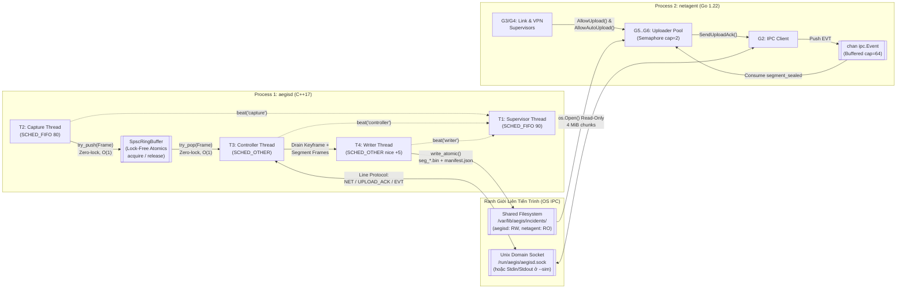
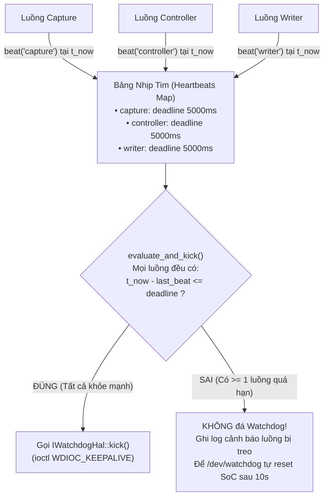

# Tài Liệu Thiết Kế Đa Tiến Trình & Đa Luồng Chi Tiết (Process, Threading & Resource Model)
## Dự Án: AegisCam (`aegisd` C++17 Real-Time Daemon + `netagent` Go 1.22 Connectivity Agent)

Tài liệu này giải thích chi tiết kiến trúc **Đa tiến trình (Multi-Process)** và **Đa luồng (Multi-Threading / Goroutines)** của hệ thống AegisCam, ánh xạ trực tiếp lên phần cứng SoC ARM64 nhúng chạy Linux `PREEMPT_RT`, phân tích độ ưu tiên lập lịch (`SCHED_FIFO` vs `SCHED_OTHER`), cơ chế giao tiếp không khóa (Lock-Free IPC), giám sát nhịp tim Watchdog theo từng luồng, và quy trình tắt máy an toàn 4 pha (4-Phase Graceful Shutdown).

---

## 1. Tại Sao Tách Thành 2 Tiến Trình Độc Lập (`aegisd` vs `netagent`)?

Trong một thiết bị camera bằng chứng đeo người (Body-Worn Camera), có 2 miền tác vụ có bản chất hoàn toàn trái ngược nhau:
* **Miền Thu nhận & Ghi bằng chứng (`aegisd` — C++17)**: Yêu cầu **thời gian thực cứng/mềm (Real-Time, jitter $< 1\text{ ms}$, kích hoạt $< 100\text{ ms}$)**, bộ nhớ tĩnh xác định trước (Zero dynamic allocation trên hot path), và tuyệt đối không được phép crash.
* **Miền Kết nối mạng & Tải lên đám mây (`netagent` — Go 1.22)**: Phải xử lý các kết nối TCP/TLS không ổn định, chuyển vùng LTE/Wi-Fi, phân giải DNS, quản lý hầm VPN WireGuard và tải lên song song nhiều mảnh dữ liệu lớn.

Nếu gộp chung cả hai vào cùng một tiến trình duy nhất, một lỗi phân mảnh heap của thư viện mạng, một cú tạm dừng thu gom rác (GC pause) hoặc một lỗ hổng bảo mật ở tầng parser HTTP có thể làm sập toàn bộ tiến trình và làm **mất đoạn video bằng chứng đang ghi**. Do đó, AegisCam tách thành **2 tiến trình OS độc lập** được giám sát riêng bởi `systemd`:

| Tiêu chí so sánh | Tiến trình 1: `aegisd` (C++17) | Tiến trình 2: `netagent` (Go 1.22) |
|---|---|---|
| **Unit file `systemd`** | [`deploy/systemd/aegisd.service`](file:///c:/Users/Admin/Documents/EmbeddedAxon/aegiscam/deploy/systemd/aegisd.service) | [`deploy/systemd/netagent.service`](file:///c:/Users/Admin/Documents/EmbeddedAxon/aegiscam/deploy/systemd/netagent.service) |
| **Vai trò cốt lõi** | Thu nhận khung hình, vòng đệm 30s, FSM ghi hình, băm SHA-256/HMAC, ghi đĩa nguyên tử, A/B OTA, Hardware Watchdog | Chuyển mạch `eth/wifi/lte`, DHCP T1/T2, DNS canary, giám sát WireGuard VPN + Kill-Switch, tải lên phân mảnh 4 MiB |
| **Quyền hạn Linux (`CapabilityBoundingSet`)** | `CAP_SYS_NICE` (đặt `SCHED_FIFO`), `CAP_IPC_LOCK` (`mlockall`) — **Không có quyền quản trị mạng** | `CAP_NET_ADMIN`, `CAP_NET_RAW` (quản lý giao diện mạng & WireGuard) — **Không có quyền ghi vào thư mục bằng chứng** |
| **Quyền truy cập thư mục bằng chứng (`/var/lib/aegis`)** | **Read-Write (`ReadWritePaths=/var/lib/aegis`)** — tiến trình duy nhất được tạo/niêm phong bằng chứng | **Read-Only (`ReadOnlyPaths=/var/lib/aegis/incidents`)** — ngay cả khi bị tấn công từ mạng cũng không thể sửa xóa bằng chứng trên đĩa |
| **Giới hạn RAM (`MemoryMax`)** | Cố định theo kích thước vòng đệm `PreEventBuffer` + `SpscRingBuffer` ($\approx 128\text{ MB}$) | Bị khống chế cứng bởi cgroups `MemoryMax=64M` |
| **Hậu quả khi tiến trình bị crash** | Hardware Watchdog (`/dev/watchdog`) khởi động lại thiết bị hoặc `systemd` chạy `recover()` trong $< 200\text{ ms}$ | `systemd` tự khởi động lại `netagent` sau 2 giây; **`aegisd` không bị ảnh hưởng, không rớt 1 frame nào** |

---

## 2. Bản Đồ Ánh Xạ Phần Cứng SoC ARM64 & Phân Bổ Nhân CPU (Hardware & Core Affinity Map)

Trên một SoC ARM64 nhúng tiêu biểu (4 nhân Cortex-A53/A55, RAM LPDDR4 1–2 GB, bộ nhớ eMMC, chip bảo mật TPM 2.0), các nhân CPU được phân chia rõ ràng để luồng ghi đĩa hoặc luồng mạng không bao giờ chiếm CPU của luồng thu nhận khung hình:

```
SoC ARM64 Embedded Linux (Kernel PREEMPT_RT + isolcpus=3)
┌───────────────────────────────────────────────────────────────────────────────────┐
│ CPU Core 3 (Isolated Real-Time Core — isolcpus=3, nohz_full=3, rcu_nocbs=3)       │
│ ┌───────────────────────────────────────┐ ┌─────────────────────────────────────┐ │
│ │ [aegisd] T1: WatchdogSupervisor       │ │ [aegisd] T2: Capture Thread         │ │
│ │ • Policy: SCHED_FIFO Priority 90      │ │ • Policy: SCHED_FIFO Priority 80    │ │
│ │ • Chu kỳ: 500 ms                      │ │ • Chu kỳ: 33.3 ms (30 FPS)          │ │
│ │ • Kiểm tra deadline mọi luồng -> kick │ │ • V4L2/ISP -> SpscRingBuffer (O(1)) │ │
│ └───────────────────────────────────────┘ └─────────────────────────────────────┘ │
├───────────────────────────────────────────────────────────────────────────────────┤
│ CPU Cores 0, 1, 2 (General Application, Disk I/O & Networking Cores)              │
│ ┌───────────────────────────────────────┐ ┌─────────────────────────────────────┐ │
│ │ [aegisd] T3: Controller / IPC Thread  │ │ [aegisd] T4: Segment Writer Thread  │ │
│ │ • Policy: SCHED_OTHER (priority 0)    │ │ • Policy: SCHED_OTHER (nice +5)     │ │
│ │ • CommandProtocol, TriggerArbiter,    │ │ • Xả PreEventBuffer từ Keyframe     │ │
│ │   RecordingStateMachine, AbSlotMgr    │ │ • SHA-256, HashChain, HMAC, fsync() │ │
│ └───────────────────────────────────────┘ └─────────────────────────────────────┘ │
│ ┌───────────────────────────────────────────────────────────────────────────────┐ │
│ │ [netagent] Go Runtime GMP Scheduler (GOMAXPROCS=2, Pinned to Cores 0-1)       │ │
│ │ • G1: Main & Signal Context        • G4: WireGuard VPN Supervisor (15s)       │ │
│ │ • G2: IPC Reader/Writer Loop       • G5..G6: Resumable Chunk Uploader Pool    │ │
│ │ • G3: Link / DHCP / DNS Prober     • Token Bucket Rate Limiter                │ │
│ └───────────────────────────────────────────────────────────────────────────────┘ │
├───────────────────────────────────────────────────────────────────────────────────┤
│ Phần Cứng Chuyên Dụng & Ngoại Vi (Dedicated Hardware & Peripherals)               │
│ • MIPI CSI-2 / ISP / Hardware H.264-H.265 Encoder (DMA -> V4L2 MMAP Buffers)      │
│ • TPM 2.0 / Secure Element (`IKeyStoreHal` — lưu giữ khóa HMAC phần cứng)         │
│ • Hardware Watchdog Timer (`/dev/watchdog` — tự reset SoC nếu treo > 10s)         │
│ • Bộ nhớ Flash eMMC (`/var/lib/aegis` — `incidents/`, `audit.log`, `ota/`)        │
└───────────────────────────────────────────────────────────────────────────────────┘
```

---

## 3. Bảng Đặc Tả Chi Tiết Toàn Bộ Các Luồng (Threads & Goroutines Inventory)

### 3.1 Các Luồng Của Tiến Trình `aegisd` (C++17)

| Mã Luồng | Tên Luồng | Chính sách Lập lịch (Linux Prod) | CPU Affinity | Chu kỳ / Sự kiện kích hoạt | Việc ĐƯỢC làm | Việc CẤM TUYỆT ĐỐI |
|---|---|---|---|---|---|---|
| **T1** | **Supervisor Thread** (`watchdog_supervisor`) | `SCHED_FIFO`, Priority **90** (Cao nhất) | Core 3 | Định kỳ mỗi **500 ms** | Đọc dấu thời gian nguyên tử `last_beat_ms` của các luồng T2, T3, T4; gọi `IWatchdogHal::kick()` nếu tất cả còn hạn | Cấp phát bộ nhớ, khóa mutex lâu, gọi I/O đĩa hoặc mạng |
| **T2** | **Capture Thread** (`capture`) | `SCHED_FIFO`, Priority **80** | Core 3 | Định kỳ mỗi **33.3 ms** (30 FPS) | Gọi `ICameraHal::read_frame()`, đẩy vào `SpscRingBuffer<Frame>::try_push()`, cập nhật nhịp tim `beat("capture")` | `new`/`malloc`, `std::mutex`, ghi file, đọc/ghi socket, ném C++ exception |
| **T3** | **Controller / IPC Thread** (`controller`) | `SCHED_OTHER` (Standard) | Cores 0–2 | Hướng sự kiện (lệnh IPC hoặc nhịp Tick) | Phân tích lệnh `CommandProtocol`, chạy `TriggerArbiter`, `RecordingStateMachine`, điều phối `AbSlotManager`, phát sự kiện `EVT`, cập nhật nhịp tim `beat("controller")` | Chặn trực tiếp luồng T2 |
| **T4** | **Segment Writer Thread** (`writer`) | `SCHED_OTHER`, `nice +5` | Cores 0–2 | Khi đủ thời lượng phân đoạn (`segment_ms = 10s`) hoặc khi đóng sự cố | Rút khung hình từ `PreEventBuffer` (căn chỉnh từ Keyframe), tính `Sha256`, `HashChain`, `Hmac`, gọi `write_atomic()` (`.tmp` + `fsync` + `rename`), ghi `AuditLog`, cập nhật `beat("writer")` | Giữ khóa chung với luồng T2 |

> [!NOTE]
> **Chế độ Mô phỏng Tất định (`--sim` Deterministic Single-Threaded Step Mode)**:
> Khi chạy `aegisd --sim` (phục vụ Unit Test, Integration Test và `pytest` System Test), toàn bộ các bước của T1, T2, T3, T4 được gom lại và thực thi tuần tự, tất định hoàn toàn bên trong `DeviceController` mỗi khi nhận lệnh `TICK <ms>` đi kèm đồng hồ giả lập `FakeClock`. Nhờ đó:
> 1. Bài kiểm thử mô phỏng 60 giây ghi hình chỉ mất **$< 5\text{ ms}$** thời gian thực trên máy tính cá nhân.
> 2. Không bao giờ xảy ra lỗi kiểm thử chập chờn (Flaky tests) do độ trễ lập lịch của hệ điều hành host.

### 3.2 Các Goroutine Của Tiến Trình `netagent` (Go 1.22)

| Mã Goroutine | Tên Goroutine | Package / File | Chu kỳ / Cơ chế điều phối | Vai trò kỹ thuật chính |
|---|---|---|---|---|
| **G1** | **Main & Lifecycle Coordinator** | [`cmd/netagent/main.go`](file:///c:/Users/Admin/Documents/EmbeddedAxon/aegiscam/netagent/cmd/netagent/main.go) | Khởi tạo & chờ `ctx.Done()` (`SIGINT`/`SIGTERM`) | Khởi tạo `link.Manager`, `dnscheck.Checker`, `vpn.Supervisor`, `uploader.Uploader`; đóng gói an toàn khi tắt máy |
| **G2** | **IPC Event Reader & Command Client** | [`internal/ipc/ipc.go`](file:///c:/Users/Admin/Documents/EmbeddedAxon/aegiscam/netagent/internal/ipc/ipc.go) | Chặn trên `bufio.Reader.ReadString('\n')` | Tách dòng bất đồng bộ `EVT {"type":"segment_sealed",...}` đẩy vào kênh `events chan Event` (dung lượng 64) và gửi lệnh `NET up|down`, `UPLOAD_ACK` |
| **G3** | **Link, DHCP & DNS Health Prober** | [`internal/link/link.go`](file:///c:/Users/Admin/Documents/EmbeddedAxon/aegiscam/netagent/internal/link/link.go)<br>[`internal/dhcp/dhcp.go`](file:///c:/Users/Admin/Documents/EmbeddedAxon/aegiscam/netagent/internal/dhcp/dhcp.go)<br>[`internal/dnscheck/dnscheck.go`](file:///c:/Users/Admin/Documents/EmbeddedAxon/aegiscam/netagent/internal/dnscheck/dnscheck.go) | `time.Ticker` định kỳ (5 giây) | Kiểm tra trạng thái thuê bao DHCP (T1/T2), phân giải DNS canary chống Captive Portal, tính điểm sức khỏe đường truyền và chuyển mạch `eth > wifi > lte` với Hysteresis |
| **G4** | **WireGuard Tunnel Supervisor** | [`internal/vpn/vpn.go`](file:///c:/Users/Admin/Documents/EmbeddedAxon/aegiscam/netagent/internal/vpn/vpn.go) | `time.Ticker` định kỳ (15 giây) | Kiểm tra tuổi bắt tay WireGuard (`<= 3m`), kích hoạt khởi động lại hầm với Exponential Backoff nếu mất kết nối và cập nhật cờ Kill-Switch `AllowUpload()` |
| **G5..G6** | **Resumable Chunk Uploader Workers** | [`internal/uploader/uploader.go`](file:///c:/Users/Admin/Documents/EmbeddedAxon/aegiscam/netagent/internal/uploader/uploader.go) | Giới hạn bởi Semaphore `sem chan struct{}` (`MaxInFlight = 2`) | Khi `vpn.AllowUpload()` và `link.AllowAutoUpload()` đều cho phép: đọc tệp `seg_*.bin`, truy vấn offset qua `HEAD`, đẩy từng mảnh 4 MiB qua `PATCH` dưới sự điều tiết của `tokenBucket`, sau đó gửi `UPLOAD_ACK` về `aegisd` |

---

## 4. Cơ Chế Giao Tiếp Liên Luồng & Liên Tiến Trình (Synchronization & IPC Architecture)



### 4.1 Phòng Chống Đảo Ngược Độ Ưu Tiên (Priority Inversion Avoidance)
Một rủi ro kinh điển trong hệ thống nhúng thời gian thực (từng xảy ra trên tàu thăm dò Mars Pathfinder) là **Đảo ngược độ ưu tiên không giới hạn (Unbounded Priority Inversion)**:
* Giả sử luồng độ ưu tiên thấp **T4 (Writer)** giữ một `std::mutex` dùng chung với luồng độ ưu tiên cao **T2 (Capture `SCHED_FIFO 80`)**, và đúng lúc đó luồng trung bình **T3 (Controller)** hoặc tiến trình khác chiếm CPU của T4 $\rightarrow$ luồng thời gian thực T2 bị chặn gián tiếp bởi T3!
* **Giải pháp triệt để trong AegisCam**:
  1. **Trên đường dẫn T2 $\rightarrow$ T3/T4**: Sử dụng hoàn toàn [`SpscRingBuffer<Frame>`](file:///c:/Users/Admin/Documents/EmbeddedAxon/aegiscam/core/include/aegis/util/spsc_ring_buffer.h) dựa trên chỉ số nguyên tử `std::atomic<size_t>` (`memory_order_acquire` / `memory_order_release`). **Luồng T2 không bao giờ chạm vào bất kỳ `mutex` nào.**
  2. **Khóa trang bộ nhớ (`mlockall(MCL_CURRENT | MCL_FUTURE)`)**: Được cấp quyền qua `CAP_IPC_LOCK` trong [`aegisd.service`](file:///c:/Users/Admin/Documents/EmbeddedAxon/aegiscam/deploy/systemd/aegisd.service), ngăn nhân Linux đẩy trang bộ nhớ của `aegisd` ra vùng swap hoặc gây page fault trên đường dẫn thời gian thực.
  3. **Kế thừa độ ưu tiên (`PTHREAD_PRIO_INHERIT`)**: Đối với các mutex bảo vệ trạng thái điều khiển giữa các luồng quản lý, thuộc tính `PTHREAD_PRIO_INHERIT` đảm bảo nếu luồng ưu tiên cao chờ khóa, luồng đang giữ khóa được tạm thời nâng lên cùng mức ưu tiên để giải phóng khóa nhanh nhất.

---

## 5. Cơ Chế Giám Sát Nhịp Tim Đa Luồng (`WatchdogSupervisor`)

Trên nhiều hệ thống nhúng sơ sài, một luồng riêng biệt chỉ lặp `while (true) { ioctl(fd, WDIOC_KEEPALIVE); sleep(1); }`. Cách làm đó **vô dụng** nếu luồng `writer` bị treo vĩnh viễn trên một ổ đĩa lỗi hoặc luồng `controller` bị deadlock, vì luồng watchdog vẫn đá phần cứng đều đặn!

Trong AegisCam, [`WatchdogSupervisor`](file:///c:/Users/Admin/Documents/EmbeddedAxon/aegiscam/core/src/health/watchdog_supervisor.cpp) giải quyết triệt để:



* Khi tắt máy chủ động (`QUIT` hoặc `SIGTERM`), `aegisd` gọi [`IWatchdogHal::stop_magic_close()`](file:///c:/Users/Admin/Documents/EmbeddedAxon/aegiscam/core/hal/linux/linux_watchdog_hal.cpp) — ghi ký tự ma thuật `'V'` (Magic Close theo chuẩn nhân Linux `watchdog-api.txt`) vào `/dev/watchdog` trước khi đóng file descriptor, báo cho phần cứng biết đây là lần tắt máy có chủ đích để không reset bo mạch.

---

## 6. Quy Trình Tắt Máy An Toàn 4 Pha (4-Phase Deterministic Graceful Shutdown)

Khi nhận tín hiệu `SIGTERM` từ `systemd`, `SIGINT` (`Ctrl+C`), hoặc lệnh `QUIT` qua IPC, hệ thống thực thi quy trình đóng máy 4 pha nghiêm ngặt trong [`DeviceController::shutdown()`](file:///c:/Users/Admin/Documents/EmbeddedAxon/aegiscam/core/src/app/device_controller.cpp) để đảm bảo **không mất khung hình cuối cùng và không để lại sự cố chưa niêm phong**:

1. **Pha 1 — Ngắt Thu Nhận Đầu Vào (Stop Ingress)**:
   * Bẫy tín hiệu POSIX (`signal_handler` trong [`aegisd_main.cpp`](file:///c:/Users/Admin/Documents/EmbeddedAxon/aegiscam/core/apps/aegisd_main.cpp)) chỉ thực hiện thao tác `g_signal_received.store(true, std::memory_order_release)` (100% *Async-Signal-Safe*).
   * Dừng nhận khung hình mới từ `ICameraHal` và dừng nhận lệnh IPC mới.
2. **Pha 2 — Xả Toàn Bộ Khung Hình Đang Đệm & Cắt Phân Đoạn Cuối (Drain Queues & Cut Final Segment)**:
   * Nếu thiết bị đang ở trạng thái `Recording` hoặc `PostRecord`, toàn bộ các khung hình còn nằm trong `SpscRingBuffer` và `current_segment_frames_` được gom lại và đẩy xuống `SegmentWriter` để tạo phân đoạn cuối cùng (`seg_%06u.bin`) kèm `fsync`.
3. **Pha 3 — Niêm Phong Hồ Sơ Bằng Chứng & Ghi Nhật Ký Kiểm Toán (Seal Manifest & Audit Log)**:
   * Gọi `EvidenceStore::seal_incident()` để chốt `chain_head`, tính chữ ký `HMAC-SHA256`, đặt `"sealed": true` trong `manifest.json` (ghi nguyên tử) và phát thông báo `EVT {"type":"incident_sealed",...}`.
   * Ghi bản ghi cuối cùng `SHUTDOWN | graceful_shutdown` vào chuỗi băm `audit.log`.
4. **Pha 4 — Giải Phóng Hardware Watchdog Bằng Magic Close (`'V'`) & Thoát (`exit(0)`)**:
   * Gọi `watchdog_hal_.stop_magic_close()` (ghi `'V'` vào `/dev/watchdog`) và trả về mã thoát `0`.

