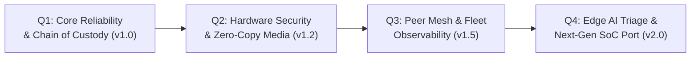

# AegisCam Technical Roadmap (4-Quarter Horizon)

This roadmap sequences platform investments across real-time capture, hardware security, fleet networking, and developer velocity.

---

## Quarter 1 — Core Reliability & Chain of Custody (v1.0 — Current Baseline)
- **Deliverables:**
  - Lock-free SPSC ring buffer + 30 s keyframe-aligned `PreEventBuffer`.
  - Crash-safe segment writer (`tmp + fsync + rename`), binary SHA-256 hash chain, HMAC-signed `manifest.json`, and hash-chained `audit.log`.
  - Go `netagent` with hysteretic `eth > wifi > lte` failover, DNS canary, WireGuard supervisor, and resumable 4 MiB chunked uploader.
  - Full deterministic `--sim` harness and 8-gate CI pipeline.
- **Exit KPI:** 0 lost frames in 72h soak; `< 100 ms` p99 trigger latency; `>= 80%` core line coverage.

## Quarter 2 — Hardware Security & Zero-Copy V4L2/DMABUF Pipeline (v1.2)
- **Deliverables:**
  - Replace V4L2 memcpy stub with zero-copy `VIDIOC_EXPBUF` (DMABUF) pipeline directly from ISP/encoder to `SpscRingBuffer` descriptor slots.
  - PKCS#11 / TPM 2.0 `LinuxKeyStoreHal` binding per-device ECDSA P-256 + HMAC keys in secure silicon, plus `dm-verity` signed squashfs rootfs in `meta-aegiscam`.
  - Signed OTA bundle format (Ed25519 manifest signature verified before `ABSlotManager::stage`).
- **Exit KPI:** 35% reduction in capture CPU utilization; hardware-attested evidence manifests.

## Quarter 3 — BLE/Wi-Fi Aware Peer Trigger Mesh & Fleet Telemetry (v1.5)
- **Deliverables:**
  - Low-energy peer broadcast daemon feeding `TRIGGER signal` to nearby cameras within 15 meters when an officer draws a weapon or activates lightbar sirens.
  - Structured OpenTelemetry/Prometheus health metrics exported by `netagent` over the WireGuard management plane (battery health, eMMC wear-leveling counters, link scores, upload queue depth).
- **Exit KPI:** Peer trigger propagation `< 250 ms` across 8 co-located cameras.

## Quarter 4 — On-Device Edge Triage & Next-Gen SoC Bring-Up (v2.0)
- **Deliverables:**
  - Isolated NPU worker process (`Nice=15`, zero impact on `capture`) generating automatic priority tags (`PriorityHigh` on gunshot/siren acoustic detection) to trigger immediate LTE offload via `netagent`.
  - HAL port to next-generation low-power ARMv9 SoC using the existing `ICameraHal` / `IStorageHal` contract with zero changes to `RecordingStateMachine` or `EvidenceStore`.
