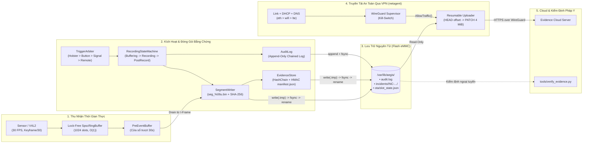

# System Design Document (SDD) — AegisCam Platform
## Mission-Critical Body-Worn & In-Vehicle Evidence Camera System (Embedded Linux `PREEMPT_RT`, C++17 & Go 1.22)

Tài liệu **System Design Document (SDD)** này định nghĩa kiến trúc tổng thể cấp hệ thống của **AegisCam**, bao gồm phân vùng phần cứng — phần mềm, ngân sách bộ nhớ RAM & Flash eMMC, luồng dữ liệu từ cảm biến đến đám mây qua hầm VPN WireGuard, kiến trúc bảo mật phần cứng (Secure Boot, `dm-verity`, TPM 2.0), và chiến lược chịu lỗi công nghiệp.

---

## 1. Kiến Trúc Phân Tầng 3 Lớp & Phân Tách 2 Tiến Trình (3-Layer & Dual-Daemon Architecture)

Tuân thủ các tiêu chuẩn phần mềm nhúng có độ tin cậy cao (POSIX.1b Real-Time Extensions, IEC 62443), AegisCam được phân tách theo **chiều dọc thành 2 tiến trình hệ điều hành độc lập** (`aegisd` C++17 và `netagent` Go 1.22) và theo **chiều ngang thành 3 tầng kiến trúc nghiêm ngặt**:

```
+=======================================================================================+
| TIẾN TRÌNH 1: aegisd (C++17 Real-Time Evidence Daemon)                                |
+---------------------------------------------------------------------------------------+
| 1. APP & IPC LAYER (Orchestration & Command Protocol)                                 |
|    - aegisd_main.cpp (CLI Parser, Async-Signal-Safe SIGINT/SIGTERM, Process Exit)     |
|    - DeviceController (Master Lifecycle, Dependency Injection Container, Event Sink)  |
|    - CommandProtocol (Line-Protocol Parser/Formatter, Fuzz-hardened)                  |
+-------------------------------------------^-------------------------------------------+
                                            | calls downwards only
+-------------------------------------------v-------------------------------------------+
| 2. DOMAIN & SERVICE LAYER (Platform-Independent Core Logic)                           |
|    - Concurrency: SpscRingBuffer<Frame> (Lock-Free), BoundedQueue<T>                  |
|    - Recording & Trigger: RecordingStateMachine (Table-Driven FSM), TriggerArbiter    |
|    - Evidence Engine: PreEventBuffer (30s Keyframe Drain), SegmentWriter,             |
|                       EvidenceStore (Manifest & Recovery), AuditLog (Hash-Chained)    |
|    - Cryptography: Sha256 (FIPS 180-4), Hmac (RFC 2104), HashChain                    |
|    - Reliability: AbSlotManager (A/B OTA Rollback), WatchdogSupervisor (Heartbeats)   |
+-------------------------------------------^-------------------------------------------+
                                            | calls via pure interfaces
+-------------------------------------------v-------------------------------------------+
| 3. HARDWARE ABSTRACTION LAYER - HAL (Linux Target Drivers vs Deterministic Sim HALs)  |
|    - ICameraHal      : V4l2CameraHal (MMAP DMA)       | SimCameraHal (Synthetic GOP)  |
|    - IStorageHal     : PosixStorageHal (tmp+fsync)    | SimStorageHal (Fault Inject)  |
|    - IWatchdogHal    : LinuxWatchdogHal (/dev/watchdog)| SimWatchdogHal (Kick Counter)|
|    - IKeyStoreHal    : TPM 2.0 / PKCS#11 KeyStore     | SimKeyStoreHal (Test Key)     |
|    - IBootControlHal : U-Boot / fw_setenv Slot Store  | SimBootControlHal (JSON)      |
+===========================================^===========================================+
                                            |
              Unix Domain Socket (/run/aegis/aegisd.sock) + Shared RO Flash
                                            |
+===========================================v===========================================+
| TIẾN TRÌNH 2: netagent (Go 1.22 Connectivity, VPN & Resumable Upload Daemon)          |
|    - internal/link     : Failover eth > wifi > lte với Hysteresis & Metered Policy    |
|    - internal/dhcp     : RFC 2131 Lease State Machine (BOUND -> T1 Renew -> T2 Rebind)|
|    - internal/dnscheck : Primary/Secondary DNS Failover & Captive Portal Detection    |
|    - internal/vpn      : WireGuard Tunnel Supervisor & Upload Kill-Switch             |
|    - internal/uploader : 4 MiB Resumable Chunked Upload, Token Bucket, Full-Jitter    |
+=======================================================================================+
```

### Ba Bất Biến Kiến Trúc (Strict Layer Invariants):
1. **Bất biến 1 — Chỉ gọi từ trên xuống (Downward Invocation Only)**: Tầng Domain (`RecordingStateMachine`, `EvidenceStore`, `AbSlotManager`) hoàn toàn không chứa bất kỳ lời gọi hệ thống Linux (`open`, `ioctl`, `socket`) nào mà chỉ giao tiếp qua các giao diện thuần ảo ở tầng HAL.
2. **Bất biến 2 — Cô lập Đặc quyền Tối thiểu (Least-Privilege Process Split)**: `aegisd` giữ quyền ghi duy nhất vào `/var/lib/aegis/incidents` nhưng không mở kết nối ra Internet; ngược lại `netagent` mở kết nối mạng nhưng chỉ được gắn kết `/var/lib/aegis/incidents` ở chế độ **Read-Only (`ReadOnlyPaths`)**.
3. **Bất biến 3 — Thực thi Kép (Dual-Mode Execution)**: Cùng một mã nguồn `aegis_core` vừa biên dịch chéo cho ARM64 Yocto Linux (`cmake --preset release-aarch64`), vừa chạy mô phỏng tất định 100% trên máy tính phát triển (`aegisd --sim`) phục vụ kiểm thử tự động CI/CD.

---

## 2. Sơ Đồ Luồng Dữ Liệu Đầu-Cuối Toàn Hệ Thống (End-to-End Data Flow)



---

## 3. Ngân Sách Bộ Nhớ RAM & Bộ Nhớ Flash (Memory & Storage Budget)

Thiết bị nhúng mục tiêu được trang bị **RAM LPDDR4 512 MB – 1 GB** và **Flash eMMC 32 GB – 64 GB** (cấu hình phân vùng kép A/B). Ngân sách bộ nhớ được hoạch định tĩnh:

### 3.1 Ngân sách RAM lúc chạy (Runtime RAM Budget)

| Thành phần | Dung lượng cấp phát | Cơ chế giới hạn (Bounded Mechanism) |
|---|---|---|
| **Nhân Linux `PREEMPT_RT` + `systemd` + WireGuard module** | $\approx 64\text{ MB}$ | Cấu hình nhân tối giản [`aegis-rt.cfg`](../../deploy/yocto/meta-aegiscam/recipes-kernel/linux/files/aegis-rt.cfg) |
| **`aegisd` — `SpscRingBuffer<Frame>` (1024 slots)** | $\approx 16\text{ MB}$ | Cố định lúc khởi tạo (`kDefaultCapacity = 1024`), khóa trong RAM bằng `mlockall()` |
| **`aegisd` — `PreEventBuffer` (30 giây @ 30 FPS = 900 frames)** | $\approx 45\text{ MB}$ | Cắt cửa sổ trượt theo cả thời gian (`window_ms = 30000`) và số khung tối đa (`max_frames = 8192`) |
| `aegisd` — Vùng đệm cắt phân đoạn 10 giây (`current_segment_frames_`) | $\approx 15\text{ MB}$ | Được giải phóng (`clear()`) mỗi `segment_ms = 10000 ms` ngay sau khi `write_file_atomic` hoàn tất |
| **`netagent` — Go Runtime + 2 Chunk Buffers (2 × 4 MiB)** | $\le 64\text{ MB}$ | Khống chế bởi `MaxInFlight = 2`, `ChunkSize = 4 MiB` và cgroup `MemoryMax=64M` trong [`netagent.service`](../../deploy/systemd/netagent.service) |
| **Tổng mức sử dụng RAM toàn hệ thống** | **$\approx 204\text{ MB}$** | **Dư $> 300\text{ MB}$ an toàn trên hệ thống 512 MB RAM (Không bao giờ OOM)** |

### 3.2 Sơ đồ Phân vùng Bộ nhớ Flash eMMC (A/B Partition Layout)

```
eMMC Flash (32 GB)
+-----------------------------------------------------------------------+
| Bootloader Partition (SPL / TF-A / U-Boot + Redundant Env)     [16 MB]|
+-----------------------------------------------------------------------+
| RootFS Slot A (Read-Only SquashFS + dm-verity Merkle Tree)    [512 MB]|
+-----------------------------------------------------------------------+
| RootFS Slot B (Read-Only SquashFS + dm-verity Merkle Tree)    [512 MB]|
+-----------------------------------------------------------------------+
| Evidence & Persistent Data Partition (/var/lib/aegis - ext4/f2fs)     |
|   ├── audit.log (Append-only SHA-256 hash chain)                      |
|   ├── ota/slot_state.json (Active/Pending slot & boot counter)        |
|   └── incidents/INC-<dev>-<ts>/ (seg_*.bin + signed manifest.json)    |
|   [Dung lượng: ~30.5 GB -> Lưu trữ > 24 giờ video Full HD H.264/H.265] |
+-----------------------------------------------------------------------+
```

---

## 4. Chiến Lược Chịu Lỗi & Tự Phục Hồi (Fault-Tolerance & Self-Healing Matrix)

| Sự cố phần cứng / môi trường | Tác động tiềm ẩn | Cơ chế bảo vệ & Tự phục hồi trong AegisCam |
|---|---|---|
| **Rút pin / sập nguồn đột ngột khi đang ghi** | Hỏng tệp video đang ghi hoặc mất toàn bộ phiên ghi | Video được chia nhỏ mỗi 10s (`seg_%06u.bin`); ghi qua `.tmp` + `fsync` + `rename` nguyên tử. Khi bật lại, `EvidenceStore::recover()` dọn tệp `.tmp` và giữ nguyên toàn bộ các phân đoạn đã niêm phong trước đó |
| **Đầy bộ nhớ Flash (`StorageFull`)** | Ghi đè làm hỏng bằng chứng cũ hoặc crash daemon | `IStorageHal` báo lỗi `kIoError`/`StorageFull` $\rightarrow$ `RecordingStateMachine` tự động cắt phân đoạn hiện tại, niêm phong `manifest.json` (`SealIncident`) và chuyển sang trạng thái an toàn `Fault` |
| **Một luồng bị treo (Deadlock / I/O hang)** | Tiến trình vẫn tồn tại nhưng không ghi hình được | `WatchdogSupervisor` kiểm tra `deadline_ms = 5000 ms` của từng luồng (`capture`, `controller`, `writer`). Nếu 1 luồng quá hạn, Supervisor ngừng đá `/dev/watchdog` để phần cứng reset bo mạch |
| **Bản cập nhật Firmware OTA bị lỗi lúc khởi động** | Thiết bị biến thành "cục gạch" (Bricked) ngoài hiện trường | `AbSlotManager` đặt `boot_attempts_left = 3` cho phân vùng mới. Sau 3 lần khởi động mà chưa vượt qua tự kiểm tra để gọi `mark_good()`, tự động rollback về phân vùng cũ |
| **Mạng Wi-Fi/LTE chập chờn hoặc đi vào đường hầm** | Đứt kết nối TCP giữa chừng khi đang tải tệp lớn | `netagent` dùng Resumable Upload (`HEAD` hỏi offset + `PATCH` từng mảnh 4 MiB) kết hợp Full-Jitter Exponential Backoff; không bao giờ phải tải lại từ byte 0 |
| **Wi-Fi công cộng giả mạo DNS / Captive Portal** | Rò rỉ thông tin hoặc treo kết nối tải lên | `dnscheck.Checker` kiểm tra tiền tố IP kỳ vọng của tên miền Canary và `vpn.Supervisor` bật Kill-Switch chặn tải lên nếu hầm WireGuard chưa bắt tay mật mã thành công |

