# Đặc Tả Đầy Đủ Luồng Vận Hành Chương Trình Từ Đầu Đến Cuối (End-to-End System Workflow)
## Dự Án: AegisCam (`aegisd` C++17 + `netagent` Go 1.22 + `verify_evidence.py` Python)

Tài liệu này mô tả **trọn vẹn 1 vòng đời vận hành từ đầu đến cuối (End-to-End Lifecycle)** của hệ thống AegisCam: từ lúc cấp nguồn khởi động tiến trình, nạp vòng đệm 30 giây trước sự kiện, nhận tín hiệu rút súng (`TRIGGER holster`), xả khung hình từ Keyframe, băm SHA-256 & ký HMAC, ghi nguyên tử xuống đĩa, bắn sự kiện IPC sang tiến trình mạng Go `netagent`, kiểm tra hầm VPN WireGuard, tải từng mảnh 4 MiB lên đám mây, đóng gói bằng chứng sau khi dừng (`PostRecord`), kiểm định pháp y độc lập bằng `verify_evidence.py`, cho đến khi tắt máy an toàn (`QUIT` / `SIGTERM`).

Tại mỗi bước đều chỉ rõ: **Tiến trình / Luồng nào thực thi**, **Hàm / Class nào trong source code được gọi**, **Biến đổi dữ liệu cụ thể trong RAM & trên Đĩa**, và **Ngân sách thời gian (Timing Budget)**.

---

## 1. Sơ Đồ Tổng Quan 12 Bước Trong Luồng Chạy Từ Đầu Đến Cuối

```mermaid
flowchart TD
    B1["BƯỚC 1: Khởi Động & Cài Đặt Bẫy Tín Hiệu<br/>(aegisd_main.cpp -> DeviceController::start)"]
    B2["BƯỚC 2: Khôi Phục Sau Mất Điện & Kiểm Tra A/B OTA<br/>(EvidenceStore::recover, AbSlotManager::init, AuditLog::init)"]
    B3["BƯỚC 3: Thu Nhận Khung Hình & Nạp Vòng Đệm 30 Giây<br/>(ICameraHal -> SpscRingBuffer -> PreEventBuffer)"]
    B4["BƯỚC 4: Nhận Lệnh Kích Hoạt Khẩn Cấp (TRIGGER holster)<br/>(CommandProtocol -> TriggerArbiter -> RecordingStateMachine)"]
    B5["BƯỚC 5: Mở Sự Cố Mới & Xả Vòng Đệm Căn Chỉnh Keyframe<br/>(EvidenceStore::begin_incident + PreEventBuffer::drain)"]
    B6["BƯỚC 6: Cắt Phân Đoạn, Băm SHA-256/HashChain/HMAC & Ghi Nguyên Tử<br/>(SegmentWriter::write_segment + PosixStorageHal::write_file_atomic)"]
    B7["BƯỚC 7: Phát Sự Kiện Bất Đồng Bộ EVT segment_sealed Qua IPC<br/>(DeviceController::emit_event -> netagent internal/ipc)"]
    B8["BƯỚC 8: Kiểm Tra Đường Truyền, DHCP/DNS & Hầm WireGuard VPN<br/>(link.Manager + dnscheck.Checker + vpn.Supervisor.AllowTraffic)"]
    B9["BƯỚC 9: Tải Lên Phân Mảnh 4 MiB Có Thể Nối Lại & Báo UPLOAD_ACK<br/>(uploader.Uploader: HEAD offset -> PATCH chunks -> UPLOAD_ACK)"]
    B10["BƯỚC 10: Chặn Lệnh Tắt Trái Phép & Xử Lý STOP + PostRecord 5 Giây<br/>(STOP remote bị từ chối -> STOP holster -> PostRecord -> Buffering)"]
    B11["BƯỚC 11: Niêm Phong Sự Cố (manifest.json) & Kiểm Định Ngoại Tuyến<br/>(EvidenceStore::seal_incident + tools/verify_evidence.py)"]
    B12["BƯỚC 12: Tắt Máy An Toàn 4 Pha & Giải Phóng Hardware Watchdog<br/>(DeviceController::shutdown -> Magic Close 'V' -> exit 0)"]

    B1 --> B2 --> B3 --> B4 --> B5 --> B6 --> B7 --> B8 --> B9 --> B10 --> B11 --> B12
```



---

## 2. Phân Tích Chi Tiết Từng Bước Vận Hành (Step-by-Step Code & Data Walkthrough)

### 🟢 BƯỚC 1: Khởi Động Tiến Trình, Phân Tích CLI & Tiêm Phụ Thuộc (Bootstrapping & DI)
* **Tiến trình / Luồng thực thi**: `aegisd` — Main Thread
* **Điểm nhập code**: [`aegisd_main.cpp`](../../core/apps/aegisd_main.cpp)
* **Diễn biến chi tiết**:
  1. Đăng ký hàm bắt tín hiệu `std::signal(SIGINT, signal_handler)` và `std::signal(SIGTERM, signal_handler)` sử dụng cờ nguyên tử `std::atomic<bool> g_signal_received{false}`.
  2. Phân tích các cờ dòng lệnh:
     ```bash
     ./aegisd --sim --store /var/lib/aegis --device-id AEG-0001 \
              --pre-event-ms 30000 --segment-ms 10000 --post-record-ms 5000 --fps 30
     ```
  3. Khởi tạo đồng hồ (`FakeClock` ở mốc `1700000000000 ms` trong chế độ `--sim`, hoặc `SystemClock` trên phần cứng thực) và 5 đối tượng HAL (`CameraHal`, `StorageHal`, `WatchdogHal`, `KeyStoreHal`, `BootControlHal`).
  4. Tiêm toàn bộ 5 HAL và `IClock` vào hàm tạo của [`DeviceController`](../../core/src/app/device_controller.cpp) và gọi `controller.start()`.
* **Thời gian tiêu tốn**: $\mathbf{< 2.0\text{ ms}}$.

---

### 🟢 BƯỚC 2: Khôi Phục Tệp Dở Dang, Kiểm Tra A/B OTA, Mở Audit Log & Bật Watchdog
* **Tiến trình / Luồng thực thi**: `aegisd` — Main / Controller Thread
* **Hàm thực thi**: [`DeviceController::start()`](../../core/src/app/device_controller.cpp)
* **Diễn biến chi tiết**:
  1. **`audit_log_.init()`** ([`audit_log.cpp`](../../core/src/evidence/audit_log.cpp)):
     * Đọc tệp `<store_root>/audit.log` (nếu đã tồn tại từ lần chạy trước), xác minh toàn bộ chuỗi băm từ đầu đến dòng cuối để khôi phục `seq_` và `last_hash_hex_`. Nếu chưa có tệp, khởi tạo `last_hash_hex_ = "0000...0000"` (64 số `'0'`).
  2. **`ota_manager_.init()`** ([`ab_slot_manager.cpp`](../../core/src/ota/ab_slot_manager.cpp)):
     * Đọc trạng thái phân vùng từ `<store_root>/ota/slot_state.json` qua `IBootControlHal`. Nếu đang có phân vùng chờ (`pending_slot != ""`), kiểm tra bộ đếm `boot_attempts_left`: nếu đã cạn về `0` mà chưa được đánh dấu `marked_good`, tự động **rollback** về phân vùng ổn định trước đó.
  3. **`evidence_store_.recover()`** ([`evidence_store.cpp`](../../core/src/evidence/evidence_store.cpp)):
     * Quét thư mục `incidents/`, xóa sạch mọi tệp tạm `.tmp` bị bỏ dở do lần sập nguồn trước.
  4. **Khởi động Hardware Watchdog & Đăng ký Nhịp tim**:
     * Gọi `watchdog_hal_.start(10000)` (đặt phần cứng `/dev/watchdog` timeout 10 giây).
     * Đăng ký 3 luồng cốt lõi vào [`WatchdogSupervisor`](../../core/src/health/watchdog_supervisor.cpp): `"capture"`, `"controller"`, `"writer"` với hạn chót `deadline_ms = 5000 ms`.
  5. **Kích hoạt sự kiện `Event::PowerOn()`**:
     * Máy trạng thái `RecordingStateMachine` chuyển từ `Idle` $\rightarrow$ **`Buffering`**.
     * Ghi dòng đầu tiên vào `audit.log`:
       ```text
       1|1700000000000|POWER_ON|device=AEG-0001,slot=A|0000000000000000000000000000000000000000000000000000000000000000|9f8e...
       ```
* **Thời gian tiêu tốn**: $\mathbf{3.0 - 8.0\text{ ms}}$.

---

### 🟢 BƯỚC 3: Thu Nhận Khung Hình Liên Tục & Duy Trì Vòng Đệm Trước Sự Kiện 30 Giây (`Buffering`)
* **Tiến trình / Luồng thực thi**: `aegisd` — Capture Thread (`SCHED_FIFO 80`) $\rightarrow$ `SpscRingBuffer` $\rightarrow$ `PreEventBuffer`
* **Hàm thực thi**: [`DeviceController::ingest_available_frames()`](../../core/src/app/device_controller.cpp) & [`PreEventBuffer::push()`](../../core/src/evidence/pre_event_buffer.cpp)
* **Diễn biến chi tiết**:
  1. Ở tốc độ 30 FPS (mỗi $33.3\text{ ms}$ một khung hình; trong chế độ `--sim` được thúc đẩy qua lệnh `TICK 35000`), `ICameraHal::read_frame()` tạo ra các cấu trúc `Frame{seq, ts_ms, keyframe, payload}` trong đó cứ mỗi 30 khung hình (1 giây) có 1 khung hình khóa **`keyframe = true` (I-frame)**.
  2. Luồng Capture đẩy khung hình vào [`SpscRingBuffer<Frame>::try_push()`](../../core/include/aegis/util/spsc_ring_buffer.h) bằng thao tác nguyên tử `memory_order_release` (không khóa mutex, không cấp phát bộ nhớ).
  3. Luồng tiêu thụ rút khung hình qua `try_pop()` (`memory_order_acquire`). Vì `state_machine_.state() == State::kBuffering`, khung hình được đưa vào `pre_event_buffer_.push(frame)`.
  4. `PreEventBuffer` tự động loại bỏ các khung hình ở đầu hàng đợi có `now_ms - frame.ts_ms > 30000 ms`. Nhờ vậy, RAM của thiết bị luôn giữ cố định **đúng 30 giây quá khứ gần nhất** (900 khung hình ở 30 FPS) và **không ghi bất kỳ byte nào xuống chip nhớ Flash** (bảo vệ tuổi thọ eMMC và tiết kiệm pin).
* **Thời gian tiêu tốn**: $\mathbf{< 0.05\text{ ms} / \text{frame}}$ trên CPU.

---

### 🟢 BƯỚC 4: Nhận Sự Kiện Kích Hoạt Khẩn Cấp (`TRIGGER holster`) & Phân Xử Ưu Tiên (`< 100 ms`)
* **Tiến trình / Luồng thực thi**: `aegisd` — Controller Thread (`T3`)
* **Hàm thực thi**: [`CommandProtocol::parse_line()`](../../core/src/ipc/command_protocol.cpp) $\rightarrow$ [`TriggerArbiter::evaluate_trigger()`](../../core/src/trigger/trigger_arbiter.cpp) $\rightarrow$ [`RecordingStateMachine::dispatch()`](../../core/src/recording/recording_state_machine.cpp)
* **Diễn biến chi tiết**:
  1. Cảm biến bao súng phát hiện sĩ quan rút vũ khí và gửi dòng lệnh IPC:
     ```text
     TRIGGER holster
     ```
  2. `CommandProtocol::parse_line()` phân tích dòng lệnh thành `Command{type: kTrigger, arg1: "holster"}`.
  3. `TriggerArbiter::evaluate_trigger(kHolster, now_ms)` kiểm tra:
     * Thời gian từ lần kích hoạt `kHolster` trước đó có $\ge 50\text{ ms}$ (Debounce) không? $\rightarrow$ **Hợp lệ (`kAccepted`)**.
     * Đặt `active_source_ = TriggerSource::kHolster` (Mức ưu tiên cao nhất = `40`).
  4. `RecordingStateMachine::dispatch(Event::Trigger("holster"))` chuyển trạng thái ngay lập tức từ `Buffering` $\rightarrow$ **`Recording`** và trả về 2 hành động nguyên tử:
     * `ActionType::kBeginIncident` (`detail = "holster"`)
     * `ActionType::kFlushPreEventBuffer`
* **Thời gian tiêu tốn (Độ trễ kích hoạt Trigger-to-Recording)**: $\mathbf{< 1.0\text{ ms}}$ (vượt xa yêu cầu **R2 $< 100\text{ ms}$**).

---

### 🟢 BƯỚC 5: Khởi Tạo Hồ Sơ Sự Cố & Xả Vòng Đệm 30 Giây Căn Chỉnh Từ Keyframe
* **Tiến trình / Luồng thực thi**: `aegisd` — Controller / Writer Thread
* **Hàm thực thi**: [`DeviceController::execute_actions()`](../../core/src/app/device_controller.cpp) $\rightarrow$ [`EvidenceStore::begin_incident()`](../../core/src/evidence/evidence_store.cpp) & [`PreEventBuffer::drain()`](../../core/src/evidence/pre_event_buffer.cpp)
* **Diễn biến chi tiết**:
  1. Sinh mã định danh sự cố duy nhất: `active_incident_id_ = "INC-AEG-0001-1700000035000"`.
  2. `EvidenceStore::begin_incident()` khởi tạo trạng thái sự cố trong bộ nhớ với chuỗi băm `HashChain` ở giá trị khởi thủy (32 byte `0x00`) và ghi bản tệp `incidents/INC-AEG-0001-1700000035000/manifest.json` ban đầu (`"sealed": false`).
  3. `pre_event_buffer_.drain()` quét vòng đệm 30 giây, tìm **khung hình khóa (`keyframe == true`) đầu tiên**, loại bỏ vài khung P-frame lẻ phía trước nó, và chuyển toàn bộ ~900 khung hình (30 giây trước khi rút súng) vào `current_segment_frames_`.
  4. Ghi vào `audit.log`:
     ```text
     2|1700000035000|INCIDENT_START|incident=INC-AEG-0001-1700000035000,src=holster|9f8e...|4a1c...
     ```
  5. Trả phản hồi tức thì về IPC:
     ```json
     OK {"state":"Recording","incident":"INC-AEG-0001-1700000035000","segments":0,"net":"up","slot":"A"}
     ```

---

### 🟢 BƯỚC 6: Cắt Phân Đoạn Định Kỳ (`seg_000001.bin`), Băm Chuỗi Mật Mã & Ghi Nguyên Tử Xuống Đĩa
* **Tiến trình / Luồng thực thi**: `aegisd` — Writer Thread (`T4`)
* **Hàm thực thi**: [`DeviceController::cut_segment_if_nonempty()`](../../core/src/app/device_controller.cpp) $\rightarrow$ [`EvidenceStore::append_segment()`](../../core/src/evidence/evidence_store.cpp) $\rightarrow$ [`SegmentWriter::write_segment()`](../../core/src/evidence/segment_writer.cpp)
* **Diễn biến chi tiết**:
  1. Khi thời gian ghi hình trôi qua mỗi `segment_ms = 10000 ms` (10 giây), `RecordingStateMachine` phát hành hành động `ActionType::kCutSegment`.
  2. `SegmentWriter::write_segment()` đóng gói toàn bộ các khung hình trong `current_segment_frames_` (bao gồm cả 30 giây pre-event + 10 giây mới ghi) thành mảng byte nhị phân có header `"AEGS"`.
  3. Tính mã băm SHA-256 của phân đoạn:
     $$S_1 = \text{SHA256}(\text{seg\_000001.bin})$$
  4. Ghi tệp phân đoạn xuống đĩa thông qua [`IStorageHal::write_file_atomic("incidents/INC-.../seg_000001.bin", data, len)`](../../core/hal/linux/posix_storage_hal.cpp):
     * Ghi vào `seg_000001.bin.tmp` $\rightarrow$ `fsync(fd)` $\rightarrow$ `rename()` thành `seg_000001.bin` $\rightarrow$ `fsync(dir_fd)`.
  5. Cập nhật mắt xích chuỗi băm nhị phân:
     $$H_1 = \text{SHA256}(0^{32} \parallel S_1)$$
  6. Lấy khóa bí mật của thiết bị từ `IKeyStoreHal::get_device_hmac_key()` và tính chữ ký xác thực:
     $$\text{hmac} = \text{HMAC-SHA256}(K_{\text{device}}, \text{hex}(H_1))$$
  7. Ghi nguyên tử tệp `manifest.json` đã cập nhật.
* **Thời gian tiêu tốn**: $\mathbf{4.0 - 12.0\text{ ms}}$ (chạy trên luồng Writer `SCHED_OTHER`, hoàn toàn không làm chậm luồng Capture `SCHED_FIFO`).

---

### 🟢 BƯỚC 7: Phát Thông Báo Bất Đồng Bộ `EVT segment_sealed` Sang Tiến Trình Go `netagent`
* **Tiến trình / Luồng thực thi**: `aegisd` $\xrightarrow{\text{IPC Pipe / Unix Socket}}$ `netagent` (Goroutine `G2`)
* **Hàm thực thi**: [`DeviceController::emit_event()`](../../core/src/app/device_controller.cpp) $\rightarrow$ [`ipc.Client.Command()`](../../netagent/internal/ipc/ipc.go)
* **Diễn biến chi tiết**:
  1. Ngay khi `seg_000001.bin` được ghi nguyên tử xuống đĩa, `aegisd` phát dòng sự kiện bất đồng bộ ra kênh IPC:
     ```text
     EVT {"type":"segment_sealed","incident":"INC-AEG-0001-1700000035000","index":1,"path":"incidents/INC-AEG-0001-1700000035000/seg_000001.bin","sha256":"a3f1..."}
     ```
  2. Trong tiến trình `netagent`, [`ipc.Client`](../../netagent/internal/ipc/ipc.go) nhận diện tiền tố `"EVT "`, giải mã chuỗi JSON thành cấu trúc `ipc.Event` và lưu vào danh sách sự kiện (`DrainEvents()`) để kích hoạt bộ tải lên mà không làm nghẽn luồng lệnh điều khiển.

---

### 🟢 BƯỚC 8: Kiểm Tra Đường Truyền Mạng, DHCP/DNS & Công Tắc Ngắt WireGuard VPN (`netagent`)
* **Tiến trình / Luồng thực thi**: `netagent` — Goroutines `G3` (Link/DHCP/DNS) & `G4` (WireGuard Supervisor)
* **Hàm thực thi**: [`link.Manager.ProbeAll()`](../../netagent/internal/link/link.go), [`dnscheck.Checker.CheckCanary()`](../../netagent/internal/dnscheck/dnscheck.go), [`dhcp.Lease.StateAt()`](../../netagent/internal/dhcp/dhcp.go), [`vpn.Supervisor.AllowTraffic()`](../../netagent/internal/vpn/vpn.go)
* **Diễn biến chi tiết**:
  1. **Kiểm tra thuê bao DHCP**: Xác nhận giao diện mạng hiện tại đang ở trạng thái `BOUND` (hoặc chủ động gia hạn tại mốc $T_1 = 50\%$).
  2. **Kiểm tra DNS Canary chống Captive Portal**: Phân giải `CanaryHost` qua `CheckCanary(ctx)` và xác minh IP trả về khớp tiền tố mạng nội bộ `ExpectedCanary` (không bị chuyển hướng bởi trang đăng nhập Wi-Fi công cộng).
  3. **Chọn đường truyền tốt nhất với Hysteresis (`eth > wifi > lte`)**:
     * Nếu chỉ có sóng di động LTE (`Metered = true`), `link.AllowUpload(p)` chỉ cho phép tải ngay vì đây là sự cố ưu tiên cao (`PriorityHigh`).
  4. **Kiểm tra Công tắc ngắt WireGuard (`vpn.AllowTraffic()`)**:
     * Xác minh hầm WireGuard đang ở trạng thái `healthy == true` và lần bắt tay mật mã gần nhất cách đây $\le 3\text{ phút}$. Nếu hầm VPN bị đứt, `AllowTraffic()` trả về `false` — tệp phân đoạn nằm yên an toàn trên đĩa flash chờ VPN khôi phục.

---

### 🟢 BƯỚC 9: Tải Lên Phân Mảnh 4 MiB Có Thể Nối Lại (Resumable Upload) & Báo `UPLOAD_ACK`
* **Tiến trình / Luồng thực thi**: `netagent` — Uploader Worker Goroutine (`G5`) $\xrightarrow{\text{IPC}}$ `aegisd`
* **Hàm thực thi**: [`uploader.Uploader.UploadSegment()`](../../netagent/internal/uploader/uploader.go) & [`ipc.Client.SendUploadAck()`](../../netagent/internal/ipc/ipc.go)
* **Diễn biến chi tiết**:
  1. Mở tệp `/var/lib/aegis/incidents/INC-.../seg_000001.bin` ở chế độ **Read-Only**.
  2. Gửi HTTP `HEAD` tới máy chủ lưu trữ bằng chứng để hỏi `Upload-Offset` hiện tại (nếu trước đó đã tải được một phần rồi rớt mạng, sẽ nối tiếp từ đúng byte đó).
  3. Đọc từng mảnh tối đa **4 MiB**, tính mã băm `SHA-256` của mảnh đó, xin cấp phát băng thông từ bộ điều tốc **Token Bucket**, và gửi HTTP `PATCH` kèm header `X-Chunk-SHA256`, `Upload-Offset`, `Upload-Length`.
  4. Nếu gặp lỗi mạng tạm thời, tự động ngủ theo công thức **Full-Jitter Exponential Backoff** trước khi thử lại mảnh đó.
  5. Khi toàn bộ tệp `seg_000001.bin` đã lên mây thành công, `netagent` gửi lệnh xác nhận về `aegisd`:
     ```text
     UPLOAD_ACK INC-AEG-0001-1700000035000 1
     ```
  6. `aegisd` ghi nhận vào `audit.log` bản ghi `UPLOAD_ACK` và trả về phản hồi trạng thái `OK {...}`.

---

### 🟢 BƯỚC 10: Chặn Lệnh Tắt Trái Phép (`STOP remote`) & Xử Lý Lệnh Kết Thúc (`STOP holster` + `PostRecord`)
* **Tiến trình / Luồng thực thi**: `aegisd` — Controller Thread (`T3`)
* **Hàm thực thi**: [`TriggerArbiter::evaluate_stop()`](../../core/src/trigger/trigger_arbiter.cpp) & [`RecordingStateMachine::dispatch()`](../../core/src/recording/recording_state_machine.cpp)
* **Diễn biến chi tiết**:
  1. **Tình huống 1 — Lệnh `STOP remote` đến khi đang ghi bởi `holster`**:
     * `TriggerArbiter::evaluate_stop(kRemote, now_ms)` so sánh `trigger_priority(kRemote = 10) < trigger_priority(kHolster = 40)` $\rightarrow$ trả về **`kRejectedLowerPriority`**.
     * `aegisd` trả về lỗi `ERR INVALID_STATE STOP rejected: lower priority than active trigger source` và **tiếp tục ghi hình bình thường**.
  2. **Tình huống 2 — Sĩ quan tra vũ khí vào bao và bấm dừng (`STOP holster`)**:
     * `TriggerArbiter::evaluate_stop(kHolster, now_ms)` trả về **`kAccepted`**.
     * `RecordingStateMachine` chuyển từ `Recording` $\rightarrow$ **`PostRecord`** (ghi thêm `post_record_ms = 5000 ms` sau sự kiện để đảm bảo không bỏ sót diễn biến cuối).
  3. Khi 5 giây `PostRecord` kết thúc, `RecordingStateMachine` chuyển về **`Buffering`** và phát hành 2 hành động chốt hạ: `[kCutSegment, kSealIncident]`.

---

### 🟢 BƯỚC 11: Niêm Phong Sự Cố (`manifest.json`) & Kiểm Định Pháp Y Ngoại Tuyến (`verify_evidence.py`)
* **Tiến trình / Luồng thực thi**: `aegisd` (`EvidenceStore::seal_incident`) & Công cụ Python độc lập [`tools/verify_evidence.py`](../../tools/verify_evidence.py)
* **Diễn biến chi tiết**:
  1. `DeviceController` cắt phân đoạn cuối cùng (`seg_000002.bin`), cập nhật mắt xích $H_2 = \text{SHA256}(H_1 \parallel S_2)$, đặt cờ `"sealed": true`, ký `HMAC-SHA256` lên `chain_head` và ghi nguyên tử tệp `manifest.json` hoàn chỉnh:
     ```json
     {
       "version": 1,
       "device_id": "AEG-0001",
       "incident_id": "INC-AEG-0001-1700000035000",
       "trigger_source": "holster",
       "pre_event_ms": 30000,
       "segments": [
         {"index": 1, "file": "seg_000001.bin", "bytes": 4096, "sha256": "...", "chain": "..."},
         {"index": 2, "file": "seg_000002.bin", "bytes": 2048, "sha256": "...", "chain": "..."}
       ],
       "chain_head": "...",
       "hmac": "...",
       "sealed": true
     }
     ```
  2. Phát sự kiện `EVT {"type":"incident_sealed","incident":"INC-AEG-0001-1700000035000","segments":2}`.
  3. **Kiểm định trực tuyến (`VERIFY`) hoặc ngoại tuyến (`python3 tools/verify_evidence.py /var/lib/aegis`)**:
     * Kiểm tra lại từng dòng `audit.log` từ genesis `0000...0000`.
     * Kiểm tra mọi thư mục sự cố: băm lại từng tệp `seg_*.bin`, kiểm tra không có tệp `seg_*.bin` lạ hay thiếu, tính lại chuỗi nhị phân $H_1 \to H_2$, và đối chiếu chữ ký `HMAC-SHA256` bằng `hmac.compare_digest`.
     * Trả về mã thoát `0` nếu toàn vẹn 100%, hoặc mã thoát `2` (`TAMPER`) nếu chỉ 1 bit bị thay đổi.

---

### 🟢 BƯỚC 12: Tắt Máy An Toàn 4 Pha (`QUIT` / `SIGTERM`)
* **Tiến trình / Luồng thực thi**: `aegisd` — Main & Controller Thread
* **Hàm thực thi**: [`DeviceController::shutdown()`](../../core/src/app/device_controller.cpp)
* **Diễn biến chi tiết**:
  1. Khi nhận lệnh `QUIT` hoặc tín hiệu `SIGTERM` từ `systemd`:
  2. **Pha 1**: Ngừng thu nhận khung hình mới từ camera.
  3. **Pha 2**: Nếu đang có sự cố mở dở dang, gom toàn bộ khung hình còn lại cắt thành phân đoạn cuối cùng và `fsync` xuống đĩa.
  4. **Pha 3**: Niêm phong `manifest.json` (`"sealed": true`) và ghi dòng `SHUTDOWN` vào `audit.log`.
  5. **Pha 4**: Gọi `watchdog_hal_.stop()` (`LinuxWatchdogHal::stop()` ghi `'V'` vào `/dev/watchdog`) và kết thúc tiến trình với mã thoát `0`.

---

## 3. Bảng Tổng Hợp Ngân Sách Thời Gian & Tài Nguyên Toàn Hệ Thống (End-to-End Timing & Memory Budget)

| Giai đoạn / Thao tác | Luồng / Tiến trình | Thời gian tiêu tốn (Typical) | Thời gian tối đa (Worst-Case) | Cấp phát Heap động? | Ghi chú kỹ thuật |
|---|---|---|---|---|---|
| **1. Thu nhận 1 khung hình vào Ring Buffer** | `aegisd` Capture (`SCHED_FIFO 80`) | $15\text{ }\mu\text{s}$ | $80\text{ }\mu\text{s}$ | **Không (`0 B`)** | Lock-free `SpscRingBuffer` với `acquire`/`release` |
| **2. Cập nhật cửa sổ trượt `PreEventBuffer`** | `aegisd` Controller/Writer | $25\text{ }\mu\text{s}$ | $150\text{ }\mu\text{s}$ | Cố định theo cửa sổ 30s | Luôn giữ đúng 30 giây gần nhất trong RAM |
| **3. Độ trễ kích hoạt (`TRIGGER` $\rightarrow$ `Recording`)** | `aegisd` Controller | $0.4\text{ ms}$ | **$< 5.0\text{ ms}$** | Tối thiểu | Yêu cầu R2 là $< 100\text{ ms}$ (nhanh hơn 20 lần) |
| **4. Cắt phân đoạn 10s + SHA-256 + `fsync` nguyên tử** | `aegisd` Writer (`SCHED_OTHER +5`) | $6.5\text{ ms}$ | $25.0\text{ ms}$ | Buffer tuần tự hóa | Chạy tách biệt trên nhân CPU thường, không chặn Capture |
| **5. Kiểm tra nhịp tim & Đá Watchdog (`/dev/watchdog`)** | `aegisd` Supervisor (`SCHED_FIFO 90`) | $10\text{ }\mu\text{s}$ | $50\text{ }\mu\text{s}$ | **Không (`0 B`)** | Chu kỳ 500 ms, timeout phần cứng 10.000 ms |
| **6. Tải lên 1 mảnh 4 MiB qua hầm WireGuard VPN** | `netagent` Uploader Goroutine | Phụ thuộc băng thông mạng | Có `TokenBucket` & `Full-Jitter Backoff` | Giới hạn bởi `MemoryMax=64M` | Tự động nối lại (`HEAD` + `PATCH`) khi mạng chập chờn |
| **7. Quy trình tắt máy an toàn 4 pha (`shutdown()`)** | `aegisd` Main/Controller | $8.0\text{ ms}$ | $50.0\text{ ms}$ | Không | Đóng gói phân đoạn cuối, ký HMAC, ghi `audit.log`, Magic Close `'V'` |

