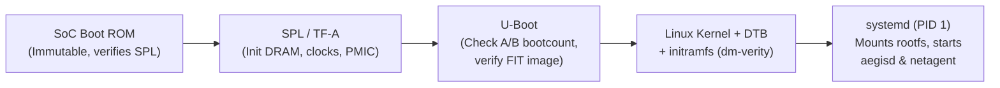

# 04. Embedded Linux, RTOS & Real-Time Systems

> **Interviewer đang đánh giá gì?** JD yêu cầu:
> - *"Experience developing, debugging, and shipping embedded software on Linux or RTOS platforms"*
> - *"Preferred: Experience with Linux-based embedded systems and real-time constraints"*
> - *"Consumer or professional hardware products with tight security, low latency, and high stability requirements"*
>
> Ở level Staff, bạn phải nối được từ **phần cứng bật nguồn (ROM → Bootloader → DTB → Kernel → systemd)** đến **lập lịch thời gian thực (`PREEMPT_RT`, `SCHED_FIFO`, priority inversion, `mlockall`)**, **cấu hình Yocto**, và giải thích rõ khi nào chọn **RTOS (FreeRTOS/Zephyr)** thay vì **Embedded Linux**.

Liên hệ dự án:
- AegisCam: [threading_and_realtime.md](../aegiscam/docs/architecture/threading_and_realtime.md), [ADR-0002: Lock-Free Pre-Event Buffer](../aegiscam/docs/adr/0002-lock-free-pre-event-buffer.md), [`deploy/systemd/aegisd.service`](../aegiscam/deploy/systemd/aegisd.service), [`deploy/yocto/meta-aegiscam/`](../aegiscam/deploy/yocto/meta-aegiscam/)
- MultiCamera: Jetson / Linux real-time pipeline, GStreamer pad probe < 50 µs
- eCall: Automotive TCU (Linux/AUTOSAR interaction, CAN wake-up, strict call setup latency)

---

## 1. Embedded Linux Boot Chain & Device Tree



### 1.1 Từng giai đoạn khởi động và lỗi thường gặp
1. **Boot ROM (Mask ROM trong SoC):** đọc boot mode pins (eMMC, QSPI NOR, USB recovery), nạp **First-Stage Bootloader (SPL / ARM Trusted Firmware - TF-A)** vào SRAM nội (vì DRAM chưa được khởi tạo!), xác thực chữ ký RSA/ECDSA của SPL bằng hash của public key đốt trong eFuse (Root of Trust).
2. **SPL / TF-A:** khởi tạo PMIC (nguồn), xung nhịp PLL, và **DRAM controller** (training DDR). Sau đó nạp **U-Boot** vào DRAM.
3. **U-Boot (Second-Stage Bootloader):**
   - Chạy logic chọn phân vùng **A/B (`bootcount`, `upgrade_available`)** — xem [ADR-0004](../aegiscam/docs/adr/0004-ab-ota-with-boot-counter-rollback.md).
   - Nạp **FIT Image (Flattened uImage Tree)** chứa Kernel + **Device Tree Blob (`.dtb`)** + `initramfs`, kiểm tra chữ ký cryptographic của cả gói trước khi nhảy vào kernel.
4. **Linux Kernel & Device Tree (`.dts` → `.dtb`):**
   - Trên ARM không có ACPI/PCI bus tự khám phá mọi phần cứng ngoại vi (I2C, SPI, MIPI-CSI camera sensor, GPIO button/holster, hardware watchdog). **Device Tree** mô tả địa chỉ thanh ghi, ngắt (IRQ), xung nhịp, pinmux và chuỗi `compatible = "vendor,chip"` để kernel khớp (match) với platform driver tương ứng.
5. **User space (`initramfs` → `systemd`):**
   - Thiết lập `dm-verity` cho read-only rootfs, mount phân vùng dữ liệu mã hoá (`/var/lib/aegis`), rồi khởi chạy `aegisd.service` và `netagent.service`.

### 1.2 Kernel Space vs User Space
- **Virtual Memory & MMU:** mỗi tiến trình user space có không gian địa chỉ ảo riêng; truy cập trái phép gây `SIGSEGV` chỉ làm chết tiến trình đó. Trong kernel space, một con trỏ null/hỏng gây **Kernel Oops / Panic** làm treo toàn bộ thiết bị.
- **System Call & Context Switch:** chuyển từ user → kernel qua lệnh `svc` (ARM64). Để truyền frame camera tốc độ cao mà không copy qua lại giữa kernel và user space, ta dùng **`mmap` / V4L2 `DMABUF`** (zero-copy chia sẻ buffer vật lý từ ISP/DMA sang user space).
- **Top-half vs Bottom-half Interrupts:**
  - **Hard IRQ (Top-half):** chạy với ngắt bị tắt trên core hiện tại, không được phép sleep/block; chỉ làm việc tối thiểu (đọc thanh ghi trạng thái, xoá cờ ngắt, đánh thức bottom-half).
  - **Bottom-half (Softirq, Tasklet, Workqueue, hoặc Threaded IRQ trong `PREEMPT_RT`):** xử lý phần nặng.

---

## 2. Real-Time Linux: `PREEMPT_RT`, Scheduling & Latency Determinism

### 2.1 Throughput vs Determinism (Real-Time là gì?)
> **Real-time không có nghĩa là "nhanh trung bình" (high average throughput); real-time có nghĩa là "độ trễ trường hợp xấu nhất có chặn trên xác định" (bounded worst-case latency / jitter).**

Trong body camera (`AegisCam`), ở 30 fps mỗi frame cách nhau **33.33 ms**. Nếu bộ đệm phần cứng V4L2 chỉ giữ 4 frame (~133 ms), bất kỳ lúc nào `capture` thread bị khựng > 133 ms (do kernel tắt preemption, page fault, hoặc disk flush), frame sẽ bị rớt — mất khoảnh khắc quan trọng của bằng chứng.

### 2.2 Bản vá `PREEMPT_RT` (nay đã hợp nhất vào mainline Linux 6.12+) làm gì?
Kernel Linux tiêu chuẩn (`CONFIG_PREEMPT_VOLUNTARY` hoặc `CONFIG_PREEMPT`) vẫn có những vùng không thể bị chiếm quyền (non-preemptible) kéo dài hàng chục ms: spinlock trong kernel, hard/soft IRQ handlers. `PREEMPT_RT` biến đổi 3 điểm cốt lõi:
1. **Sleeping Spinlocks:** hầu hết `spinlock_t` trong kernel được thay bằng **RT-mutex hỗ trợ Priority Inheritance (PI)**. Thay vì tắt preemption và quay vòng chờ (busy-wait), thread giữ lock có thể bị preempt, và nếu một RT thread ưu tiên cao cần lock đó, nó đẩy ưu tiên cho người đang giữ lock. (Chỉ `raw_spinlock_t` ở tầng scheduler/clock thấp nhất mới giữ hành vi tắt ngắt).
2. **Threaded IRQs (`force_irqthreads`):** biến các trình phục vụ ngắt thành các kernel thread có ưu tiên `SCHED_FIFO` (mặc định prio 50). Nhờ vậy, thread `capture` hoặc `supervisor` quan trọng của ta có thể được gán ưu tiên cao hơn các IRQ không quan trọng (như Ethernet/USB), hoặc ta chủ động nâng ưu tiên cho IRQ của camera CSI.
3. **High-Resolution Timers (`hrtimers`):** độ phân giải cấp micro-second thay vì phụ thuộc vào tick `HZ`.

### 2.3 Linux Scheduling Policies
| Policy | Loại | Cách hoạt động | Ứng dụng trong AegisCam |
|---|---|---|---|
| `SCHED_OTHER` (`SCHED_NORMAL`) | CFS / EEVDF (Time-sharing) | Chia sẻ công bằng theo trọng số `nice` (-20 đến +19). Bị mọi thread RT chiếm quyền ngay lập tức | `controller` thread (`nice 0`), `writer` thread (`nice 5`), `netagent` |
| `SCHED_FIFO` | Real-Time (prio 1..99) | Chạy cho đến khi tự block/sleep hoặc bị thread RT có prio cao hơn chiếm quyền. **Không có time slice** (nếu lặp vô hạn sẽ treo core!) | `supervisor` (prio 90), `capture` (prio 80) |
| `SCHED_RR` | Real-Time (prio 1..99) | Giống `SCHED_FIFO` nhưng các thread **cùng mức ưu tiên** chia nhau time quantum (mặc định 100 ms) | Khi có nhiều worker RT ngang hàng |
| `SCHED_DEADLINE` | Real-Time (EDF + CBS) | Lập lịch theo Earliest Deadline First với 3 tham số: `(runtime, deadline, period)` | Các tác vụ tuần hoàn có chu kỳ và thời gian chạy cố định |

> [!WARNING]
> **Bảo vệ hệ thống khỏi RT Runaway:** Nếu một thread `SCHED_FIFO` bị bug lặp vô hạn (`while(true){}` không sleep), các tiến trình `SCHED_OTHER` (bao gồm `sshd`, shell, systemd) trên core đó sẽ **chết đói hoàn toàn (starvation)**. Cách phòng vệ:
> 1. Thiết kế mọi vòng lặp `SCHED_FIFO` luôn block trên I/O có timeout (`poll` trên V4L2 fd) hoặc timer (`clock_nanosleep`).
> 2. Ghim (`CPUAffinity`) RT thread vào core riêng, giữ core 0 cho housekeeping/OS.
> 3. Có `WatchdogSupervisor` ở mức ưu tiên cao nhất (`SCHED_FIFO 90`) gắn với **Hardware Watchdog** (`/dev/watchdog`).

---

## 3. Priority Inversion & Priority Inheritance (Câu hỏi kinh điển)

### 3.1 Kịch bản kinh điển (Mars Pathfinder bug)
Giả sử có 3 thread:
- $T_{high}$ (`capture`, `SCHED_FIFO 80`)
- $T_{med}$ (nén log / xử lý mạng, `SCHED_FIFO 50`)
- $T_{low}$ (`controller`, `SCHED_OTHER`)

1. $T_{low}$ lấy mutex $M$.
2. $T_{high}$ thức dậy, cần mutex $M$ → phải block chờ $T_{low}$ nhả $M$.
3. Đúng lúc đó, $T_{med}$ (không hề dùng mutex $M$!) thức dậy. Vì $T_{med}$ có ưu tiên cao hơn $T_{low}$, $T_{med}$ **chiếm CPU của $T_{low}$**.
4. Hệ quả: $T_{low}$ không chạy được để nhả $M$ → **$T_{high}$ bị chặn gián tiếp bởi $T_{med}$ trong thời gian không giới hạn (Unbounded Priority Inversion)!**

### 3.2 Hai cách giải quyết trong AegisCam
1. **Cách tốt nhất — Loại bỏ hoàn toàn lock giữa RT và non-RT thread:**
   Trong AegisCam ([ADR-0002](../aegiscam/docs/adr/0002-lock-free-pre-event-buffer.md)), thread `capture` (`SCHED_FIFO 80`) đẩy frame vào **`SpscRingBuffer` lock-free** dùng `std::atomic` acquire/release. `capture` không bao giờ lấy bất kỳ mutex nào chung với `writer` hay `controller`. Không có mutex = không thể có priority inversion!
2. **Khi bắt buộc phải dùng mutex giữa các mức ưu tiên — Bật Priority Inheritance (`PTHREAD_PRIO_INHERIT`):**
   Khi $T_{high}$ block trên mutex $M$ đang do $T_{low}$ giữ, kernel **tạm thời nâng mức ưu tiên của $T_{low}$ lên bằng $T_{high}$ (80)** cho đến khi $T_{low}$ gọi `pthread_mutex_unlock(&M)`. Nhờ vậy $T_{med}$ (50) không thể chen ngang.

```cpp
pthread_mutexattr_t attr;
pthread_mutexattr_init(&attr);
pthread_mutexattr_setprotocol(&attr, PTHREAD_PRIO_INHERIT);
pthread_mutex_init(&mtx, &attr);
pthread_mutexattr_destroy(&attr);
```
*(Lưu ý: `std::mutex` mặc định của C++ trên glibc không bật `PTHREAD_PRIO_INHERIT`; trên RT path nếu cần lock phải bọc `pthread_mutex_t` với `PTHREAD_PRIO_INHERIT` trong một class RAII).*

---

## 4. Checklist 6 bước cho một Real-Time Thread trên Linux

Nếu interviewer hỏi *"How do you write a deterministic real-time thread in Embedded Linux?"*, hãy trả lời đủ 6 điểm sau (trình bày chi tiết trong [`threading_and_realtime.md`](../aegiscam/docs/architecture/threading_and_realtime.md)):

1. **Lock memory (`mlockall(MCL_CURRENT | MCL_FUTURE)`):** ngăn kernel swap hoặc reclaim các trang nhớ của tiến trình. Một major page fault đọc từ eMMC/flash tốn **1–10 ms**, phá vỡ hoàn toàn cam kết real-time.
2. **Pre-fault stack & pre-allocate heap:** ngay sau `mlockall`, cấp phát toàn bộ `SpscRingBuffer` và chạm vào một mảng trên stack của RT thread (ví dụ 64 KB) để MMU tạo sẵn bảng trang (page tables) **trước khi** bước vào vòng lặp thời gian thực (tránh minor page fault).
3. **Zero dynamic allocation trên hot path:** không `new`/`malloc`, không `std::vector::push_back` gây cấp phát lại, không `std::function` vượt ngưỡng SSO.
4. **No blocking I/O & No contended locks:** không ghi file/log đồng bộ trên `capture` thread (`fsync` trên eMMC có thể tốn **20–100 ms** khi flash controller chạy garbage collection!). Đẩy qua SPSC ring sang `writer` thread.
5. **CPU Isolation & IRQ Affinity (`isolcpus`, `taskset`, `/proc/irq/*/smp_affinity`):** trên SoC 4 nhân (Core 0..3), dành riêng Core 3 cho `capture` thread; chuyển các ngắt mạng/lưu trữ sang Core 0..1.
6. **Đo kiểm định lượng bằng `cyclictest` dưới tải thật (`stress-ng`):**
   ```bash
   # Chạy tải I/O + CPU + mạng ở nền, đo độ trễ đánh thức RT thread:
   cyclictest --smp -p 80 -m -i 200 -d 0 -D 4h --histogram=500
   ```
   Quan tâm đến cột **`Max` latency** (ví dụ < 80 µs trên `PREEMPT_RT`), không bao giờ chỉ nhìn cột `Avg`!

---

## 5. RTOS Fundamentals (FreeRTOS / Zephyr) & Khi nào dùng Linux vs RTOS?

### 5.1 Các nguyên lý cốt lõi của RTOS
Nhiều thiết bị như body camera có **kiến trúc lai (Heterogeneous / AMP)**: một SoC Cortex-A chạy Linux (hoặc chỉ bật khi ghi hình/upload) đi kèm một **MCU Cortex-M siêu tiết kiệm điện chạy FreeRTOS/Zephyr** (luôn bật để quét nút bấm, cảm biến bao súng Hall-effect, BLE beacon, quản lý sạc pin).
- **Tasks & Scheduler:** Preemptive priority-based scheduler với tick cố định hoặc tickless idle (tiết kiệm pin). Task trạng thái: `Running`, `Ready`, `Blocked`, `Suspended`.
- **ISR (Interrupt Service Routine) Rules:**
  - Trong ISR **không bao giờ được gọi API có thể block**.
  - Trong FreeRTOS, phải dùng các hàm hậu tố **`...FromISR`** (ví dụ `xQueueSendFromISR(q, &item, &xHigherPriorityTaskWoken)` followed by `portYIELD_FROM_ISR(xHigherPriorityTaskWoken)`).
- **IPC & Sync trong RTOS:**
  - **Queue:** copy dữ liệu theo giá trị (by value) để an toàn lifetime giữa ISR và Task, hoặc truyền con trỏ tới vùng nhớ trong static pool.
  - **Binary Semaphore / Direct Task Notification:** dùng để **đánh thức task từ ISR** (signaling). *Không* có cơ chế Priority Inheritance.
  - **Mutex:** dùng cho **mutual exclusion** bảo vệ tài nguyên dùng chung giữa các task; **có Priority Inheritance** (không dùng được trong ISR!).
- **Quản lý bộ nhớ RTOS:** tránh `malloc`/`free` chuẩn vì phân mảnh heap (heap fragmentation) trên RAM vài chục KB; dùng static allocation (`xTaskCreateStatic`, `xQueueCreateStatic`) hoặc fixed-size block pool.

### 5.2 Bảng so sánh chọn kiến trúc: RTOS vs Embedded Linux
| Tiêu chí | Bare-metal / RTOS (FreeRTOS, Zephyr) | Embedded Linux (+ `PREEMPT_RT`) |
|---|---|---|
| **Thời gian khởi động (Cold boot)** | **< 10–50 ms** (ghi hình/bắt sự kiện gần như tức thì) | 2–15 giây (cần chế độ standby/pre-event để bù) |
| **Công suất tiêu thụ (Power)** | µW – vài mW (deep sleep / tickless idle) | Hàng trăm mW – vài W |
| **Độ trễ ngắt (IRQ latency)** | **< 1–5 µs** (deterministic tuyệt đối) | ~20–100 µs (với `PREEMPT_RT`) |
| **RAM / Flash tối thiểu** | 32 KB RAM / 128 KB Flash | ≥ 64–256 MB RAM / ≥ 64 MB Flash |
| **Hệ sinh thái (Network, Video, AI, Crypto)** | Hạn chế (lwIP, mbedTLS, ít driver phức tạp) | **Khổng lồ** (V4L2, GStreamer, WireGuard, Go, TensorRT/DeepStream) |
| **Cô lập lỗi (Fault Isolation)** | Kém (thường không có MMU; 1 task ghi đè bộ nhớ làm sập toàn hệ thống; có thể dùng MPU giới hạn) | **Mạnh** (MMU bảo vệ từng process, namespaces, cgroups, systemd restart) |

---

## 6. Yocto Project & Hardened systemd trong AegisCam

Xem [`deploy/yocto/meta-aegiscam/`](../aegiscam/deploy/yocto/meta-aegiscam/) và [`deploy/systemd/aegisd.service`](../aegiscam/deploy/systemd/aegisd.service):
- **Vì sao dùng Yocto thay vì Ubuntu/Debian cho sản phẩm thương mại?**
  - Kiểm soát từng package đưa vào rootfs (minimal attack surface, image < 50 MB).
  - Read-only rootfs (`IMAGE_FEATURES += "read-only-rootfs"`) kết hợp `dm-verity` và phân vùng A/B (RAUC/SWUpdate/custom slot manager).
  - Tự động xuất **SBOM (SPDX)**, kiểm tra license (chặn GPLv3 nếu chính sách yêu cầu) và quét CVE (`cve-check.bbclass`) ngay trong lúc build.
- **Một BitBake recipe chuẩn (`aegisd_1.0.bb`) gồm gì?**
  - `LICENSE`, `LIC_FILES_CHKSUM`, `SRC_URI`, `SRCREV` (ghim đúng commit hash, không dùng floating tag!).
  - `DEPENDS` (build-time, ví dụ `systemd`) vs `RDEPENDS:${PN}` (run-time).
  - `inherit cmake systemd` để tự động cross-compile với toolchain của Yocto và cài đặt unit file.
- **Hardened systemd unit (`aegisd.service`):**
  - `CPUSchedulingPolicy=fifo`, `CPUSchedulingPriority=80`, `LimitMEMLOCK=infinity`.
  - `Restart=always`, `RestartSec=1`, `WatchdogSec=5s`.
  - Bảo mật tối đa: `NoNewPrivileges=yes`, `ProtectSystem=strict`, `ProtectHome=yes`, `PrivateTmp=yes`, `ReadWritePaths=/var/lib/aegis /run/aegis`, `RestrictAddressFamilies=AF_UNIX` (daemon `aegisd` **không hề có quyền mở socket mạng AF_INET** — mọi kết nối mạng phải đi qua `netagent`!).
