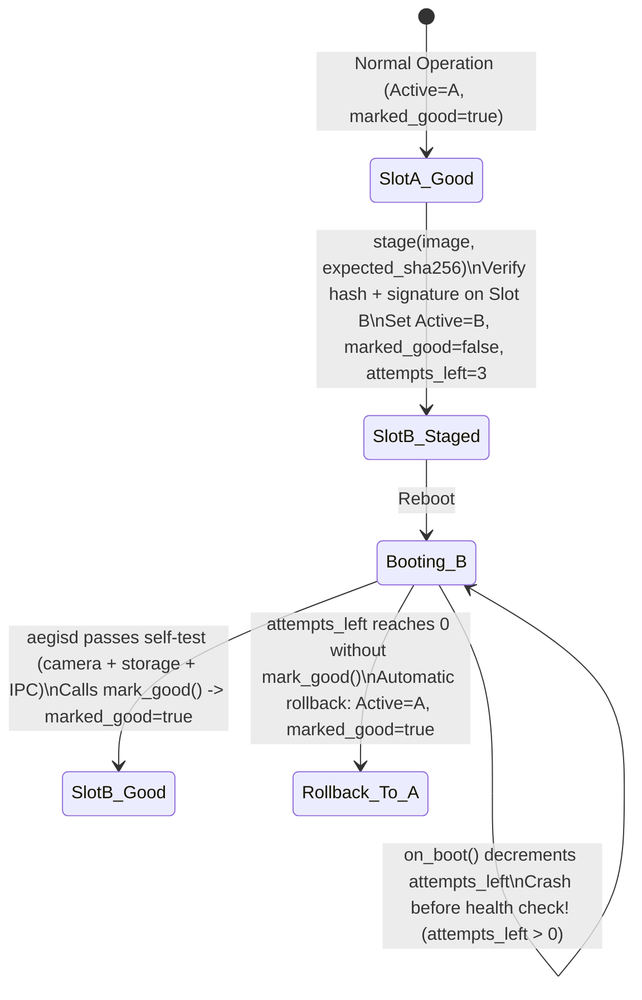

# 05. Debugging, Crash Triage & Shipping in the Field

> **Interviewer đang đánh giá gì?** Từ khoá quan trọng nhất trong JD là **"shipping"**: *"Experience developing, debugging, and shipping embedded software on Linux or RTOS platforms"*.
>
> Viết code chạy trên bàn làm việc chỉ là 30% công việc. 70% giá trị của một Staff Embedded Engineer nằm ở:
> 1. Thiết bị ngoài hiện trường (trên ngực cảnh sát hoặc trong xe tuần tra ở nhiệt độ -20°C đến +60°C) bị treo, mất nguồn đột ngột, hoặc rò rỉ bộ nhớ sau 14 ngày — bạn chẩn đoán thế nào khi không có IDE gắn vào?
> 2. Làm sao cập nhật firmware (OTA) cho 50,000 thiết bị mà **không bao giờ biến thiết bị thành cục gạch (brick)**?
> 3. Bạn có những câu chuyện thực chiến (war stories) nào chứng minh bạn đã từng chịu trách nhiệm cho sản phẩm chạy thật?

Liên hệ dự án:
- AegisCam: [`watchdog_supervisor.h`](../aegiscam/core/include/aegis/health/watchdog_supervisor.h), [`ab_slot_manager.h`](../aegiscam/core/include/aegis/ota/ab_slot_manager.h), [`segment_writer.h`](../aegiscam/core/include/aegis/evidence/segment_writer.h), [ADR-0003](../aegiscam/docs/adr/0003-segment-based-evidence-with-hash-chain.md), [ADR-0004](../aegiscam/docs/adr/0004-ab-ota-with-boot-counter-rollback.md), [`operational_readiness.md`](../aegiscam/docs/process/operational_readiness.md)
- MultiCamera: Watchdog, EOS isolation, PTS liveness monitor, 4-phase graceful shutdown
- eCall: Field defect triage, CAN wake-up race condition, retry under poor cellular coverage

---

## 1. Hộp công cụ Debugging trên Embedded Linux

| Triệu chứng | Công cụ hàng đầu | Lệnh thực tế & Ý nghĩa |
|---|---|---|
| **Crash (`SIGSEGV`, `SIGABRT`, `SIGBUS`)** | `coredumpctl` / `gdb-multiarch` / `addr2line` | `gdb-multiarch ./aegisd.debug core.dump` → `bt full`, `info threads`, `thread apply all bt` |
| **Deadlock / Hang (tiến trình sống nhưng đơ)** | `gdb` attach hoặc `SIGQUIT` / `/proc/<pid>/task/*/stack` | `cat /proc/$(pidof aegisd)/task/*/stack` (xem thread đang kẹt ở syscall nào trong kernel mà không cần cài gdb trên target!) |
| **Memory corruption / Use-after-free / Overflow** | **ASan + UBSan** (`-fsanitize=address,undefined`) | Bắt ngay tại dòng đọc/ghi sai với shadow memory (~2× RAM overhead, chạy trong CI/soak test) |
| **Data race / Lock order inversion (Deadlock tiềm ẩn)** | **TSan** (`-fsanitize=thread`) / `go test -race` | Phát hiện cả 2 thread truy cập không đồng bộ và cảnh báo **lock-order-inversion** trước khi deadlock thật xảy ra |
| **Memory leak chạy nhiều ngày** | Heaptrack / Valgrind `massif` / ASan `LSan` / `/proc/<pid>/smaps_rollup` | Theo dõi `Rss` và `Pss` theo thời gian; phân biệt heap leak vs page cache (page cache do kernel giữ sẽ tự trả khi cần) |
| **Hiệu năng CPU cao / Cache miss** | `perf` | `perf record -F 99 -p $(pidof aegisd) -g -- sleep 30` → `perf report` / FlameGraph |
| **Latency spike / Jitter trên RT thread** | `ftrace` / `trace-cmd` / `rtla` / `eBPF` | `trace-cmd record -e sched:sched_switch -e sched:sched_wakeup` để xem ai đã chiếm CPU của `capture` thread |
| **Lỗi tương tác syscall / file / quyền hạn** | `strace` | `strace -f -tt -T -p <pid>` (`-tt` in microsecond timestamp, `-T` in thời gian tốn trong mỗi syscall — **cẩn thận:** `strace` dùng `ptrace` làm chậm tiến trình rất nhiều, không gắn vào RT path đang chạy thật!) |
| **Lỗi driver, OOM killer, I/O error, Watchdog** | `dmesg -T` / `journalctl -k` / `pstore` | Kiểm tra `Out of memory: Killed process`, lỗi I2C/V4L2 timeout, hoặc `/sys/fs/pstore` sau khi máy tự khởi động lại do kernel panic |

### 1.1 Quy trình giải mã Crash từ Hiện trường (Stripped Binary + Debug Symbols)
Trên thiết bị thực tế, binary `/usr/bin/aegisd` đã bị **strip** để tiết kiệm flash và bảo mật, nhưng được biên dịch với **`-Wl,--build-id=sha1`**.
1. **Trong CI khi phát hành:**
   - Biên dịch với `-O2 -g`.
   - Tách debug symbols ra file riêng: `aarch64-linux-gnu-objcopy --only-keep-debug aegisd aegisd.debug`
   - Strip binary chính: `aarch64-linux-gnu-strip --strip-debug --strip-unneeded aegisd`
   - Gắn link debug: `aarch64-linux-gnu-objcopy --add-gnu-debuglink=aegisd.debug aegisd`
   - Lưu `aegisd.debug` vào kho lưu trữ artifact theo `Build-ID`.
2. **Trên thiết bị khi crash:**
   - Thay vì gửi toàn bộ core dump 100 MB qua LTE tốn kém, một crash handler nhẹ (như Google Breakpad/Crashpad hoặc `systemd-coredump` hook) thu thập **minidump**: thanh ghi CPU (`PC`, `LR`, `SP`), vùng stack của các thread, `/proc/self/maps` (để biết địa chỉ nạp ASLR), và `Build-ID`.
3. **Trên máy kỹ sư:**
   - Khớp `Build-ID` lấy đúng `aegisd.debug`.
   - Dùng `aarch64-linux-gnu-addr2line -e aegisd.debug -f -C -p 0x402a1c` (trừ đi base address từ `/proc/<pid>/maps` nếu là PIE binary!) hoặc mở minidump trong `gdb-multiarch` để thấy chính xác file `.cpp`, số dòng và giá trị biến.

---

## 2. Thiết kế cho sự cố thực địa (Designing for the Bad Day)

### 2.1 Hardware Watchdog & Per-Thread Heartbeats (`WatchdogSupervisor`)
> **Sai lầm phổ biến của kỹ sư junior:** Viết một thread riêng chỉ làm mỗi việc `while (true) { write(wd_fd, "1", 1); sleep(1); }`.
> **Tại sao sai?** Nếu `capture` thread bị deadlock hoặc `writer` thread bị treo vĩnh viễn trên eMMC bị lỗi, cái thread "đá watchdog" kia vẫn chạy đều đặn → hardware watchdog tưởng hệ thống khoẻ mạnh và **không bao giờ reset thiết bị**! Camera trông như đang bật nhưng thực chất đã ngừng ghi hình.

**Thiết kế chuẩn Staff trong AegisCam ([`watchdog_supervisor.h`](../aegiscam/core/include/aegis/health/watchdog_supervisor.h)):**
- Mỗi worker thread quan trọng (`capture`, `controller`, `writer`) đăng ký một slot nhịp tim với **deadline riêng** (ví dụ `capture`: 500 ms, `writer`: 5000 ms).
- Ở mỗi vòng lặp xử lý thực sự, worker gọi `supervisor.beat("capture")` (atomic store `clock.now_ms()`).
- `WatchdogSupervisor` chạy ở ưu tiên cao nhất (`SCHED_FIFO 90`), kiểm tra định kỳ: **chỉ khi TẤT CẢ các thread đã đăng ký đều có `now - last_beat <= deadline`**, nó mới gọi `IWatchdogHal::kick()` xuống `/dev/watchdog`.
- Nếu bất kỳ thread nào quá hạn (livelock/deadlock), `WatchdogSupervisor` ghi một bản ghi cuối cùng vào `audit.log` (nếu có thể, non-blocking) với tên thread bị treo và **ngừng đá hardware watchdog** → phần cứng SoC tự động reset thiết bị để phục hồi dịch vụ.

### 2.2 Power-Loss Safe Storage: Chống hỏng dữ liệu khi rớt pin
Trên body camera, pin có thể bị văng ra trong lúc xô xát hoặc xe tắt máy đột ngột. Nếu ghi toàn bộ buổi tuần tra 2 tiếng vào 1 file MP4 duy nhất (nơi bảng index `moov` atom thường nằm ở cuối file), mất nguồn ở phút 119 sẽ làm **hỏng toàn bộ 2 tiếng video**.

**Giải pháp trong AegisCam ([ADR-0003](../aegiscam/docs/adr/0003-segment-based-evidence-with-hash-chain.md), [`segment_writer.cpp`](../aegiscam/core/src/evidence/segment_writer.cpp)):**
1. **Chia nhỏ theo Segment (ví dụ 10 giây / segment):** mất nguồn đột ngột tối đa chỉ ảnh hưởng đến vài giây đang trên RAM của segment hiện tại; toàn bộ các segment trước đó đã được niêm phong an toàn trên đĩa.
2. **Quy trình ghi nguyên tử (Write-Temp → `fsync` file → Atomic `rename` → `fsync` parent dir):**
   ```
   1. open("seg_000003.bin.tmp", O_WRONLY | O_CREAT | O_TRUNC, 0600)
   2. write(...) toàn bộ dữ liệu segment (đồng thời cập nhật SHA-256 streaming)
   3. fsync(fd)          <-- Đảm bảo dữ liệu nằm trên flash vật lý, không nằm ở page cache!
   4. close(fd)
   5. rename("seg_000003.bin.tmp", "seg_000003.bin") <-- Atomic theo chuẩn POSIX trên cùng filesystem
   6. fsync(dir_fd)      <-- Đảm bảo directory entry mới đã được commit vào journal
   ```
3. **Khôi phục khi khởi động lại (Crash Recovery on Boot):**
   Khi `aegisd` bật lên, nó quét thư mục `incidents/`:
   - Mọi file đuôi `.tmp` (ghi dở lúc mất điện) được xoá sạch và ghi nhận vào `audit.log`.
   - Mọi incident chưa có `"sealed": true` trong `manifest.json` được kiểm tra lại chuỗi băm các segment hiện có, niêm phong (`recovery_sealed`) để `netagent` vẫn upload được trọn vẹn các segment trước lúc mất điện.

---

## 3. A/B OTA Updates, Boot-Counter Rollback & Staged Rollout

### 3.1 Máy trạng thái A/B OTA ([ADR-0004](../aegiscam/docs/adr/0004-ab-ota-with-boot-counter-rollback.md), [`ab_slot_manager.h`](../aegiscam/core/include/aegis/ota/ab_slot_manager.h))



**Tại sao không đánh dấu `mark_good()` ngay khi Linux vừa boot lên tới shell?**
> Vì kernel boot thành công không có nghĩa là ứng dụng chạy được! Có thể bản cập nhật mới làm hỏng thư viện crypto hoặc driver camera khiến `aegisd` crash lặp đi lặp lại mỗi 2 giây.
> Trong AegisCam, `mark_good()` **chỉ được gọi sau khi** `aegisd` đã khởi tạo xong HAL camera, mở được kho lưu trữ bằng chứng, xác minh chữ ký và chạy ổn định qua chu kỳ kiểm tra sức khoẻ đầu tiên. Nếu `aegisd` crash 3 lần liên tiếp (hoặc hardware watchdog reset máy 3 lần), `boot_attempts_left` về `0` và hệ thống tự động quay về Slot A.

### 3.2 Chiến lược triển khai ra đội thiết bị lớn (Staged Fleet Rollout)
Khi ship firmware cho 100,000 camera, ngay cả khi qua hết CI + HIL, vẫn có những lỗi chỉ xuất hiện ở 0.1% phần cứng (ví dụ một lô chip nhớ eMMC từ nhà cung cấp phụ có timing hơi khác ở nhiệt độ thấp).
1. **Ring 0 (Internal Dogfood / Lab Soak — 50 máy, 48h):** chạy tải liên tục.
2. **Ring 1 (Canary — 0.5% đội máy, chọn phân bố đều theo hardware revision & khu vực, 72h).**
3. **Ring 2 (5% → 25% → 100%).**
4. **Automated Rollback Gate (Phanh tự động trên Cloud):** nếu tỷ lệ `ota_rollback_count`, `watchdog_reset_rate`, hoặc `recording_drop_rate` của nhóm Canary vượt ngưỡng baseline (ví dụ tăng > 0.2%), hệ thống triển khai tự động **tạm dừng (halt rollout)** ngay lập tức trước khi lan ra toàn đội.

---

## 4. Ba câu chuyện thực chiến (STAR War Stories) cho vòng Debugging/Shipping

### Story 1: eCall — Xử lý lỗi thực địa khi cuộc gọi khẩn cấp bị kẹt ở vùng sóng yếu (Production)
- **Situation:** Trong dự án Telematics Control Unit (TCU) ô tô, mình là **Function Owner của tính năng eCall**. Trong quá trình thử nghiệm thực địa (field testing) ở khu vực hầm/vùng sóng yếu, đội QA báo cáo một lỗi nghiêm trọng: khi xe kích hoạt eCall lúc đang mất sóng rồi di chuyển ra vùng có sóng trở lại, khoảng ~5% trường hợp TCU không quay số lại được mà kẹt ở trạng thái chờ modem.
- **Task:** Vì eCall là tính năng an toàn sinh mạng (safety-critical), yêu cầu bắt buộc là tỷ lệ phục hồi kết nối khi có sóng lại phải đạt 100% trong khung thời gian quy định. Mình chịu trách nhiệm tìm nguyên nhân gốc rễ và đưa ra bản sửa an toàn.
- **Action:**
  1. Mình phân tích log DLT/CAN trace và nhận thấy một **race condition trong state machine giao tiếp với modem**: khi mạng rớt đúng lúc lệnh AT/dial đang chờ phản hồi, modem trả về sự kiện bất đồng bộ (`URC` - Unsolicited Result Code) gần như đồng thời với lúc timer retry của ứng dụng hết hạn.
  2. Code cũ xử lý sự kiện từ nhiều callback trực tiếp trên các thread khác nhau với cờ boolean rời rạc, dẫn đến trạng thái chuyển sang `DIALING` nhưng lệnh thực tế bị modem từ chối vì phiên trước chưa dọn xong.
  3. Mình thiết kế lại luồng điều khiển theo mô hình **Event-Driven State Machine tuần tự hoá qua một hàng đợi sự kiện duy nhất**, bổ sung trạng thái trung gian `ABORTING_PREV_SESSION` có timeout bảo vệ rõ ràng và cơ chế exponential retry.
  4. Để chứng minh lỗi đã hết và không tái phát, mình viết bộ test giả lập modem bơm đúng trình tự sự kiện trùng nhau (fault injection) ở biên timeout.
- **Result:** Triệt tiêu hoàn toàn lỗi kẹt trạng thái trong hơn 1,000 lần chạy thử nghiệm mô phỏng mất sóng liên tục, vượt qua kỳ audit ASPICE và đưa vào bản release sản xuất đúng hạn.

### Story 2: MultiCamera — Cô lập lỗi rớt 1 luồng RTSP không làm đứng toàn bộ 4 camera trên Jetson
- **Situation:** Trên hệ thống **MultiCamera DeepStream** chạy trên NVIDIA Jetson xử lý 4 luồng camera thời gian thực, khi 1 camera IP bị rút dây mạng hoặc gửi gói tin lỗi (EOS / stall), pipeline GStreamer mặc định truyền sự kiện EOS/Error lan ra `nvstreammux`, làm đứng hình cả 3 camera còn lại đang hoạt động tốt.
- **Task:** Thiết kế cơ chế tự phục hồi (self-healing) sao cho lỗi ở 1 nguồn camera hoàn toàn bị cô lập, các camera khác không rớt một frame nào, và camera lỗi tự động kết nối lại khi có tín hiệu.
- **Action:**
  1. Đặt **pad probe** ở từng nhánh source bin để chặn (drop) sự kiện EOS cục bộ không cho chảy xuống `nvstreammux`, đồng thời ghi nhận timestamp `PTS` cuối cùng của mỗi nguồn bằng biến atomic.
  2. Xây dựng một **Liveness / Watchdog thread** kiểm tra độ tươi của từng nguồn mỗi giây. Khi phát hiện một nguồn không có frame mới quá ngưỡng, nó phát sự kiện lên `EventBus` có giới hạn (bounded queue) để tháo rời riêng nhánh `source_bin` đó, chuyển về `GST_STATE_NULL` và khởi tạo lại với backoff mà không chạm vào pipeline chính.
  3. Thiết kế quy trình **4-phase graceful shutdown** để khi tắt dịch vụ không bao giờ bị deadlock giữa GStreamer streaming thread và main loop.
- **Result:** Hệ thống chạy soak test liên tục nhiều giờ với bài test rút/cắm cáp mạng ngẫu nhiên mà 3 luồng còn lại vẫn giữ nguyên 30 fps ổn định, không rò rỉ file descriptor hay GPU buffer.

### Story 3: AegisCam — Phát hiện bug Priority Inversion / Blocking I/O trên đường thu nhận video
- **Situation:** Khi thiết kế **AegisCam**, mục tiêu đầu tiên là đảm bảo độ trễ từ lúc bấm nút/rút súng đến lúc ghi hình **< 100 ms** và không rớt frame trong bộ đệm pre-event 30 giây, kể cả khi thẻ nhớ/eMMC đang bận ghi segment xuống đĩa.
- **Task:** Đảm bảo đường thu nhận (`capture` thread) hoàn toàn tách biệt khỏi độ trễ biến thiên của hệ thống file và mạng.
- **Action:**
  1. Thay vì dùng `std::mutex` + `std::deque` giữa `capture` và `writer` (nơi `writer` có thể bị khựng lúc `fsync` hoặc cấp phát bộ nhớ trong khi liên đới tới lock), mình thiết kế **`SpscRingBuffer` lock-free** cấp phát tĩnh lũy thừa của 2, căn lề cache line `alignas(64)`, dùng `memory_order_acquire`/`release`.
  2. Trong `PreEventBuffer`, mình phát hiện một lỗi tinh tế khi cắt vòng bộ đệm: nếu chỉ xoá các frame cũ hơn 30 giây theo thời gian tuyệt đối, frame đầu tiên còn lại có thể là **P-frame (delta frame)** chứ không phải **I-frame (keyframe)** — làm trình giải mã không mở được những giây đầu tiên của bằng chứng! Mình sửa thuật toán cắt (`evict_old`) và xả (`drain_from_keyframe`) để luôn lùi về hoặc bắt đầu từ **keyframe** hợp lệ gần nhất.
- **Result:** Toàn bộ đường `capture` đạt O(1), zero heap allocation, chạy sạch dưới cả `ASan/UBSan` và `TSan`, và mọi segment xuất ra đều bắt đầu chuẩn xác từ keyframe.
