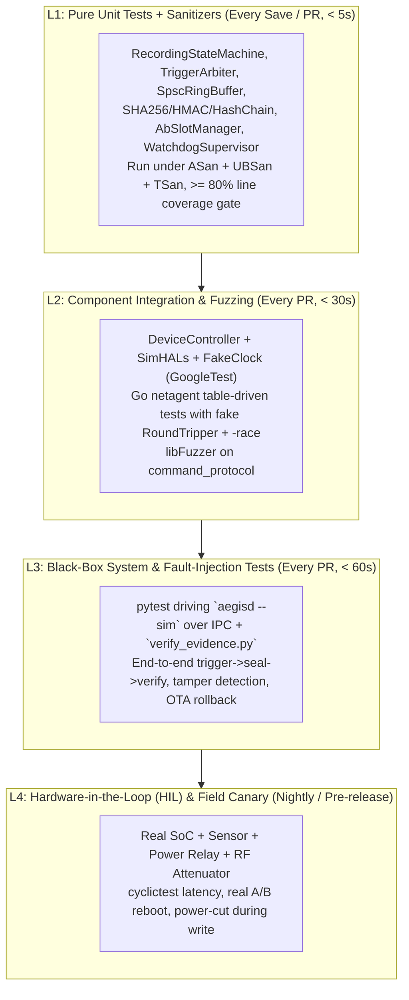

# 06. Testing Strategy for Mission-Critical Embedded Systems

> **Interviewer đang đánh giá gì?** JD nhấn mạnh 2 lần:
> - *"Write well-tested, maintainable code and lead technical design and code reviews that elevate the team's engineering standards"*
> - *"Proven track record of building well-tested software across unit, integration, and system testing levels"*
>
> Câu hỏi phân loại ứng viên Senior và Staff trong mảng nhúng là: **"How do you test embedded software rapidly and deterministically without waiting for real hardware in the loop for every commit?"** Nếu câu trả lời là *"chúng em flash lên board rồi bấm nút xem log"*, bạn trượt level Staff. Nếu câu trả lời là **"Hexagonal/HAL architecture + Dependency Injection + FakeClock + Fault Injection + Sanitizers/Fuzzing trong CI mỗi PR, kết hợp HIL nightly"**, bạn ghi điểm tuyệt đối.

Liên hệ dự án:
- AegisCam: [ADR-0001: HAL and Dependency Injection](../aegiscam/docs/adr/0001-hal-and-dependency-injection.md), [`core/include/aegis/hal/`](../aegiscam/core/include/aegis/hal/), [`core/hal/sim/`](../aegiscam/core/hal/sim/), [`core/tests/unit/`](../aegiscam/core/tests/unit/), [`core/tests/integration/`](../aegiscam/core/tests/integration/), [`core/fuzz/fuzz_command_protocol.cpp`](../aegiscam/core/fuzz/fuzz_command_protocol.cpp), [`tests/system/test_end_to_end.py`](../aegiscam/tests/system/test_end_to_end.py)
- MultiCamera: [`../include/hal/`](../include/hal/), [`../tests/`](../tests/)

---

## 1. Kim tự tháp kiểm thử nhúng (The Embedded Test Pyramid)



| Tầng | Tỷ lệ | Chạy ở đâu? | Mục tiêu bắt lỗi |
|---|---|---|---|
| **L1: Unit Tests** | ~70% | Laptop / CI container (x86_64) | Logic thuật toán, biên state machine, memory safety, race condition trong cấu trúc dữ liệu |
| **L2: Integration & Fuzz** | ~20% | Laptop / CI container (x86_64) | Phối hợp nhiều module (`DeviceController` + `EvidenceStore` + `SimStorageHal`), parser IPC chống dữ liệu rác |
| **L3: System Simulation** | ~8% | CI container (`pytest` + `aegisd --sim`) | Quy trình đầu-cuối từ CLI/socket đến file `manifest.json` trên đĩa và công cụ kiểm định độc lập `verify_evidence.py` |
| **L4: HIL (Hardware-in-the-Loop)** | ~2% | Rack thiết bị thật (ARM target) | Device Tree, driver V4L2/DMA thật, ngắt nguồn vật lý bằng rơ-le, đo dòng điện, đo `cyclictest` dưới nhiệt độ cao |

---

## 2. Kiến trúc để Code Nhúng Test được 100% trên Laptop

### 2.1 Nguyên tắc #1: Tách Logic Thuần (Pure Core) khỏi I/O
Hãy nhìn [`RecordingStateMachine`](../aegiscam/core/include/aegis/recording/recording_state_machine.h) trong AegisCam:
- Nó **không biết** camera là gì, đĩa cứng là gì, hay thread là gì.
- Đầu vào: `State` hiện tại + `Event` (`PowerOn`, `Trigger`, `Stop`, `Tick`, `StorageFull`, `FaultCleared`).
- Đầu ra: `TransitionResult` chứa `new_state` + danh sách các `Action` (`StartBuffering`, `FlushPreEventToIncident`, `SealIncident`, `EnterFault`, ...).
- **Lợi ích:** Ta có thể viết 20 unit test kiểm tra mọi tổ hợp chuyển trạng thái (bao gồm `PostRecord` 5 giây được tái kích hoạt giữa chừng bởi một `Trigger` mới!) chạy xong trong **1 mili-giây** mà không cần khởi tạo bất kỳ mock phức tạp nào.

### 2.2 Nguyên tắc #2: HAL Interfaces & Constructor Dependency Injection ([ADR-0001](../aegiscam/docs/adr/0001-hal-and-dependency-injection.md))
Mọi tương tác với thế giới bên ngoài đều đi qua 5 giao diện trừu tượng mỏng (`core/include/aegis/hal/`):
1. `ICameraHal`: `next_frame(Frame& out)`
2. `IStorageHal`: `write_file_atomic(...)`, `read_file(...)`, `append_line(...)`, `free_bytes()`
3. `IWatchdogHal`: `kick()`, `timeout_ms()`
4. `IKeyStoreHal`: `device_hmac_key()`
5. `IBootControlHal`: `active_slot()`, `set_active_slot()`, `boot_attempts_left()`, `marked_good()`

`DeviceController` nhận các giao diện này qua constructor (`Deps` struct).
- Khi chạy thật (`aegisd` prod): tiêm `LinuxCameraHal`, `PosixStorageHal`, `SysfsWatchdogHal`, `TpmKeyStoreHal`.
- Khi chạy test/sim (`aegisd --sim`): tiêm `SimCameraHal`, `SimStorageHal`, `SimWatchdogHal`, `SimKeyStoreHal`, `SimBootControlHal`.

### 2.3 Nguyên tắc #3: Làm chủ Thời gian bằng `IClock` & `FakeClock`
> **Tại sao `sleep()` trong unit test là một "code smell" nghiêm trọng?**
> Nếu bạn muốn test: *"Pre-event buffer giữ đúng 30 giây, ghi hình 25 giây, sau đó PostRecord giữ thêm 5 giây trước khi đóng"*, dùng đồng hồ thật (`std::this_thread::sleep_for`) sẽ khiến **1 test tốn 60 giây** và cực kỳ **flaky** khi máy CI bị quá tải CPU!

Trong AegisCam ([`clock.h`](../aegiscam/core/include/aegis/common/clock.h)):
```cpp
class IClock {
 public:
  virtual ~IClock() = default;
  virtual int64_t now_ms() const noexcept = 0;
};

class FakeClock : public IClock {
 public:
  explicit FakeClock(int64_t initial_ms = 1'700'000'000'000LL) noexcept : now_(initial_ms) {}
  int64_t now_ms() const noexcept override { return now_.load(std::memory_order_relaxed); }
  void advance(int64_t delta_ms) noexcept { now_.fetch_add(delta_ms, std::memory_order_relaxed); }
 private:
  std::atomic<int64_t> now_;
};
```
Mọi thành phần có yếu tố thời gian (`TriggerArbiter` debounce 50 ms, `PreEventBuffer` 30,000 ms, `RecordingStateMachine` post-record 5,000 ms, `WatchdogSupervisor` deadline) đều đọc `clock_.now_ms()`.
Trong test, gọi `clock.advance(30'000)` dịch chuyển thời gian 30 giây **trong 10 nano-giây** với độ chính xác tuyệt đối 100%!

---

## 3. Fakes vs Mocks vs Stubs — Khi nào dùng cái gì?

Nhiều kỹ sư lạm dụng mocking framework (`gMock`) cho mọi thứ, dẫn đến những bài test giòn (brittle tests): đổi thứ tự gọi hàm nội bộ dù kết quả đúng vẫn làm gãy 50 bài test.

| Loại Test Double | Bản chất | Khi nào nên dùng trong Embedded? | Ví dụ trong AegisCam |
|---|---|---|---|
| **Stub** | Trả về giá trị cố định được cấu hình sẵn | Khi chỉ cần ép một nhánh điều kiện đơn giản | `StubStorageHal` trả về `free_bytes() = 0` để test nhánh `StorageFull` |
| **Mock** | Kiểm tra hành vi (interaction verification: hàm X có được gọi đúng 1 lần với tham số Y không?) | Khi hiệu ứng phụ bên ngoài chính là yêu cầu (ví dụ gửi tín hiệu phần cứng) | Kiểm tra `IWatchdogHal::kick()` không được gọi khi 1 thread chết |
| **Fake** | Hiện thực hoạt động thật nhưng đơn giản hoá (in-memory hoặc trên thư mục tạm) | **Ưu tiên số 1 cho HAL lưu trữ, đồng hồ, mạng, boot slot** vì kiểm tra được trạng thái đầu-cuối (state verification) thay vì trói chặt vào chi tiết cài đặt | `SimStorageHal`, `SimBootControlHal`, `FakeClock` |

---

## 4. Fault Injection — Kiểm thử các kịch bản thất bại

Một hệ thống safety-critical được định nghĩa bởi cách nó xử lý lỗi. Dưới đây là ma trận Fault Injection bắt buộc:

| Lỗi thực tế (Fault) | Cách giả lập trong Test (Simulation / HIL) | Hành vi kỳ vọng của hệ thống |
|---|---|---|
| **Mất nguồn đột ngột khi đang ghi segment** | Để lại file `seg_000003.bin.tmp` dở dang + `manifest.json` với `"sealed": false`, sau đó khởi tạo lại `EvidenceStore` | Tự động dọn file `.tmp`, giữ nguyên `seg_000001..000002`, xác minh chuỗi băm và niêm phong khôi phục |
| **Sửa đổi trái phép 1 byte trong file video hoặc xoá 1 segment giữa chừng** | Trong `test_end_to_end.py`: lật 1 bit trong `seg_000001.bin` hoặc sửa 1 ký tự trong `audit.log` | Cả `VERIFY` IPC command và `tools/verify_evidence.py` đều trả về lỗi `INTEGRITY_ERROR` / exit code `2` |
| **Đầy bộ nhớ (Disk Full / ENOSPC)** | Cấu hình `SimStorageHal::set_fail_writes(true)` hoặc hết quota | `RecordingStateMachine` chuyển sang `Fault`, dừng ghi an toàn, niêm phong các segment đã có, ghi `audit.log` |
| **Gói tin OTA bị lỗi / sai SHA-256 hoặc firmware mới bị crash khi boot** | Truyền sai `expected_sha256` vào `stage()`, hoặc gọi `on_boot()` 3 lần liên tiếp mà không gọi `mark_good()` | `stage()` từ chối ngay; hoặc sau 3 lần boot thất bại, `AbSlotManager` tự động rollback về Slot A |
| **Rung dội nút bấm (Button bounce) hoặc lệnh `STOP` từ nguồn ưu tiên thấp** | Bơm 2 sự kiện `Trigger(Button)` cách nhau 10 ms (< 50 ms debounce); đang ghi do `Holster` thì gửi `STOP remote` | Sự kiện thứ 2 bị chặn bởi debounce; lệnh `STOP remote` bị `TriggerArbiter` từ chối vì `remote < holster` |
| **Mạng chập chờn (Link flapping) & Captive Portal** | Trong `netagent`: bơm chuỗi probe `up, down, up` (< ngưỡng hysteresis) hoặc DNS trả về IP giả | Không chuyển mạng vội vàng; chặn upload khi phát hiện DNS hijack hoặc khi WireGuard tunnel sập |

---

## 5. Fuzzing, Sanitizers & Quality Gates trong CI

### 5.1 Fuzz Testing cho bề mặt tấn công IPC (`fuzz_command_protocol.cpp`)
Mọi bộ phân tích cú pháp (parser) nhận dữ liệu từ socket, mạng, BLE hoặc file cấu hình bằng C/C++ đều là bề mặt dễ dính lỗi tràn bộ đệm, đọc ngoài biên (`out-of-bounds read`), hoặc integer overflow nhất.
Xem [`core/fuzz/fuzz_command_protocol.cpp`](../aegiscam/core/fuzz/fuzz_command_protocol.cpp):
```cpp
extern "C" int LLVMFuzzerTestOneInput(const uint8_t* data, size_t size) {
  std::string_view input(reinterpret_cast<const char*>(data), size);
  auto res = aegis::ipc::parse_command(input);
  if (res.ok()) {
    (void)aegis::ipc::format_ok("Idle", "none", 0, "down", "A");
  }
  return 0;
}
```
Khi biên dịch với `clang++ -fsanitize=fuzzer,address,undefined`, **libFuzzer** dùng thông tin độ phủ nhánh (coverage-guided mutation) để tự động sinh hàng triệu chuỗi đầu vào quái dị (chuỗi rỗng, không có `\0`, số âm cực lớn, thiếu khoảng trắng, dài quá 512 byte) nhằm đảm bảo `parse_command` **không bao giờ crash, hang hay UB**.

### 5.2 Tại sao Độ phủ dòng lệnh (Line Coverage ≥ 80%) là điều kiện cần nhưng chưa đủ?
- Trong AegisCam (Spec §7), chúng ta áp đặt cổng tự động **≥ 80% line coverage** cho các module lõi (`crypto`, `evidence`, `recording`, `ota`).
- **Góc nhìn Staff:** Coverage cao chỉ chứng minh dòng code đó đã được chạy qua, **không** chứng minh các assertion đủ mạnh hay mọi trạng thái đồng thời đã được kiểm tra. Vì vậy, bên cạnh coverage gate, chúng ta kết hợp:
  1. **Sanitizer Gates (ASan + UBSan + TSan)** trên toàn bộ test suite.
  2. **Boundary & Negative Testing** (kiểm tra mọi mã lỗi `ErrorCode` trả về từ `Result<T>`).
  3. **Independent Verification** (`verify_evidence.py` viết bằng ngôn ngữ khác để tránh lỗi logic đối xứng "cùng một người viết hàm mã hoá và hàm kiểm tra").

---

## 6. Model Answer — *"Walk me through how you would set up the testing strategy for a new embedded device squad."*

> "I structure embedded testing around a four-layer pyramid designed to keep developer feedback under ten seconds on a laptop while still validating real hardware behavior nightly.
>
> First, at the architectural level, I enforce two rules: **pure state machines** with zero I/O, and **HAL interfaces** injected via constructors — including an `IClock` interface so no test ever calls `sleep()`. In AegisCam, that let us unit-test the recording state machine, trigger priority arbiter, lock-free SPSC ring buffer, cryptographic hash chain, and A/B OTA manager purely in memory on x86_64 inside GoogleTest, running under AddressSanitizer, UndefinedBehaviorSanitizer, and ThreadSanitizer on every pull request.
>
> Second, for integration and protocol boundaries, we run **coverage-guided fuzzing** with libFuzzer on our IPC parser, and table-driven tests with `go test -race` and injectable transports for the Go connectivity agent.
>
> Third, we run black-box **system simulation tests** in `pytest`: spawning the `aegisd --sim` binary, driving it over its line protocol, injecting faults like corrupted segments or truncated manifests, and verifying the output directory with a zero-dependency Python forensic verifier.
>
> Finally, we keep the **Hardware-in-the-Loop (HIL)** tier focused on what simulation cannot prove: real V4L2 DMA transfers, `cyclictest` latency under load, physical power-relay cuts during eMMC writes, and real A/B bootloader switching."
