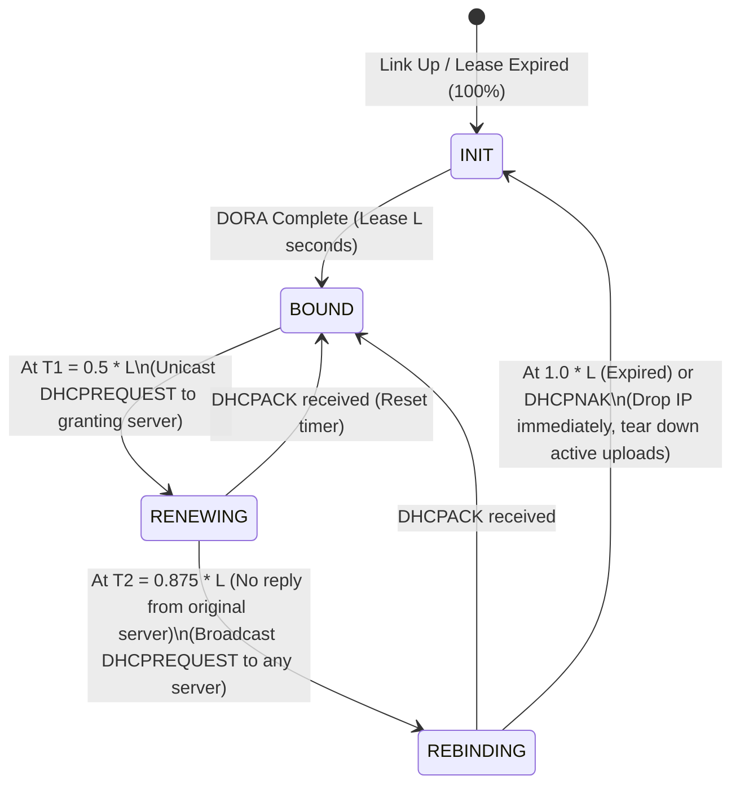

# 08. Embedded Networking: TCP/IP, VPN, DNS, DHCP & Tunneling

> **Interviewer đang đánh giá gì?** JD nêu rất cụ thể:
> *"Knowledge of networking concepts and protocols such as TCP/IP, VPN, DNS, DHCP, and tunneling is a plus."*
>
> Vì sao một kỹ sư nhúng làm camera lại cần hiểu sâu đến vậy về mạng?
> Hãy nhìn bối cảnh sử dụng thực tế của **body camera / in-car camera (Axon Body / Axon Fleet / AegisCam)**:
> 1. Cảnh sát kết thúc ca trực, cắm camera vào **Ethernet Dock**, hoặc xe tuần tra đậu về đồn bắt **Wi-Fi**, hoặc đang chạy ngoài đường dùng **LTE/5G** để livestream/upload bằng chứng khẩn cấp.
> 2. Mạng của các sở cảnh sát (CJIS-compliant agency networks) cực kỳ phức tạp: đi qua **VPN (WireGuard / IPsec)**, tường lửa chặn ICMP làm hỏng **Path MTU Discovery**, Wi-Fi công cộng có **Captive Portal / DNS hijack**, và phiên **DHCP lease** đổi giữa chừng khi xe di chuyển.
> 3. Nếu một file video bằng chứng 2 GB bị đứt mạng ở 99%, thiết bị **phải nối lại đúng chunk cuối cùng (resumable upload)** chứ không được gửi lại từ đầu qua LTE đắt đỏ.

Liên hệ dự án:
- AegisCam: [`docs/architecture/networking.md`](../aegiscam/docs/architecture/networking.md), [ADR-0005: Go for Connectivity Agent](../aegiscam/docs/adr/0005-go-for-connectivity-agent.md), [ADR-0006: WireGuard over IPsec/OpenVPN](../aegiscam/docs/adr/0006-wireguard-over-ipsec-openvpn.md)
- Code Go `netagent`: [`internal/link/`](../aegiscam/netagent/internal/link/link.go), [`internal/dnscheck/`](../aegiscam/netagent/internal/dnscheck/dnscheck.go), [`internal/dhcp/`](../aegiscam/netagent/internal/dhcp/dhcp.go), [`internal/vpn/`](../aegiscam/netagent/internal/vpn/vpn.go), [`internal/uploader/`](../aegiscam/netagent/internal/uploader/uploader.go)

---

## 1. TCP/IP Stack Deep Dive cho Thiết bị Di động

### 1.1 TCP 3-Way Handshake, 4-Way Teardown & `TIME_WAIT`
- **Handshake:** `SYN (seq=x)` $\rightarrow$ `SYN-ACK (seq=y, ack=x+1)` $\rightarrow$ `ACK (ack=y+1)`.
  - *Bẫy thực tế:* Nếu gói `SYN` rơi trên mạng LTE yếu, Linux mặc định retry theo `tcp_syn_retries` (có thể tốn > 60 giây). Trong `netagent`, ta luôn đặt `net.Dialer{Timeout: 5 * time.Second}` kết hợp `context.WithTimeout`.
- **Teardown & `TIME_WAIT`:** Bên chủ động đóng kết nối (`close()`) đi vào trạng thái `TIME_WAIT` (mặc định 60s trên Linux) để đảm bảo gói `ACK` cuối đến nơi và các gói tin lạc đường của phiên cũ hết hạn.
  - *Bẫy trên thiết bị nhúng:* Nếu `uploader` mở một kết nối TCP/TLS mới cho mỗi chunk 4 MiB rồi đóng ngay, thiết bị vừa tốn 2–3 RTT cho TCP+TLS handshake, vừa tích tụ hàng trăm socket ở `TIME_WAIT` hoặc `CLOSE_WAIT` (nếu quên `resp.Body.Close()`!). **Giải pháp:** tái sử dụng kết nối qua HTTP Keep-Alive / HTTP/2 connection pool của `http.Transport`.

### 1.2 Congestion Control (CUBIC vs BBR) & TCP Keepalive trên LTE/Wi-Fi
- **CUBIC (mặc định trên Linux):** coi **packet loss** là tín hiệu nghẽn mạng và cắt giảm mạnh cửa sổ gửi (`cwnd`). Trên mạng không dây (LTE trên xe đang chạy, Wi-Fi), rớt gói thường do nhiễu sóng (RF fading) chứ không phải nghẽn router → CUBIC làm tụt băng thông upload thê thảm.
- **BBR (Bottleneck Bandwidth and Round-trip propagation time):** ước lượng băng thông thực và RTT nhỏ nhất thay vì phản ứng mù quáng với packet loss rời rạc → tăng tốc độ upload qua LTE/VPN từ **2–5×** khi có rớt gói nhẹ (1–2%).
- **Half-Open Connections & TCP Keepalive / `TCP_USER_TIMEOUT`:**
  - Khi xe tuần tra đi vào hầm mất sóng LTE, socket TCP không nhận được `FIN` hay `RST` nên hàm `write()` có thể treo rất lâu nếu bộ đệm gửi chưa đầy.
  - Cần cấu hình cả **TCP Keepalive** (`KeepAlive: 15 * time.Second`) và timeout ở tầng ứng dụng cho mỗi lần ghi chunk (`context.WithTimeout`).

---

## 2. MTU, Path MTU Discovery (PMTUD) & Hiện tượng "Black Hole" qua VPN (Câu hỏi đắt giá!)

### 2.1 Tại sao gói tin nhỏ (`ping`, `STATUS`) đi qua VPN bình thường nhưng upload video lại treo cứng?
Hãy tính toán kích thước gói tin khi chạy **WireGuard trên IPv4 hoặc IPv6**:
- MTU chuẩn của Ethernet/Wi-Fi = **1500 bytes** (trên một số nhà mạng LTE chỉ là **1428 bytes**!).
- WireGuard bọc gói tin bên trong UDP:
  - Outer IPv4 header (20 B) + UDP header (8 B) + WireGuard header & auth tag (32 B) = **60 bytes overhead** (nếu Outer IPv6 là **80 bytes**).
- Do đó, **MTU hiệu dụng của interface `wg0` chỉ còn $1500 - 80 = 1420\text{ bytes}$** (hoặc **1340–1360 bytes** trên LTE!).
- Nếu socket TCP bên trong tunnel thương lượng MSS theo MTU 1500 (MSS = 1460) và bật cờ `DF` (Don't Fragment), khi bắt đầu đẩy chunk video lớn (gói 1500 B), gói tin sau khi bọc VPN sẽ vượt quá 1500 B và bị router dọc đường loại bỏ kèm thông báo **ICMP Type 3 Code 4 (`Fragmentation Needed`)**.
- **Thảm hoạ PMTUD Black Hole:** Nhiều tường lửa doanh nghiệp/sở cảnh sát chặn toàn bộ ICMP → thiết bị không nhận được báo lỗi để giảm kích thước gói, cứ gửi đi gửi lại gói 1500 B và phiên upload **treo cứng ở 0% dù handshake TCP thành công!**

### 2.2 Giải pháp chuẩn trong AegisCam (`netagent/internal/vpn`)
1. Đặt cứng **`MTU = 1360`** (an toàn cho cả LTE + IPv6 + WireGuard overhead) trong cấu hình `wg0`.
2. Bật **TCP MSS Clamping** trên `nftables`/`iptables` cho mọi kết nối đi qua `wg0`:
   ```bash
   iptables -t mangle -A POSTROUTING -o wg0 -p tcp --tcp-flags SYN,RST SYN -j TCPMSS --clamp-mss-to-pmtu
   ```
3. Bật `net.ipv4.tcp_mtu_probing = 1` (Packetization Layer PMTUD - RFC 4821) trong `sysctl` để TCP tự động hạ kích thước segment khi phát hiện black hole mà không cần phụ thuộc vào ICMP.

---

## 3. DHCP: Quy trình DORA & Máy trạng thái Lease T1 / T2

Xem hiện thực tại [`netagent/internal/dhcp/dhcp.go`](../aegiscam/netagent/internal/dhcp/dhcp.go).

### 3.1 Quy trình 4 bước DORA
1. **Discover:** Client broadcast (`0.0.0.0:68` $\rightarrow$ `255.255.255.255:67`) tìm DHCP server.
2. **Offer:** Server phản hồi đề xuất IP, Subnet Mask, Default Gateway (Option 3), DNS Servers (Option 6), Lease Time (Option 51).
3. **Request:** Client broadcast xác nhận chọn Offer của 1 server cụ thể (để các server khác thu hồi Offer).
4. **Ack (hoặc NAK):** Server xác nhận cấp phát; client chạy **ARP Probe (ACD - RFC 5227)** kiểm tra không có thiết bị nào trùng IP rồi mới gắn IP vào interface.

### 3.2 Vòng đời Lease và Thời điểm T1 (50%) / T2 (87.5%)

- **Tại sao `netagent` phải theo dõi trạng thái DHCP?** Nếu lease sắp hết hạn (đang ở `REBINDING` mà chưa được gia hạn) hoặc vừa nhận IP mới sau khi chuyển trạm phát, `netagent` chủ động thông báo cho `uploader` và `vpn` để re-bind socket và kích hoạt lại handshake WireGuard ngay thay vì chờ timeout.

---

## 4. DNS: Resolution, Caching, Split-Horizon & Captive Portal Detection

Xem hiện thực tại [`netagent/internal/dnscheck/dnscheck.go`](../aegiscam/netagent/internal/dnscheck/dnscheck.go).
- **Quy trình phân giải & TTL Caching:** Mặc định UDP port 53 (chuyển sang TCP port 53 nếu phản hồi > 512 bytes không có EDNS0, hoặc dùng DoT/DoH). `dnscheck` lưu cache kết quả theo đúng `TTL` nhưng kẹp trong khoảng `[minTTL=10s, maxTTL=300s]` để tránh giữ IP chết quá lâu.
- **Primary $\rightarrow$ Secondary Fallback:** Nếu DNS server do DHCP cấp bị treo, tự động chuyển sang resolver dự phòng đã cấu hình của tổ chức.
- **Phát hiện Captive Portal & DNS Hijack (Cực kỳ thực tế!):**
  - Khi camera kết nối vào một mạng Wi-Fi có trang đăng nhập web (Captive Portal ở khách sạn, sân bay, hoặc mạng khách của đồn cảnh sát), mọi truy vấn DNS (kể cả `ingest.aegis.example.com`) đều bị trả về một địa chỉ IP nội bộ (ví dụ `192.168.1.1` hoặc `10.0.0.1`) để ép trình duyệt mở trang login.
  - Trong `dnscheck`, nếu tên miền cloud công cộng lại phân giải ra **private/loopback/link-local IP (RFC 1918 / RFC 6598)** hoặc nằm ngoài tập prefix kỳ vọng (khi không dùng split-DNS nội bộ), `dnscheck` gắn cờ **`ErrHijackedOrCaptive`** và báo cho `LinkManager` rằng giao diện Wi-Fi này **không có Internet thật** $\rightarrow$ tự động chuyển sang LTE thay vì cố kết nối vào trang login giả!

---

## 5. VPN & Tunneling: Tại sao chọn WireGuard thay vì IPsec / OpenVPN? ([ADR-0006](../aegiscam/docs/adr/0006-wireguard-over-ipsec-openvpn.md))

| Tiêu chí | WireGuard (Chọn cho AegisCam) | IPsec (strongSwan / IKEv2) | OpenVPN |
|---|---|---|---|
| **Độ phức tạp & Codebase** | ~4,000 dòng code trong Linux kernel; bề mặt tấn công cực nhỏ | Hàng trăm nghìn dòng code; thương lượng IKEv2/cipher suite rất dễ lệch cấu hình | Hàng trăm nghìn dòng code + phụ thuộc OpenSSL |
| **Hiệu năng trên ARM SoC** | **Trong kernel**, dùng `ChaCha20-Poly1305` cực nhanh ngay cả khi CPU không có tập lệnh tăng tốc AES phần cứng | Nhanh nếu có crypto engine phần cứng cho AES-GCM, nhưng phức tạp | **Chậm**: chạy ở user space, tốn context switch đọc/ghi qua `/dev/net/tun` |
| **Di chuyển mạng (Roaming: Wi-Fi $\leftrightarrow$ LTE)** | **Bẩm sinh (Built-in Roaming):** khi thiết bị đổi IP từ Wi-Fi sang LTE, gói tin xác thực tiếp theo tự động cập nhật endpoint IP:port mới trên server mà **không cần thiết lập lại tunnel**! | Cần cấu hình mở rộng MOBIKE (RFC 4555), nhiều tường lửa chặn | Phải reconnect toàn bộ phiên TLS/tunnel (mất vài giây) |
| **Tiết kiệm pin (Battery life)** | **Stealth / On-demand:** nếu không có dữ liệu cần gửi và không bật `PersistentKeepalive`, WireGuard hoàn toàn im lặng, không đánh thức modem LTE | Các gói IKEv2 DPD / rekey định kỳ | Ping keepalive liên tục |

### 5.1 Cơ chế giám sát VPN & Kill-Switch trong `netagent` (`internal/vpn/vpn.go`)
1. **Cryptokey Routing:** Mỗi peer gắn với `AllowedIPs` cố định (bảng định tuyến và bảng khóa công khai là một).
2. **Handshake Age Monitor:** WireGuard xoay khóa (re-handshake) mỗi ~2 phút khi có dữ liệu truyền qua. Nếu `netagent` đang đẩy dữ liệu mà `time.Since(LastHandshake) > 3 * time.Minute`, `TunnelSupervisor` kết luận đường hầm đã chết và khởi động lại với exponential backoff.
3. **Kill-Switch (`KillSwitch: true`):** Tuyệt đối không cho phép `uploader` mở kết nối tới server bằng chứng nếu `wg0` chưa có handshake hợp lệ (hoặc ép route của endpoint ingest chỉ đi qua interface `wg0`).

---

## 6. Kịch bản Thực chiến: Debug sự cố mạng trên thiết bị Linux nhúng (Walkthrough 6 bước)

**Câu hỏi phỏng vấn:** *"An officer docks a body camera or connects to station Wi-Fi, and evidence uploads are failing. Walk me through exact commands you run on the Linux device to isolate the layer that is broken."*

> "I troubleshoot strictly bottom-up through the network stack so I don't guess:
>
> **Step 1 — Physical / Link Layer (L1/L2):**
> Run `ip -br link` and `ethtool eth0` (or `iw dev wlan0 link`). Is the carrier `UP` (`LOWER_UP`)? Are TX/RX error or drop counters climbing in `ip -s link`?
>
> **Step 2 — IP & DHCP Layer (L3):**
> Run `ip -br addr` and `ip route show table all`. Did DHCP assign a valid IPv4/IPv6 address, or is it stuck on a `169.254.x.x` link-local address? Can I reach the local gateway (`ping -c 3 <gateway_ip>`)?
>
> **Step 3 — DNS & Captive Portal Check:**
> Run `dig +short +time=2 ingest.aegis.internal @<dhcp_dns>`. Does it time out, return `NXDOMAIN`, or return a hijacked captive-portal IP like `192.168.1.1`?
>
> **Step 4 — VPN Tunnel Layer (`wg0`):**
> Run `wg show wg0`. Look at `latest handshake` and `transfer`. If `transfer` shows `0 B received`, the UDP port (e.g., `51820/udp`) is blocked by the station firewall or NAT.
>
> **Step 5 — MTU / PMTUD Check:**
> If handshake succeeds and small requests work, but 4 MiB chunk uploads hang, I test Path MTU immediately:
> `ping -M do -s 1332 -I wg0 <ingest_ip>` vs `ping -M do -s 1450 -I wg0 <ingest_ip>`. If 1332 works and 1450 drops silently, we have a PMTUD black hole and need to lower `wg0` MTU / clamp TCP MSS.
>
> **Step 6 — Transport & Application Layer (L4/L7):**
> Run `ss -ti dst <ingest_ip>` to inspect active TCP sockets (`retrans`, `cwnd`, `rtt`, `pmtu`), or capture a quick trace with `tcpdump -i wg0 -nn -s 128 -w /tmp/upload.pcap port 443` to see whether we are failing on TLS certificate validation (often caused by **system clock skew / NTP not synced** after a cold battery pull!) or an HTTP 4xx/5xx from the backend."
