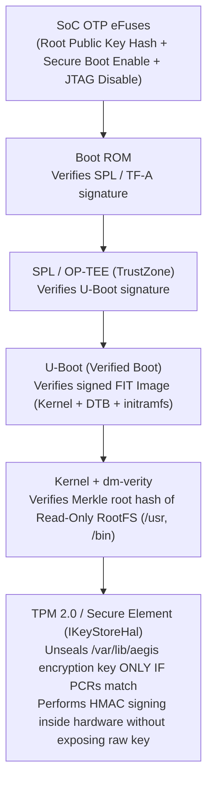

# 09. Embedded Security & Evidence Chain of Custody

> **Interviewer đang đánh giá gì?** JD nhấn mạnh:
> *"Preferred: Experience working on consumer or professional hardware products with tight security, low latency, and high stability requirements."*
>
> Với một thiết bị ghi nhận bằng chứng pháp lý (body-worn camera / in-car video system), **bảo mật không chỉ là chống hacker từ xa, mà còn là chống lại chính người đang cầm thiết bị vật lý trong tay** (kẻ xấu nhặt được camera rơi, hoặc nỗ lực chỉnh sửa/xoá bớt 10 giây video bất lợi trước khi nộp lên toà án).
> Ở level Staff, bạn phải trình bày được một kiến trúc bảo mật xuyên suốt từ **phần cứng (Hardware Root of Trust / Secure Boot / TPM)** $\rightarrow$ **Hệ điều hành (dm-verity, Least Privilege systemd)** $\rightarrow$ **Dữ liệu bằng chứng (SHA-256 Hash Chain + HMAC + Append-Only Audit Log)** $\rightarrow$ **Quản lý lỗ hổng chuỗi cung ứng (SBOM / CVE / Signed A/B OTA)**.

Liên hệ dự án:
- AegisCam: [`docs/architecture/security_model.md`](../aegiscam/docs/architecture/security_model.md), [ADR-0003: Segment-Based Evidence with Hash Chain](../aegiscam/docs/adr/0003-segment-based-evidence-with-hash-chain.md), [ADR-0004: A/B OTA with Boot-Counter Rollback](../aegiscam/docs/adr/0004-ab-ota-with-boot-counter-rollback.md), [`sha256.h`](../aegiscam/core/include/aegis/crypto/sha256.h), [`hmac.h`](../aegiscam/core/include/aegis/crypto/hmac.h), [`hash_chain.h`](../aegiscam/core/include/aegis/crypto/hash_chain.h), [`evidence_store.h`](../aegiscam/core/include/aegis/evidence/evidence_store.h), [`audit_log.h`](../aegiscam/core/include/aegis/evidence/audit_log.h), [`tools/verify_evidence.py`](../aegiscam/tools/verify_evidence.py)

---

## 1. STRIDE Threat Model cho Body-Worn Evidence Camera

Khi được hỏi *"How do you approach security design for an embedded device?"*, luôn mở đầu bằng **Threat Modeling (STRIDE)** và xác định **Assets (Tài sản cần bảo vệ)** + **Attacker Capabilities (Năng lực kẻ tấn công)**:

| STRIDE Category | Kịch bản tấn công cụ thể trên Body Camera | Biện pháp phòng vệ trong AegisCam |
|---|---|---|
| **S — Spoofing (Giả mạo định danh)** | Kẻ tấn công tạo một chương trình giả mạo `aegisd` để đẩy video giả lên cloud, hoặc giả mạo lệnh `STOP` qua mạng | Khóa định danh thiết bị nằm trong **TPM / Secure Element (`IKeyStoreHal`)** không thể trích xuất; mTLS/WireGuard với key gắn vào phần cứng; IPC socket `/run/aegis/aegisd.sock` giới hạn quyền `0660` cho user/group `aegis` |
| **T — Tampering (Sửa đổi dữ liệu / Firmware)** | 1) Chỉnh sửa 1 segment video hoặc xoá 1 segment ở giữa. 2) Thay đổi file binary `/usr/bin/aegisd` trên flash. | 1) **SHA-256 Hash Chain + HMAC-SHA256 Manifest + Append-Only Chained Audit Log**. 2) **Secure Boot + `dm-verity`** trên read-only rootfs. |
| **R — Repudiation (Chối bỏ hành động)** | Người dùng khẳng định *"Tôi đã bấm nút ghi hình nhưng máy không chạy"* hoặc *"Tôi không hề bấm dừng ghi hình"* | `audit.log` ghi nhận mọi sự kiện (`TRIGGER`, `STOP`, `BOOT`, `OTA`, `SEAL`) kèm timestamp và chuỗi băm liên kết từ lúc khởi tạo thiết bị |
| **I — Information Disclosure (Rò rỉ dữ liệu)** | Camera bị rơi ngoài hiện trường; kẻ nhặt được tháo chip nhớ eMMC ra đọc video nhạy cảm của nạn nhân/nhân chứng | **Encryption at rest (`dm-crypt` / LUKS / fscrypt)** với khóa giải mã được phong ấn (sealed) trong TPM/OP-TEE theo trạng thái Secure Boot; **Encryption in transit** qua WireGuard + TLS 1.3 + VPN Kill-Switch |
| **D — Denial of Service (Từ chối dịch vụ)** | Bơm dữ liệu rác vào IPC socket hoặc làm ngập hàng đợi để treo camera; đẩy gói OTA hỏng làm brick máy | Bounded queues ở mọi nơi, parser IPC không cấp phát động và đã được **fuzz bằng libFuzzer**, `WatchdogSupervisor` tự phục hồi, và **A/B OTA tự động rollback** sau 3 lần boot lỗi |
| **E — Elevation of Privilege (Leo thang đặc quyền)** | Khai thác lỗ hổng trong stack mạng để chiếm quyền `root` và đọc khóa mật mã | Tách tiến trình mạng ra **`netagent` viết bằng Go (memory-safe)** chạy với non-root user; `aegisd` bị khóa chặt bằng systemd sandboxing (`NoNewPrivileges`, `ProtectSystem=strict`, `RestrictAddressFamilies=AF_UNIX`) |

---

## 2. Phần cứng & Hệ điều hành: Chain of Trust từ ROM đến User Space

### 2.1 Tại sao cần cả Secure Boot LẪN `dm-verity`?
- **Secure Boot** chỉ kiểm tra chữ ký của Bootloader, Kernel, DTB và `initramfs` **tại thời điểm nạp vào RAM lúc khởi động**.
- Nếu Root Filesystem (`ext4`/`squashfs` chứa `/usr/bin/aegisd`) không được kiểm tra toàn vẹn, kẻ tấn công có quyền truy cập vật lý vào chip flash có thể sửa trực tiếp các khối dữ liệu của `/usr/bin/aegisd` trên eMMC.
- **`dm-verity` (Device-Mapper Verity):** tạo một **cây băm Merkle (Merkle Hash Tree)** cho toàn bộ các khối 4 KB của phân vùng rootfs read-only. **Root hash** của cây Merkle này được ký và nhúng vào داخل FIT image đã được Secure Boot xác thực. Mỗi khi Linux đọc bất kỳ trang 4 KB nào từ `/usr/bin/aegisd`, kernel kiểm tra đường dẫn băm lên tới Root hash — nếu sai 1 bit, kernel báo lỗi I/O và từ chối thực thi ngay lập tức!

### 2.2 Bảo vệ khóa mật mã bằng TPM 2.0 / Secure Element (`IKeyStoreHal`)
- **Sai lầm chết người:** Lưu khóa đối xứng hoặc private key trong một file `/etc/aegis/device.key` hoặc hardcode trong binary (dùng `strings aegisd` là lấy được cho toàn bộ 100,000 thiết bị!).
- **Thiết kế chuẩn trong AegisCam ([`i_key_store_hal.h`](../aegiscam/core/include/aegis/hal/i_key_store_hal.h)):**
  - Mỗi thiết bị được cấp phát một khóa định danh duy nhất ngay tại nhà máy (factory provisioning) nằm bên trong **TPM 2.0, ATECC608 Secure Element, hoặc ARM TrustZone (OP-TEE)**.
  - Trong sản phẩm thương mại, giao diện mật mã lý tưởng không trả mảng byte khóa thô ra RAM của Linux mà thực hiện lệnh `sign_hmac(data_digest)` **ngay bên trong chip bảo mật**.
  - **Anti-Rollback phần cứng:** lưu số phiên bản bảo mật tối thiểu (`Rollback Index`) vào thanh ghi monotonic counter của TPM hoặc eFuse để ngăn kẻ tấn công hạ cấp (downgrade attack) thiết bị về một bản firmware cũ đã được ký hợp lệ nhưng có lỗ hổng CVE đã biết.

---

## 3. Thiết kế Chain of Custody (Chuỗi bảo quản bằng chứng) trong AegisCam

Xem chi tiết tại [ADR-0003](../aegiscam/docs/adr/0003-segment-based-evidence-with-hash-chain.md), [`hash_chain.h`](../aegiscam/core/include/aegis/crypto/hash_chain.h), [`evidence_store.cpp`](../aegiscam/core/src/evidence/evidence_store.cpp), và [`tools/verify_evidence.py`](../aegiscam/tools/verify_evidence.py).

### 3.1 Tại sao chỉ băm SHA-256 từng file segment riêng lẻ là KHÔNG ĐỦ?
Giả sử một vụ việc gồm 3 segment: `seg_000001.bin`, `seg_000002.bin`, `seg_000003.bin`.
- Nếu ta chỉ lưu `sha256(seg_i)` độc lập:
  1. Kẻ có quyền truy cập đĩa có thể **xoá `seg_000002.bin`**, đánh số lại `seg_000003` thành `seg_000002` và tính lại SHA-256 trong `manifest.json`!
  2. Hoặc hoán đổi một segment từ một vụ việc khác sang.

### 3.2 Cấu trúc 3 lớp bảo vệ của AegisCam
1. **Lớp 1 — Per-Segment SHA-256:**
   Ngay khi `SegmentWriter` ghi từng chunk ra file `.tmp`, nó tính $S_i = \text{SHA256}(\text{seg\_}i)$.
2. **Lớp 2 — Cryptographic Hash Chain ($H_i$):**
   Mỗi segment thứ $i$ được móc xích với toàn bộ lịch sử trước đó từ khởi thủy $H_0 = 0^{32}$ (32 byte 0):
   $$H_1 = \text{SHA256}(H_0 \parallel S_1), \quad H_i = \text{SHA256}(H_{i-1} \parallel S_i)$$
   *Hệ quả:* Nếu bất kỳ ai sửa 1 bit trong `seg_000001.bin`, xoá `seg_000002.bin`, hoặc đổi thứ tự 2 segment, giá trị đỉnh chuỗi $H_{\text{head}} = H_n$ sẽ thay đổi hoàn toàn!
3. **Lớp 3 — Hardware-Backed HMAC Seal & Chained Audit Log:**
   Để ngăn kẻ tấn công tính toán lại toàn bộ chuỗi $H_1 \dots H_n$ mới rồi ghi đè vào `manifest.json`, giá trị đỉnh chuỗi $H_{\text{head}}$ được ký bằng khóa bí mật của thiết bị:
   $$\text{Tag} = \text{HMAC-SHA256}(K_{\text{device}}, \text{hex}(H_{\text{head}}))$$
   Đồng thời, mỗi lần niêm phong segment hoặc incident, một dòng bản ghi được nối vào [`audit.log`](../aegiscam/core/include/aegis/evidence/audit_log.h) — bản thân `audit.log` cũng là một chuỗi băm liên tục từ lúc thiết bị xuất xưởng (`<seq>|<ts_ms>|<event>|<detail>|<prev_hash>|<hash>`).

---

## 4. An toàn Bộ nhớ C/C++ & Quản lý Chuỗi cung ứng Phần mềm (SBOM / CVE)

JD yêu cầu: *"Identify and integrate the latest open source technologies to enhance our platform while maintaining reliability in a mission-critical environment."*

### 4.1 Phòng chống lỗ hổng mật mã và bộ nhớ trong C/C++
1. **Constant-Time Comparison cho HMAC / Signature:**
   - **Không bao giờ dùng `operator==` hay `memcmp`** để so sánh 2 mã HMAC! Vì `memcmp` dừng ngay ở byte đầu tiên khác nhau, kẻ tấn công có thể đo thời gian phản hồi (Timing Side-Channel Attack) để đoán từng byte một của mã HMAC đúng chỉ trong vài nghìn lần thử (thay vì $2^{256}$).
   - Trong [`hmac.cpp`](../aegiscam/core/src/crypto/hmac.cpp) của AegisCam, hàm `constant_time_equal` dùng phép `diff |= (a[i] ^ b[i])` chạy qua đủ 32 byte không có bất kỳ câu lệnh rẽ nhánh (`if`) nào phụ thuộc dữ liệu.
2. **Zeroize nhạy cảm (`explicit_bzero`):**
   - Sau khi dùng xong khóa tạm hoặc dữ liệu nhạy cảm trên stack, trình biên dịch với `-O2` sẽ **tối ưu hoá bỏ lệnh `memset(key, 0, sizeof(key))`** ở cuối hàm (Dead Store Elimination) vì biến đó không được đọc lại nữa! Phải dùng `explicit_bzero` hoặc `volatile uint8_t*` để ép xoá thật trên RAM.
3. **Compiler Hardening Flags:**
   - `-fstack-protector-strong` (Stack Canary phát hiện tràn bộ đệm stack).
   - `-D_FORTIFY_SOURCE=2` (kiểm tra biên cho các hàm `libc`).
   - `-fPIE -pie` + ASLR + `-Wl,-z,relro,-z,now` (Full RELRO: bảng GOT thành read-only ngay khi khởi chạy).

### 4.2 Quy trình Đánh giá & Tích hợp Open-Source (OSS Governance & SBOM)
Khi đưa một thư viện mã nguồn mở mới vào thiết bị mission-critical:
1. **Đánh giá trước khi chọn (Pre-Integration Checklist):**
   - **License:** MIT / Apache-2.0 / BSD (an toàn) vs GPLv3 (có điều khoản anti-tivoization yêu cầu cung cấp khóa cài đặt phần mềm sửa đổi lên thiết bị phần cứng — thường **bị cấm tuyệt đối** trên thiết bị bảo mật có Secure Boot!).
   - **Maintenance & Bus factor:** Có bao nhiêu maintainer hoạt động? Lịch sử vá CVE mất bao lâu?
   - **Dependencies & Footprint:** Kéo theo bao nhiêu thư viện phụ? Có biên dịch tĩnh/cross-compile sạch trên Yocto ARM64 không?
2. **SBOM (Software Bill of Materials) & CVE Triage:**
   - Yocto (`create-spdx.bbclass`) và Go (`go version -m`) tự động sinh danh sách SBOM cho mỗi bản build.
   - Chạy quét CVE tự động hàng ngày; phân loại mức độ ảnh hưởng thực tế (VEX — Vulnerability Exploitability eXchange: lỗ hổng đó có nằm trên đường code được gọi không? Tiến trình có bị sandbox không?).
   - Giữ mọi thư viện bên thứ ba sau một lớp **HAL / Wrapper của riêng mình** (như `IDeepStreamHAL` trong MultiCamera hoặc `ICrypto`/`IKeyStoreHal` trong AegisCam) để nếu cần thay thế thư viện, ta chỉ sửa duy nhất 1 file implementation.
