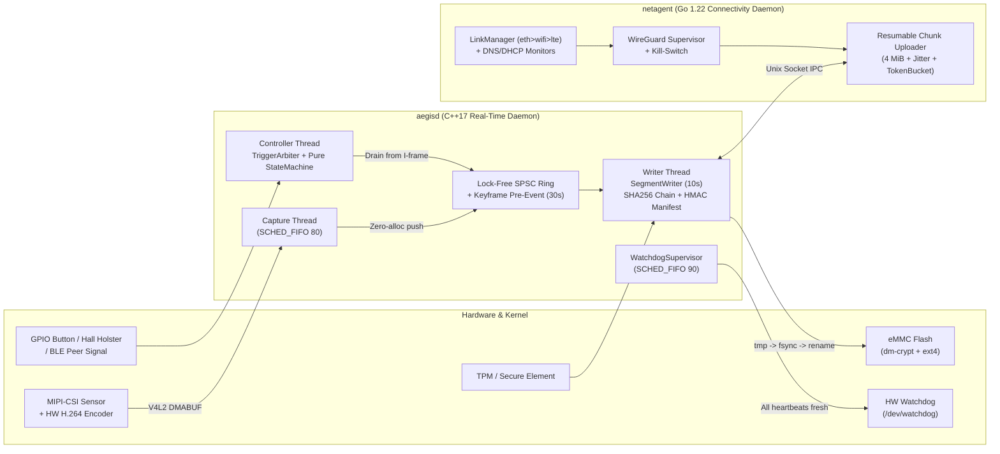
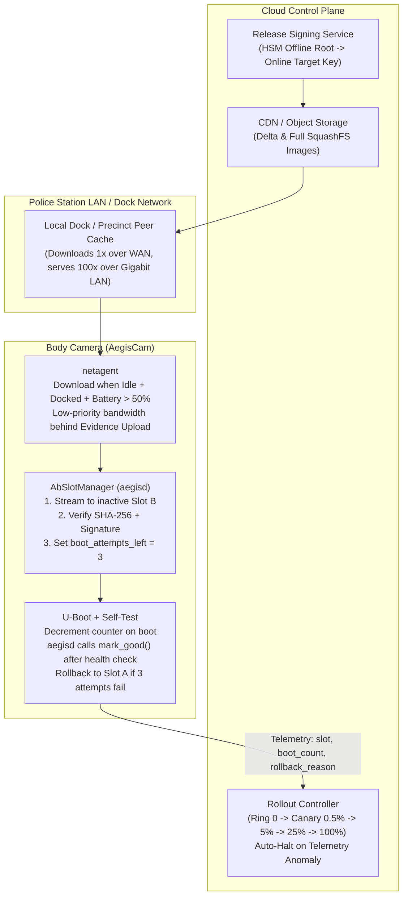
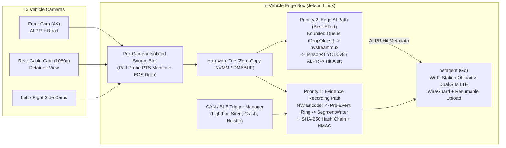

# 10. Staff-Level Embedded System Design

> **Interviewer đang đánh giá gì?** Vòng System Design quyết định trực tiếp việc bạn được xếp level **Senior** hay **Staff / Lead**.
> - **Senior Engineer** nhảy ngay vào vẽ các block C++ và nói về thuật toán bên trong một hộp.
> - **Staff Engineer** làm chủ cuộc thảo luận: làm rõ **Functional & Non-Functional Requirements**, tính toán **Resource Budgets (RAM, Flash, I/O bandwidth, Latency, Battery)** bằng con số cụ thể, vẽ **Architecture + Threading + Trust Boundaries**, chủ động chỉ ra **Failure Modes (power loss, disk full, network partition, thundering herd)** và trình bày **Trade-offs (tại sao chọn A thay vì B)**.

Liên hệ dự án:
- Thiết kế #1 (Body Cam): [`aegiscam/docs/architecture/PROJECT_SPEC.md`](../aegiscam/docs/architecture/PROJECT_SPEC.md), [`system_overview.md`](../aegiscam/docs/architecture/system_overview.md)
- Thiết kế #2 (Fleet OTA 100k): [ADR-0004](../aegiscam/docs/adr/0004-ab-ota-with-boot-counter-rollback.md), [`operational_readiness.md`](../aegiscam/docs/process/operational_readiness.md)
- Thiết kế #3 (In-Vehicle Multi-Camera + Edge AI): [`../README.md`](../README.md) (MultiCamera DeepStream) + [`networking.md`](../aegiscam/docs/architecture/networking.md)

---

## 1. Khung trả lời 45 phút (The R-B-A-D-F-O Framework)

Hãy chia 45 phút phỏng vấn System Design như sau (và nói rõ cấu trúc này với interviewer ngay phút đầu tiên):

| Giai đoạn | Thời lượng | Nội dung chính | Câu mở đầu mẫu |
|---|---|---|---|
| **1. Requirements & Constraints** | 5 phút | Use cases chính + **5 ràng buộc vật lý** (Latency, Power/Battery, RAM/Flash, Connectivity, Security/Compliance) | *"Before sketching boxes, let me lock down the functional scope and the hardware constraints..."* |
| **2. Back-of-the-Envelope Budgets** | 5 phút | Tính nhẩm tốc độ bit (bitrate), kích thước ring buffer trên RAM, dung lượng flash cho 1 ca trực 12h, băng thông upload | *"Let's do quick math on memory and storage so our numbers guide the design..."* |
| **3. High-Level Architecture** | 10 phút | Sơ đồ khối: Hardware $\rightarrow$ HAL $\rightarrow$ Real-Time Data Plane (`aegisd`) $\rightarrow$ Control/Network Plane (`netagent`) $\rightarrow$ Cloud | *"I'll separate the real-time recording plane from the untrusted connectivity plane..."* |
| **4. Deep Dive (2–3 thành phần lõi)** | 15 phút | Đi sâu vào: (a) Lock-free pre-event ring + keyframe drain, (b) Power-loss safe segment writer + hash chain, (c) VPN + resumable upload | *"Which area would you like to drill into first: the real-time capture path, evidence integrity, or upload reliability?"* |
| **5. Failure Modes & Recovery** | 5 phút | Rớt pin, đầy bộ nhớ, treo 1 thread, gói OTA lỗi, 500 máy cùng dock lúc giao ca | *"Now let's stress-test this design against the bad day..."* |
| **6. Observability & Rollout** | 5 phút | Health metrics, audit log, staged canary rollout, kill-switch | *"Finally, how we operate and safely update 100,000 of these in the field..."* |

---

## 2. Thiết kế #1: Body-Worn Evidence Camera (`AegisCam`)

### 2.1 Requirements & Back-of-the-Envelope Math
- **Yêu cầu cốt lõi:**
  - **R1 (Pre-event buffer):** Giữ 30 giây video trước khi bấm nút (thường không ghi âm thanh ở pre-event để bảo vệ quyền riêng tư theo chính sách nhiều bang).
  - **R2 (Trigger latency):** Từ lúc bấm nút / rút súng khỏi bao (Holster sensor) / nhận tín hiệu BLE đồng đội đến lúc bắt đầu phiên ghi chính thức **< 100 ms**.
  - **R3 (Chain of Custody):** Mọi sửa đổi hoặc xoá bớt đoạn video đều phải bị phát hiện 100%.
  - **R4 (Power-loss resilience):** Rớt pin bất kỳ lúc nào chỉ mất tối đa vài giây đang trên RAM; không bao giờ làm hỏng file đã ghi.
  - **R5 (Battery life):** Chạy trọn ca trực **12 tiếng** trên pin ~3,500 mAh (~13 Wh $\implies$ công suất trung bình toàn máy ~1 W ở chế độ Buffering).
- **Tính toán ngân sách (Back-of-the-Envelope):**
  - Video 1080p @ 30 fps, nén H.264/H.265 phần cứng ở bitrate **4 Mbps** ($\approx 0.5\text{ MB/s}$).
  - **RAM cho 30 giây Pre-Event Buffer:** $30\text{ s} \times 0.5\text{ MB/s} = \mathbf{15\text{ MB}}$.
    - Nếu giữ các frame đã mã hoá H.264 (30 fps $\times$ 30 s = 900 frames, mỗi frame trung bình ~16 KB; cấp phát ring buffer lũy thừa của 2 là **1024 slots**): chỉ tốn **~16–20 MB RAM**! (Sai lầm kinh điển trong phỏng vấn là giữ *raw YUV frames* chưa nén trong 30 giây: $1920 \times 1080 \times 1.5 \times 30 \times 30 \approx 2.8\text{ GB RAM}$ — bất khả thi và tốn pin!).
    - *Bí quyết kỹ thuật:* Luôn cho **Hardware Encoder (VPU)** chạy ở chế độ tiết kiệm điện, đặt GOP = 1 giây (30 frames, tức mỗi giây có 1 I-frame/keyframe), và **lưu các gói H.264 NAL units đã nén** vào `SpscRingBuffer`!
  - **Dung lượng Flash cho 12 tiếng:** Giả sử ghi hình thực tế 4 tiếng/ca $\times 0.5\text{ MB/s} \times 3600\text{ s} \approx \mathbf{7.2\text{ GB/ca}}$. Với bộ nhớ eMMC 64 GB, máy lưu thoải mái 7–8 ca trực khi offline.

### 2.2 Sơ đồ Kiến trúc Tổng thể

### 2.3 Giải quyết các bài toán hóc búa (Deep Dive)
1. **Tại sao phải Drain từ I-Frame (Keyframe)?**
   Vì ta lưu H.264 đã nén trong vòng đệm 30 giây, nếu cắt đúng mốc $T - 30\text{s}$ mà trúng một P-frame, 29 frame đầu tiên không có I-frame tham chiếu sẽ bị vỡ hình hoàn toàn. Với GOP = 30 frames (1s), `PreEventBuffer` giữ ~31 giây và luôn lùi về I-frame gần nhất $\le T - 30\text{s}$ khi xả sang `SegmentWriter`.
2. **Độ trễ Trigger < 100 ms đạt được nhờ đâu?**
   Khi cảnh sát rút súng khỏi bao, `TriggerArbiter` xác nhận sự kiện và `RecordingStateMachine` chuyển từ `Buffering` sang `Recording` ngay trong bộ nhớ (< 1 ms). Không cần khởi động lại cảm biến camera hay encoder (vì chúng đã chạy sẵn ở chế độ `Buffering`!), và việc ghi 30 giây pre-event xuống đĩa diễn ra **bất đồng bộ trên `writer` thread** mà không chặn luồng thu nhận mới.
3. **Khi bộ nhớ gần đầy (Storage Full Policy):**
   - Các segment đã nhận được `UPLOAD_ACK` từ `netagent` được phép thu hồi (garbage collect) theo thứ tự cũ nhất trước (FIFO).
   - Các segment **chưa upload** không bao giờ bị xoá tự động; khi đĩa còn < 5% dung lượng trống, máy phát cảnh báo rung/LED; khi chạm ngưỡng tới hạn, `RecordingStateMachine` niêm phong segment cuối cùng an toàn, ghi `audit.log` và chuyển sang `Fault`.

---

## 3. Thiết kế #2: Hệ thống Fleet OTA & Telemetry cho 100,000 Thiết bị

### 3.1 Yêu cầu & Thách thức Quy mô lớn
- Cập nhật hệ điều hành + ứng dụng cho **100,000 camera** phân bổ tại 1,500 sở cảnh sát.
- **Ràng buộc 1 (Zero-Brick Guarantee):** Không một thiết bị nào được phép hỏng khởi động khiến kỹ sư phải đến tận nơi cắm cáp USB nạp lại.
- **Ràng buộc 2 (Never Interrupt Active Recording):** Tuyệt đối không được reboot máy để cập nhật khi cảnh sát đang tuần tra hoặc đang ghi hình (`state != Idle`).
- **Ràng buộc 3 (Bandwidth Spike / Shift-Change Storm):** Lúc 07:00 và 19:00, hàng chục nghìn camera cắm vào dock cùng lúc — nếu tất cả cùng tải gói OTA 200 MB từ cloud, đường truyền WAN của đồn cảnh sát sẽ sập ngay lập tức (làm nghẽn cả việc upload video bằng chứng!).

### 3.2 Kiến trúc End-to-End (Cloud $\rightarrow$ Precinct Edge Cache $\rightarrow$ Device A/B Slots)

### 3.3 Năm quyết định thiết kế cấp Staff cho Fleet OTA
1. **Ưu tiên Băng thông (Evidence First, OTA Second):**
   Trên dock tại đồn cảnh sát, nhiệm vụ số 1 là đẩy hết video bằng chứng trong ca trực lên cloud. `netagent` chỉ tải gói OTA khi hàng đợi upload của thiết bị (hoặc của dock) đã rỗng, hoặc dùng mức ưu tiên thấp nhất trong Token Bucket.
2. **Local Dock Caching / Delta Updates:**
   Một trạm Dock thông minh (hoặc 1 gateway tại đồn) tải gói cập nhật 200 MB **đúng 1 lần** qua WAN, sau đó phân phối cho 100 camera qua mạng LAN nội bộ với tốc độ cao mà không tốn băng thông Internet của đồn.
3. **Điều kiện An toàn trước khi Reboot (`Pre-Reboot Safety Gate`):**
   Sau khi tải và xác thực chữ ký vào Slot B (`stage()`), máy **không** khởi động lại ngay. Nó chỉ thực hiện `OTA_REBOOT` khi đồng thời thoả mãn:
   `state == Idle` $\land$ ` on_dock == true` $\land$ `battery_soc >= 40%` $\land$ `pending_high_prio_uploads == 0`.
4. **Boot-Counter Rollback & Deep Health Check:**
   U-Boot giảm `boot_attempts_left` từ $3 \rightarrow 2 \rightarrow 1 \rightarrow 0$. Daemon `aegisd` ở bản mới chỉ gọi `OTA_MARK_GOOD` sau khi đã mở thành công camera HAL, storage HAL, key store HAL và giữ nhịp tim ổn định 60 giây.
5. **Canary Auto-Halt bằng Telemetry:**
   Nếu tỷ lệ thiết bị ở Ring 1 (0.5%) gửi sự kiện `ota_rollback_occurred` vượt quá 0.5% (hoặc không checkin lại sau 24h), `Rollout Controller` tự động đóng băng chiến dịch và báo động cho đội kỹ sư.

---

## 4. Thiết kế #3: In-Vehicle Multi-Camera + Edge AI Box (Kết hợp `MultiCamera` & `AegisCam`)

### 4.1 Bối cảnh sản phẩm (Tương tự hệ thống camera xe tuần tra Axon Fleet)
Một hộp tính toán gắn trong cốp xe tuần tra (ví dụ dựa trên **NVIDIA Jetson Orin / Xavier**), kết nối với:
- **4 camera IP / GMSL2** (trước xe để đọc biển số ALPR, trong khoang hành khách sau, hai bên hông).
- **Mạng CAN bus của xe** (nhận tín hiệu bật còi hụ/đèn xoay `Lightbar`, tốc độ xe, mở cửa, hoặc bung túi khí `eCall`).
- **BLE / Wi-Fi cục bộ** (nhận tín hiệu kích hoạt đồng bộ từ body camera hoặc bao súng của cảnh sát đứng gần xe).
- **Dual-SIM LTE/5G + Wi-Fi 6** (tự động chuyển về Wi-Fi tốc độ cao khi xe chạy về bãi đậu của đồn).

### 4.2 Kiến trúc Pipeline Kết hợp Recording + Real-Time AI (ALPR)

### 4.3 Ba nguyên tắc thiết kế cốt lõi (Lấy trực tiếp từ kinh nghiệm thực tế của bạn!)
1. **Strict Criticality Separation (Bằng chứng là Bất khả xâm phạm, AI là Best-Effort):**
   - Đường ghi hình bằng chứng (`REC_PATH`) và đường suy luận AI (`AI_PATH`) được tách nhánh qua **Zero-Copy DMA-BUF / NVMM Tee**.
   - Giữa Tee và AI pipeline là một **Bounded Queue với chính sách `DropOldest`**. Nếu GPU quá tải hoặc nhiệt độ trong cốp xe lên tới 65°C khiến xung nhịp GPU bị giảm (thermal throttling), nhánh AI tự động giảm từ 30 fps xuống 5 fps bằng cách bỏ qua frame, trong khi **nhánh ghi hình bằng chứng vẫn giữ nguyên 30 fps mượt mà 100%** (vì dùng bộ mã hoá phần cứng NVENC độc lập với nhân CUDA!).
2. **Per-Camera Fault Isolation (Từ dự án MultiCamera):**
   - Trong xe cảnh sát, dây cáp ra camera cản trước có thể bị lỏng do rung xóc. Nhờ kiến trúc **Pad Probe chặn EOS + Liveness Watchdog theo dõi PTS từng nguồn**, nếu camera số 3 bị đứt kết nối, chỉ nhánh số 3 được tự động khởi động lại ngầm; camera trước và camera khoang sau vẫn ghi hình liên tục không mất 1 mili-giây nào.
3. **Automotive Power Management & Ignition-Off Shutdown (Từ kinh nghiệm eCall TCU):**
   - Khi cảnh sát tắt chìa khoá xe (`IGN_OFF` trên CAN bus), hộp điều khiển không tắt nguồn đột ngột mà chuyển sang trạng thái `PostRecord / Offload Window` (ví dụ duy trì thêm 15 phút nhờ ắc-quy để đẩy nốt các video qua Wi-Fi của đồn), đồng thời giám sát điện áp ắc-quy (`KL30`). Nếu điện áp tụt xuống dưới 11.8V (hoặc hết thời gian hẹn giờ), hệ thống thực hiện **4-phase graceful shutdown**: dừng capture $\rightarrow$ xả hết ring buffer $\rightarrow$ niêm phong `manifest.json` + `fsync` $\rightarrow$ ngắt relay nguồn để không làm cạn ắc-quy xe.
