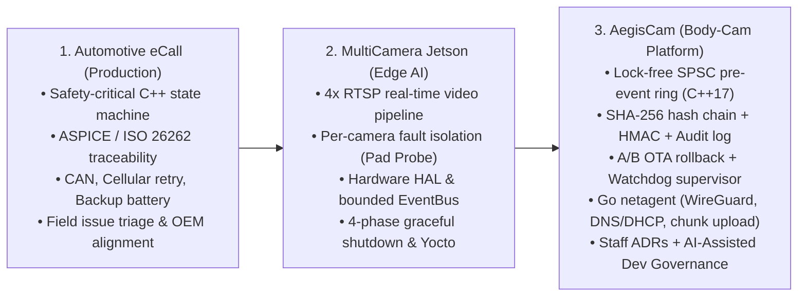

# 13. Portfolio Deep Dive: Presenting AegisCam, MultiCamera & eCall

> **Mục tiêu của file này:** Giúp bạn trình bày dự án **AegisCam** (cùng **MultiCamera** và **eCall**) một cách mạch lạc, tự nhiên, đúng tầm **Staff / Lead Embedded Software Engineer** trong 2 phút, 5 phút, hoặc 15 phút, và trả lời gọn gàng mọi câu hỏi vặn (drill-down) của interviewer.
>
> **Nguyên tắc minh bạch (Transparency Rule):** Luôn giới thiệu `AegisCam` đúng bản chất là một **clean-room reference platform / portfolio project** được bạn chủ động thiết kế và xây dựng để giải quyết chính xác các bài toán kỹ thuật của thiết bị body-worn evidence camera (pre-event ring buffer, chain-of-custody, power-loss safety, A/B OTA, VPN resumable upload, và AI governance). Interviewer đánh giá cực cao một ứng viên chủ động xây dựng cả một hệ thống chuẩn mực để chứng minh năng lực thực thi của mình!

Liên hệ toàn bộ tài liệu trong `aegiscam/`:
- Spec tổng thể: [`aegiscam/docs/architecture/PROJECT_SPEC.md`](../aegiscam/docs/architecture/PROJECT_SPEC.md)
- Bộ 6 tài liệu Thiết kế chi tiết (`aegiscam/docs/design/`): [`system_design.md`](../aegiscam/docs/design/system_design.md), [`software_design.md`](../aegiscam/docs/design/software_design.md), [`high_level_design.md`](../aegiscam/docs/design/high_level_design.md), [`low_level_design.md`](../aegiscam/docs/design/low_level_design.md), [`threading_and_process_model.md`](../aegiscam/docs/design/threading_and_process_model.md), [`system_workflow.md`](../aegiscam/docs/design/system_workflow.md)
- Kiến trúc chuyên đề (`aegiscam/docs/architecture/`): [`system_overview.md`](../aegiscam/docs/architecture/system_overview.md), [`threading_and_realtime.md`](../aegiscam/docs/architecture/threading_and_realtime.md), [`security_model.md`](../aegiscam/docs/architecture/security_model.md), [`networking.md`](../aegiscam/docs/architecture/networking.md)
- 6 ADRs: [`0001`](../aegiscam/docs/adr/0001-hal-and-dependency-injection.md), [`0002`](../aegiscam/docs/adr/0002-lock-free-pre-event-buffer.md), [`0003`](../aegiscam/docs/adr/0003-segment-based-evidence-with-hash-chain.md), [`0004`](../aegiscam/docs/adr/0004-ab-ota-with-boot-counter-rollback.md), [`0005`](../aegiscam/docs/adr/0005-go-for-connectivity-agent.md), [`0006`](../aegiscam/docs/adr/0006-wireguard-over-ipsec-openvpn.md)

---

## 1. Câu chuyện kết nối 3 Dự án thành một Hồ sơ Thống nhất

Khi interviewer nhìn vào CV và GitHub của bạn, hãy giúp họ thấy một **hành trình kỹ thuật liên tục và bổ trợ hoàn hảo cho JD**:

- **eCall** chứng minh bạn đã **ship sản phẩm safety-critical thật** trong môi trường quy trình nghiêm ngặt nhất (automotive).
- **MultiCamera** chứng minh bạn làm chủ **Linux video pipeline thời gian thực, cô lập lỗi luồng camera và Yocto trên ARM/Jetson**.
- **AegisCam** kết hợp cả hai và mở rộng sang đúng miền **Public-Safety Evidence Device**: mật mã bảo vệ chuỗi bằng chứng, mạng VPN/resumable upload bằng Go, hệ thống kiểm thử mô phỏng bằng Python, và quy trình lãnh đạo kỹ thuật cấp Staff.

---

## 2. Kịch bản Trình bày AegisCam theo Thời lượng (2 / 5 / 15 Phút)

### 2.1 Bản 90 giây – 2 phút (Dùng khi mở đầu hoặc khi thời gian ngắn)
> "To prepare deeply for the problem space of public-safety devices, I designed and built **AegisCam** — a reference device software platform for a body-worn evidence camera.
>
> I split the system across two processes along the real-time and trust boundary:
> 1. **`aegisd` in C++17** handles the deterministic data plane: a `SCHED_FIFO` capture thread pushing frames into a cache-line-aligned, lock-free SPSC ring buffer; a 30-second pre-event buffer that always drains starting from a keyframe; a pure table-driven recording state machine with trigger priority arbitration; power-loss-safe segment writes (`tmp` + `fsync` + atomic `rename`); a cryptographic SHA-256 hash chain sealed with a device HMAC and an append-only chained audit log; an A/B OTA slot manager with a 3-attempt boot rollback counter; and a per-thread heartbeat watchdog supervisor.
> 2. **`netagent` in Go 1.22** handles the untrusted network plane: link failover (`eth > wifi > lte`) with hysteresis, DNS captive-portal/hijack detection, a DHCP T1/T2 lease state machine, a WireGuard tunnel supervisor with a kill-switch, and a resumable 4 MiB chunked uploader with full-jitter backoff and a token-bucket bandwidth cap.
>
> Everything sits behind 5 HAL interfaces and an injectable `IClock`, so the entire platform runs deterministically on a laptop under GoogleTest (`ASan/UBSan/TSan`), `go test -race`, `libFuzzer`, and end-to-end `pytest` tests verified by an offline Python forensic tool."

---

### 2.2 Bản 5 phút (Walkthrough theo 4 Yêu cầu Sản phẩm Cốt lõi)
Nếu interviewer nói *"Tell me more about how AegisCam works"*, hãy dẫn dắt qua **4 bài toán kỹ thuật đắt giá nhất**:
1. **Phút 1 — Bài toán "Không bao giờ mất khoảnh khắc" (Pre-Event & Latency < 100 ms):**
   - Giải thích luồng `ICameraHal` $\rightarrow$ `SpscRingBuffer` ([`spsc_ring_buffer.h`](../aegiscam/core/include/aegis/util/spsc_ring_buffer.h)) $\rightarrow$ `PreEventBuffer` ([`pre_event_buffer.cpp`](../aegiscam/core/src/evidence/pre_event_buffer.cpp)).
   - Nhấn mạnh 2 chi tiết kỹ thuật: (a) `alignas(64)` + `acquire/release` atomics để `capture` thread không bao giờ chạm vào mutex hay chờ đĩa; (b) cắt và xả luôn bắt đầu từ **keyframe** để video không bị vỡ hình ở giây đầu tiên.
2. **Phút 2 — Bài toán "Pin văng ra bất kỳ lúc nào & Bằng chứng trước toà" (Power-Loss & Chain of Custody):**
   - Giải thích `SegmentWriter` ([`segment_writer.cpp`](../aegiscam/core/src/evidence/segment_writer.cpp)): ghi ra `seg_000001.bin.tmp` $\rightarrow$ `fsync` $\rightarrow$ `rename` nguyên tử $\rightarrow$ cập nhật `manifest.json`.
   - Giải thích chuỗi băm $H_n = \text{SHA256}(H_{n-1} \parallel S_n)$ từ genesis 32 byte 0 + chữ ký `HMAC-SHA256` trên `chain_head` + `audit.log` móc xích + công cụ độc lập [`tools/verify_evidence.py`](../aegiscam/tools/verify_evidence.py).
3. **Phút 3 — Bài toán "Độ tin cậy 24/7 & Cập nhật không biến thành cục gạch" (Watchdog & A/B OTA):**
   - Giải thích `WatchdogSupervisor` ([`watchdog_supervisor.cpp`](../aegiscam/core/src/health/watchdog_supervisor.cpp)): chỉ đá `/dev/watchdog` khi **mọi** thread đã đăng ký đều có nhịp tim trong hạn.
   - Giải thích `AbSlotManager` ([`ab_slot_manager.cpp`](../aegiscam/core/src/ota/ab_slot_manager.cpp)): `stage` kiểm tra SHA-256 trên slot không hoạt động, đặt `boot_attempts_left = 3`, giảm mỗi lần boot, tự động rollback nếu chưa được gọi `mark_good()`.
4. **Phút 4–5 — Bài toán "Đẩy bằng chứng qua mạng thực địa phức tạp" (`netagent` bằng Go):**
   - Điểm qua `link` (hysteresis + metered LTE policy), `dnscheck` (bắt captive portal), `dhcp` (T1 50% / T2 87.5%), `vpn` (WireGuard handshake age + kill-switch), và `uploader` (resumable 4 MiB chunks + query server offset + exponential backoff with full jitter + token bucket).

---

## 3. Tóm tắt 6 ADRs trong AegisCam (Học thuộc để trích dẫn ngay khi bị hỏi "Why?")

| ADR | Quyết định | Phương án bị loại bỏ | Lý do cốt lõi (Trade-off) |
|---|---|---|---|
| **[ADR-0001](../aegiscam/docs/adr/0001-hal-and-dependency-injection.md)** | 5 giao diện HAL mỏng + Constructor DI + `IClock` | Gọi trực tiếp syscall Linux / `#ifdef SIMULATION` rải rác | Cho phép chạy 100% unit/integration/system test trên laptop trong vài giây không cần phần cứng, không bao giờ phải gọi `sleep()` trong test |
| **[ADR-0002](../aegiscam/docs/adr/0002-lock-free-pre-event-buffer.md)** | Lock-free `SpscRingBuffer` lũy thừa 2 với `acquire`/`release` | `std::mutex` + `std::queue` giữa `capture` và `writer` | Ngăn chặn hoàn toàn Priority Inversion và jitter khi `writer` bị chặn lúc `fsync` xuống eMMC |
| **[ADR-0003](../aegiscam/docs/adr/0003-segment-based-evidence-with-hash-chain.md)** | Chia video thành các segment 10s + SHA-256 Hash Chain + HMAC Manifest | Ghi 1 file MP4 lớn cho cả sự kiện hoặc chỉ băm từng file rời rạc | Rớt pin chỉ mất vài giây trên RAM thay vì hỏng cả file MP4; chuỗi băm phát hiện cả việc xoá bớt 1 segment ở giữa hoặc đảo thứ tự |
| **[ADR-0004](../aegiscam/docs/adr/0004-ab-ota-with-boot-counter-rollback.md)** | Phân vùng đối xứng A/B + bộ đếm `boot_attempts_left = 3` + ứng dụng tự gọi `mark_good()` | In-place update hoặc phân vùng Recovery riêng biệt | Đảm bảo nguyên tử 100% khi mất điện lúc đang cập nhật; chỉ coi bản boot là thành công khi daemon `aegisd` đã qua bài tự kiểm tra phần cứng (chứ không chỉ dừng ở việc kernel boot xong) |
| **[ADR-0005](../aegiscam/docs/adr/0005-go-for-connectivity-agent.md)** | Tách `netagent` thành tiến trình riêng viết bằng Go 1.22 | Viết toàn bộ mạng/TLS/upload trong `aegisd` bằng C++ (`libcurl` + `OpenSSL`) | Cô lập lỗi và bảo mật bộ nhớ ở bề mặt mạng không tin cậy; nếu `netagent` crash/OOM, `aegisd` vẫn ghi hình bình thường; đánh đổi ~15 MB RAM cho Go runtime |
| **[ADR-0006](../aegiscam/docs/adr/0006-wireguard-over-ipsec-openvpn.md)** | Dùng WireGuard VPN kèm Kill-Switch và hạ MTU/MSS | OpenVPN (user-space) hoặc IPsec (strongSwan) | Chạy trong kernel cực nhẹ, ChaCha20-Poly1305 nhanh trên ARM, hỗ trợ roaming tự nhiên khi xe chuyển từ Wi-Fi sang LTE mà không cần thiết lập lại phiên |

---

## 4. Các câu hỏi "Xoáy sâu" (Tough Drill-Down Questions) về AegisCam & Cách trả lời

### Q1: *"In AegisCam's `PreEventBuffer`, you used a mutex (`std::mutex`) inside `PreEventBuffer`, while `SpscRingBuffer` is lock-free. Isn't that contradictory?"*
> "Great catch — they sit at **different stages of the pipeline**.
> In the multi-threaded architecture ([`threading_and_realtime.md`](../aegiscam/docs/architecture/threading_and_realtime.md)), the `capture` thread (`SCHED_FIFO 80`) pushes raw frames into the **lock-free `SpscRingBuffer`** and never touches `PreEventBuffer`. The single consumer of that SPSC ring is the lower-priority `writer`/pipeline thread, which drains frames out of the SPSC ring and feeds them into `PreEventBuffer` (while in `Buffering` state) or directly into `SegmentWriter` (while in `Recording` state).
> The mutex on `PreEventBuffer` only synchronizes between the `writer` thread and the `controller` thread (both `SCHED_OTHER`), never the real-time `capture` thread."

### Q2: *"Your SHA-256 and HMAC in `aegis::crypto` are written from scratch in C++. In a real production camera, would you write your own crypto?"*
> "In a commercial product shipping to law enforcement, **no** — we would use a **FIPS 140-3 validated cryptographic module** (such as BoringSSL/OpenSSL FIPS provider or wolfCrypt FIPS) combined with hardware key storage and signing inside a **TPM 2.0 or ATECC608 Secure Element** via `IKeyStoreHal`.
> For this reference repository, I implemented FIPS 180-4 SHA-256 and RFC 2104 HMAC-SHA256 (including constant-time tag comparison) directly so the repo builds out of the box on any host or cross-compiler with zero external C library dependencies, while validating the exact outputs against NIST test vectors and Python's `hashlib`/`hmac` in `verify_evidence.py`."

### Q3: *"What happens if an attacker deletes the entire incident directory `INC-AEG-0001-...` AND truncates the last lines of `audit.log`?"*
> "If an attacker has raw offline write access to an unencrypted flash chip and the key is on disk, any purely local log can be truncated from the tail. We defend against tail-truncation with three layers described in [`security_model.md`](../aegiscam/docs/architecture/security_model.md):
> 1. **Full-disk encryption (`dm-crypt`)** with the key sealed in the TPM, so offline flash removal yields only ciphertext.
> 2. **Monotonic Counter in Hardware (TPM nvram / RPMB — Replay Protected Memory Block on eMMC):** every time `audit.log` advances, we increment an authenticated monotonic counter in eMMC RPMB or TPM and store the latest `audit.log` head hash there. Because RPMB requires an HMAC from the secure element to write and cannot be rolled back, truncating `audit.log` on the filesystem immediately mismatches the hardware counter/head hash.
> 3. **Immediate Heartbeat/Audit Streaming:** whenever LTE or Wi-Fi is available, `netagent` streams the latest signed `audit.log` sequence number and hash head (just a few hundred bytes) to the cloud even before large video segments finish uploading."
